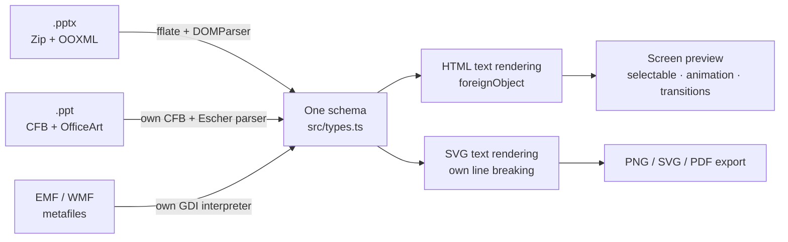

# Web-PPT

[](https://github.com/unStone/web-ppt/actions/workflows/ci.yml)
[](https://www.npmjs.com/package/@web-ppt/core)
[](https://github.com/unStone/web-ppt/blob/master/LICENSE)

**English** · [简体中文](https://github.com/unStone/web-ppt/blob/master/README.md)

A PowerPoint rendering engine that runs entirely in the browser: `.pptx` / `.ppt` → one JSON schema → SVG.

No server, no Office install, no upload. Base packages are framework-free; React and Vue live only in optional
adapter packages. Files never leave the tab, and the core runtime's only dependency is [fflate](https://github.com/101arrowz/fflate).

**[▶ Live demo](https://unstone.github.io/web-ppt/)** · **[✎ Online editor](https://unstone.github.io/web-ppt/editor.html)**
— drop in one of your own decks; parsing, rendering, and editing happen on your machine.


*Recorded by `npm run demo-gif` from `fixtures/showcase.pptx` in this repo — change the engine, re-run it, and the GIF is current again.*

### Why this exists

Every other browser-side option makes you give something up:

| Approach | What it costs you |
|---|---|
| Office Online `iframe` | Microsoft's viewer requires the file to be **publicly reachable by URL** — unusable for anything confidential |
| Server-side conversion (LibreOffice / headless Office) | A conversion box to run and scale; animations and build steps are flattened away |
| Convert to PDF or images up front | Same flattening, plus you lose text selection and search |
| Existing front-end libraries | Legacy `.ppt` unsupported; the most-used one ships a free npm package but [charges for source access](https://github.com/501351981/pptx-preview) |

Web-PPT keeps the file on the client, keeps the animations, and stays MIT all the way down — **including the 1997–2003 binary `.ppt` format**, which nothing else on the front end parses.

| Package | Role | Depends on | Size (gzip) |
|---|---|---|---|
| [`@web-ppt/core`](https://github.com/unStone/web-ppt/tree/master/packages/core) | Parse / render / export. No framework, no DOM. | fflate | 131.63 KB |
| [`@web-ppt/edit-core`](https://github.com/unStone/web-ppt/tree/master/packages/edit-core) | Stable identity, command history, edit overrides, incremental save, and high-fidelity projection. No framework, no DOM. | `@web-ppt/core` | 185.70 KB |
| [`@web-ppt/editor`](https://github.com/unStone/web-ppt/tree/master/packages/editor) | Editing session, native SVG selection, keyboard editing including layer order, move/resize/rotate gestures, and incremental three-layer DOM. No UI framework. | `core` + `edit-core` + `viewer-core` | 59.27 KB |
| [`@web-ppt/collab`](https://github.com/unStone/web-ppt/tree/master/packages/collab) | Optional field-level LWW collaboration adapter and BroadcastChannel provider | optional `@web-ppt/edit-core` peer | 12.20 KB |
| [`@web-ppt/react`](https://github.com/unStone/web-ppt/tree/master/packages/react) | React component and hook over the shared editor session and preview path | `editor` + optional React peer | 1.12 KB |
| [`@web-ppt/vue`](https://github.com/unStone/web-ppt/tree/master/packages/vue) | Vue component and composable over the shared editor session and preview path | `editor` + optional Vue peer | 1.34 KB |
| [`@web-ppt/viewer-core`](https://github.com/unStone/web-ppt/tree/master/packages/viewer-core) | Navigation / zoom / search / animation batching | `@web-ppt/core` | 13.77 KB |
| [`@web-ppt/fonts`](https://github.com/unStone/web-ppt/tree/master/packages/fonts) | Font substitution and on-demand loading (optional; zero font bytes in the package) | `@web-ppt/core` | 2.69 KB |

Sizes sum the gzipped default entry and every relative static chunk, excluding peers and dynamic entries.

See [appearance editing](docs/api/appearance-editing.md) for optional picture/3D tools, [browser enhancements](docs/api/browser-editing.md) for accessibility, EditContext and automatic ChartEx loading, [API compatibility](docs/api/api-stability.md) for entry points and lifecycle rules, and [comments](docs/api/comments.md) for the read-only comment panel and opt-in `showComments` export options (`@web-ppt/viewer-core/comments`).

Expanded editing, advanced rendering, PDF/WebM export and native PPT saving are available through optional entries. See the [capability matrix and format limits](https://github.com/unStone/web-ppt/blob/master/docs/api/expanded-capabilities.md).

Experimental vector PDF is available through `@web-ppt/core/pdf/vector` and the editor’s searchable PDF option. It requires usable font bytes; unsupported effects use object-level image fallback. See the [support scope and remaining validation](https://github.com/unStone/web-ppt/blob/master/docs/wayfinder/ppt-portability-fidelity/notes/vector-pdf-implementation.md).

## Quick start

```bash
npm i @web-ppt/core @web-ppt/viewer-core
```

```ts
import { parse, slideToSvgFile, presentationToPrintableHtml } from '@web-ppt/core';
import { Viewer } from '@web-ppt/viewer-core';

const pres = await parse(file);                       // File | Blob | ArrayBuffer | Uint8Array
const viewer = new Viewer(container, pres, { animate: true, autoAdvance: true });

viewer.next();                                        // plays the next animation batch, or advances the slide
viewer.playNextAnimation();                           // advance one batch only
viewer.finishAnimations();                            // jump to this slide's end state
viewer.setZoom(1.5);
viewer.search('keyword');                             // → array of matching slide indices
await viewer.exportPng(2);                            // → Blob

// Make video / audio actually playable (pulls in foreignObject; screen preview only)
const v2 = new Viewer(container, pres, { media: 'player' });
// Fired on the container when a media call on the animation timeline (e.g. play after previous) is rejected by the browser
container.addEventListener('web-ppt-playback-error', (e) => console.warn((e as CustomEvent).detail));

const svg = await slideToSvgFile(pres, pres.slides[0]);
const html = await presentationToPrintableHtml(pres); // print from the browser to get a PDF
// Animated slides expand into one page per click batch, so progressive reveals aren't flattened
const stepped = await presentationToPrintableHtml(pres, { animationSteps: true });
```

Load the optional entry only when exporting the whole deck. Hidden slides are included by default and every slide
uses its animation end state; `skipHidden` omits hidden slides while filenames retain their original slide numbers:

```ts
import { presentationToImageZip } from '@web-ppt/core/image-zip';

const zip = await presentationToImageZip(pres, {
  scale: 2,
  skipHidden: true,
  concurrency: 2, // 1–8; bounds the number of live canvases and Blobs
  onProgress: ({ completed, total, fileName }) => console.log(completed, total, fileName),
});
```

For a visual editor, `@web-ppt/editor` owns parsed resources, the headless Editor, and every mounted view:

Editing is currently on the beta line. Install the whole stack from the same `next` version to avoid mixing it
with stable viewer packages:

```bash
npm i @web-ppt/core@next @web-ppt/edit-core@next @web-ppt/viewer-core@next @web-ppt/editor@next
# React / Vue apps can additionally install @web-ppt/react@next react or @web-ppt/vue@next vue
```

New decks can lazy-load the built-in template catalog. Its three deterministic theme/master/layout recipes stay
out of every default entry:

```ts
import { createPptxFromTemplate, listBuiltinTemplates } from '@web-ppt/editor/templates';
import { openEditor } from '@web-ppt/editor';

const catalog = listBuiltinTemplates(); // Aurora / Editorial / Midnight plus lightweight preview tokens
const session = await openEditor(createPptxFromTemplate(catalog[0].id));
```

The 0.7 gate (`npm run test:v07`) exercises `template → theme → master → layout → ordinary slide → reopen` for all three templates.
`SetTheme` uses `exec`; masters and layouts use `execDesign`. They share history, recovery, collaboration, and save
protocols, while ordinary-slide commands cannot mutate a design canvas.

```ts
import { openEditor } from '@web-ppt/editor';
import { createDesignEditor, listLayouts, listMasters, queryMaster } from '@web-ppt/editor/design';

const session = await openEditor(file);
const slideView = session.mount(container, { mode: 'edit', zoom: 1 });
const slideId = session.editor.doc.slideOrder[0];
const elementId = session.editor.doc.slides[slideId].children[0];
session.editor.exec({ type: 'SetXfrm', id: elementId, x: 120 });
session.editor.exec({ type: 'SetZ', id: elementId, to: 'front' });
const layout = listLayouts(session.editor.doc)[0];
const designView = createDesignEditor(layoutContainer, session, { target: layout.target });
designView.exec({ type: 'SetBackground', target: layout.target, fill: { type: 'solid', color: '#112233' } });
const master = listMasters(session.editor.doc)[0];
designView.setTarget(master.target);
const masterState = queryMaster(session.editor.doc, master.target); // background and title/body/other × 9 source/value/override
designView.exec({
  type: 'SetMasterTextStyle', target: master.target, category: 'body', level: 1,
  paragraph: { align: 'right' }, run: { font: 'Aptos', size: 30 },
});
const current = session.toPresentation();             // read-only current edited state; no savepoint
const imageZip = await import('@web-ppt/core/image-zip');
const currentImages = await imageZip.presentationToImageZip(current);
slideView.setMode('view'); // keeps the static preview DOM and hides interaction layers
designView.destroy();      // the opt-in design view has explicit ownership
session.dispose();         // releases every view, source package, and blob URL
```

Official thin adapters map that lifecycle to controlled framework props. A `source` is owned and released by the
component; an injected shared session must use explicit external ownership:

```tsx
import { WebPptEditor } from '@web-ppt/react';

<WebPptEditor source={file} mode="edit" zoom={1} onError={console.error} />
```

Vue exports the same component name from `@web-ppt/vue`. Both packages are SSR-import safe and cover file
replacement, view/edit switching, undo, save, multiple views, and unmount cleanup. Svelte and Web Components can
bind the same framework-neutral adapter contract exported by `@web-ppt/editor`.

Custom toolbars use the shared adapter actions `queryTransition` / `setTransition` / `previewTransition` and
`queryAnimations` / `setAnimations` / `previewAnimations`. Both view and edit modes can preview committed or
uncommitted valid values without mutating the model, selection, or history; only edit mode can commit. Animation
timelines use stable element identities, restore their source with `null`, and clear explicitly with `[]`. The beta
catalog covers appear/fade/fly/wipe/zoom/dissolve entrances and exits, spin/grow emphasis, and 2–256-point motion
paths. Complex source timing trees report `sourceReadonly` so products can require an explicit whole-timeline
replacement instead of presenting a lossy partial edit. `MAX_ANIMATION_STEPS=128` lets toolbars enforce the same
bounded limit whose heaviest accepted timeline is guaranteed to round-trip through the parser.

In edit mode, the interaction SVG draws an exact OBB, eight resize handles, and a rotation handle for plain,
rotated/flipped, and nested-group elements. Handle size stays constant in screen pixels. Pure functions for
element-local, slide, and screen coordinates are exported so framework adapters never duplicate group math.
Elements and multi-selections can be moved directly. Eight resize handles support proportional Shift resizing,
centered Alt resizing, and flips across the opposite anchor. Rotation stays continuous across ±180°, supports
dynamic 15° Shift constraints, nested flipped groups, and shared-center multi-selection. Transform frames touch
only transient ghost DOM; pointer-up creates one undoable, saveable transaction.

Touch selection alone gets a 12px tolerance around thin SVG geometry; mouse and pen stay exact. One finger keeps
the existing edit gestures, while a second finger upgrades to canvas zoom/pan without history. Hosts consume
`onTouchNavigate` for the outer viewport and `onContextRequest` for a 500ms long-press menu. View mode binds no
edit-touch handlers, so browser page scrolling retains ownership.

`Delete` or `Backspace` removes the current selection as one transaction. Groups are recursive, while charts,
SmartArt, OLE, and other frame-only objects retain potentially shared relationships and media. A populated
placeholder clears its text first and removes its frame on the next deletion. Delete and undo update only the
affected markup/defs partitions in stable z-order, preserving untouched sibling DOM identities.

`Ctrl/Cmd+]` moves forward, `Ctrl/Cmd+Shift+]` brings to front, `Ctrl/Cmd+[` moves backward, and
`Ctrl/Cmd+Shift+[` sends to back. Multi-selections retain internal order as one undo unit; group children,
hyperlinks, and frame-only objects use the same semantics. Existing DOM partitions move in place without
rebuilding markup/defs, and boundary operations create no empty history.

When building a custom adapter or needing byte-stable markup, render with an explicit namespace:

```ts
import { renderSlideToSvg } from '@web-ppt/core';

const svg = renderSlideToSvg(pres, pres.slides[0], { idPrefix: 'editor-slide-1-' });
// Same slide + same prefix is deterministic. Use a different prefix for every concurrently mounted SVG.
```

Opt into edit metadata and hand the result to the framework-agnostic `EditDoc` only when an editor needs write-back anchors; normal previews pay neither object nor package-retention cost:

```ts
import { layoutText, parse, renderElementToSvg, renderSlideToSvg, renderTextBodyToHtml } from '@web-ppt/core';
import { createDoc, disposeDoc, effectiveElement, invalidateElement, toSlide } from '@web-ppt/edit-core';

const source = await parse(file, { edit: true, keepPackage: true, lazy: false });
const doc = createDoc(source);
const slideId = doc.slideOrder[0];
const elementId = doc.slides[slideId].children[0];

doc.elements[elementId].ovr.x = 120;                 // src stays intact; ovr stores user changes only
invalidateElement(doc, elementId);                  // invalidate this element, group ancestors, and its slide
const svg = renderSlideToSvg(source, toSlide(doc, slideId), { idPrefix: `${slideId}-` });

// During interaction, render only the dirty element. Every concurrently mounted element needs a stable unique prefix.
const part = renderElementToSvg(effectiveElement(doc, elementId), {
  idPrefix: `${slideId}-${elementId}-`,
});
// Replace this element's markup and defs DOM partitions together.

// Normal engines keep text editing outside SVG while sharing foreignObject's exact HTML/CSS.
const element = effectiveElement(doc, elementId);
if (element.kind === 'shape' && element.text) {
  const textLayer = document.querySelector<HTMLElement>('[data-text-layer]')!;
  textLayer.innerHTML = renderTextBodyToHtml(element.text, element.w, element.h);
  const editor = textLayer.firstElementChild as HTMLElement;
  editor.contentEditable = 'true';
  editor.spellcheck = false;

  // The Safari-safe path serializes the same absolute line boxes used by native SVG.
  textLayer.innerHTML = renderTextBodyToHtml(element.text, element.w, element.h, {
    layout: 'engine',
  });
  const engineLayout = layoutText(element.text, element.w, element.h);
  // engineLayout.lines[*].segments[*].carets use UTF-16 offsets into TextRun.text.
}

disposeDoc(doc);                                     // also releases the retained source package
```

`renderTextBodyToHtml` emits paragraph/run identities, empty-run and bullet boundaries, and the effective
autofit scale by default. Those markers support DOM decoding and selection restoration after IME composition.
The function is DOM-free and leaves focus ownership to the caller. It escapes text, attributes, and CSS
boundaries; unsafe schemes such as `javascript:` and `file:` are retained only as non-clickable data.
`{ layout: 'engine' }` serializes `layoutText()` soft wraps as absolutely positioned segments with source UTF-16
half-open ranges. Invisible semantic anchors retain hard breaks, empty runs/paragraphs, and atomic math, while
`white-space: pre` prevents a second browser line-breaking pass.

`layoutText` shares line breaking, CJK punctuation squeezing, columns, spacing, and autofit with native SVG
`<text>` output. It returns paragraph/run identities, line boxes, and UTF-16 caret stops. Vertical text maps
logical coordinates through the returned `transform`; math runs are atomic with endpoint carets only. Pass
`{ includeCarets: false }` when geometry alone is enough to skip per-character measurement.

When a preset shape is resized, projection recomputes its path from the retained `preset + adj`.
`doc.meta.readonly` explicitly reports missing safe save context before the user starts editing.
Submit `SetPreset` to change its type and `SetAdj` to write an adjustment value. Load the visual handles only
when the editor needs them:

```ts
import { resolvePresetAdjustmentHandles } from '@web-ppt/core/geometry/handles';
import { createPresetAdjustmentEditor } from '@web-ppt/editor/adjustments';

const handles = resolvePresetAdjustmentHandles({ preset: 'roundRect', adj: {} }, 320, 180);
const adjustments = createPresetAdjustmentEditor(session, view);
adjustments.start(elementId); // interaction-layer preview; pointerup creates one undo unit
```

The generated table covers all 187 standard presets, 120 with handles. Formulas evaluate in EMUs, and the
default core, edit-core, and editor entries do not contain the table.
The save path can lazy-load `@web-ppt/edit-core/xml`. Its preserving tree round-trips untouched parts byte
for byte and retains declarations, comments, PIs, namespace prefixes, attribute order, self-closing form,
and `AlternateContent` around point edits. New nodes share one OOXML sequence table. The optional
`@web-ppt/edit-core/opc` entry then merges dirty parts into the source archive while copying clean local headers,
extra fields, and compressed streams byte-for-byte. Identity saves reuse the original bytes; unusual ZIP features
return an explainable fallback reason. The main editing entry and its static chunks total 185.70 KB gzip,
excluding peers; save code loads on demand.

### Bring your own UI

`Viewer` is 24 lines of DOM binding on top of `PresentationState`. For React / Vue / Svelte, drive the state machine directly:

```ts
import { PresentationState, playGroup, playTransition } from '@web-ppt/viewer-core';

const st = new PresentationState(pres, { animate: true, skipHidden: true });
st.subscribe((c) => {
  if (c.type === 'slide') setIndex(c.index);          // play c.transition when it's non-null
  if (c.type === 'animation' && c.group) playGroup(el, c.group);
});
st.next();                     // plays a pending animation batch, otherwise advances
st.hiddenElementIds;           // element ids that should be hidden at the current batch
st.search('keyword');          // → array of matching slide indices
```

The metafile decoder (~15 KB gzip) is wired in by default. To drop it, remove the `setMetafileDecoder` call in `src/index.ts`.

## Capability matrix

| Capability | .pptx | .ppt |
|---|---|---|
| Preset geometry | ✅ 187 presets (the full ECMA-376 set) | ✅ complete MSOSPT mapping |
| Custom geometry | ✅ custGeom + gdLst formula evaluation + arcTo | ✅ pVertices / pSegmentInfo |
| Fills | ✅ solid / linear + radial gradient / picture / tile / pattern / theme color transforms | ✅ solid / gradient / picture |
| Strokes | ✅ dash / arrowheads / caps / joins | ✅ dash / arrowheads |
| Effects | ✅ outer + inner shadow / glow / soft edge / reflection | ⚠️ ignored |
| 3D | ✅ extrusion / bevel / contour / material / camera | ⚠️ ignored |
| Theme style references | ✅ fillRef / lnRef / effectRef + phClr | — |
| Text | ✅ complete (see below) + WordArt warps | ✅ size / color / bold-italic-underline / alignment / bullets |
| Style inheritance | ✅ master → layout → placeholder → paragraph → run | ✅ master TxMasterStyle → shape |
| Images | ✅ cropping (incl. shape fills) / crop-to-shape / opacity / grayscale | ✅ Pictures stream + DEFLATE |
| EMF / WMF / PICT | ✅ decoded to SVG | ✅ decoded to SVG (PICT comes from the Mac build) |
| Tables | ✅ tableStyles / banding / merges / borders / vertical alignment | ✅ table properties + grid reconstruction heuristics |
| Charts | ✅ column/bar/stacked/line/area/pie/doughnut/scatter/radar/bubble/stock/pie-of-pie/surface · secondary axis · 3D | ✅ via the embedded EMF preview |
| Media · ink · comments · sections | ✅ poster frame + play badge / InkML strokes / structured comments / sections | ❌ |
| SmartArt | ✅ cached drawing part; falls back to laying out the data model directly (6 layout families) | ❌ |
| Groups | ✅ nested + child coordinate-system scaling | ✅ flattened + coordinate mapping |
| Slide transitions | ✅ 20 (fade / push / wipe / cover / split / zoom …) | ✅ via SSSlideInfoAtom; 6 verified against real files |
| Element animations | ✅ entrance / exit / emphasis / motion path, batched by click | ✅ entrance / exit / emphasis; 5 steps verified |
| Speaker notes · hyperlinks | ✅ | ✅ |
| OLE embedded objects | ✅ embedded `p:pic` preview / legacy VML snapshot (incl. PICT) | ❌ |
| Encrypted documents | ✅ standard (AES-ECB) / agile (AES-CBC, segmented) | ✅ RC4 CryptoAPI (40 / 56 / 128-bit) |
| OMML math | ✅ fraction / radical / sub-superscript / n-ary / matrix / delimiter / accent / limit | ❌ |
| Hidden slides | ✅ `sld@show="0"` | ✅ `SSSlideInfoAtom` F_HIDDEN |

Text details (pptx): size / face / bold / italic / underline / strikethrough / super- and subscript / letter spacing / caps / outline / gradient fill / highlight / vertical writing / columns / autofit / character and picture bullets / auto-numbering / hyperlinks / slide-number and footer fields / RTL / 15 WordArt warp presets.

## Architecture



| Decision | Why |
|---|---|
| Parsing and rendering are fully decoupled | The render layer depends only on `src/types.ts`, so adding an input format doesn't touch a line of it. Format is detected by magic number (`PK` → pptx, `D0CF11E0` → ppt), never by extension |
| Two text rendering paths | `foreignObject` + HTML layout for screen preview and PNG export (selectable text, column support); native `<text>` + own measurement and line breaking for standalone SVG and printable HTML — only browsers understand `foreignObject`, so Inkscape / librsvg / design tools would drop every glyph. A file you hand someone has to stand on its own |
| Safari detected at runtime | A [15-year-old WebKit bug](https://bugs.webkit.org/show_bug.cgi?id=23113) doesn't apply the outer SVG scale to HTML inside `foreignObject`. When detected, the whole slide switches to the `<text>` path |
| Chart / metafile decoders injected via hooks | Tree-shakeable on demand. Note that `chart/` **is a fourth parsing pipeline, not a render plugin** — it reads `ppt/charts/chart1.xml` (itself OOXML/DrawingML) and emits `SlideElement[]`; the hook exists only to break the `pptx/parser → chart → pptx/color` module cycle |

## Performance

Measured in-browser, 210 slides / 11,280 elements:

| Metric | Value |
|---|---|
| **Lazy first paint** (parse + slide 1 + render) | **42 ms** |
| Full parse | 376 ms (1.8 ms/slide) |
| Single slide render | 0.09 ms |
| Cache hit (revisiting a slide) | 0 ms |
| JS heap | 40 MB (0.19 MB/slide) |

| Optimization | Effect |
|---|---|
| **Lazy parsing** (on by default) | Each slide is parsed on first visit; first paint 376 ms → 42 ms (**9×**) |
| **Worker parsing** | Zero main-thread blocking; 573 ms concurrent with a main-thread busy loop vs 942 ms serial |
| **Thumbnail virtualization** | 210 slides render 7 thumbnails initially, filling in on scroll |

Where the time goes (browser): XML parsing 30% (native `DOMParser`), schema construction 63%, decompression 7%, rendering <1%.
**WebAssembly does not help on this path** — XML parsing is already native C++, and schema construction is DOM walking, string work, and object allocation, all of which WASM is bad at; the marshalling cost across the boundary would eat any gain.

### Worker usage

```ts
import { parseInWorker } from '@web-ppt/core';

const worker = new Worker(new URL('@web-ppt/core/worker', import.meta.url), { type: 'module' });
const pres = await parseInWorker(worker, bytes);   // zero main-thread blocking
```

Workers have no `DOMParser` (it's Window-only), so `parseXml` falls back to the bundled `xml-lite` — pure JS, measured at ~1.8× native, structurally equivalent (tests compare every slide's XML node by node). Images can't cross the thread boundary as blob URLs, so the worker emits `asset:N` tokens plus raw bytes and the main thread redeems them into real URLs.

## Fidelity benchmark

Rendering fidelity isn't judged by "looks about right" — it's compared step by step against **LibreOffice's actual output as ground truth**. Theme color `shade` / `tint`, for example:

| Step | LibreOffice | Naive sRGB multiply (old) | Linear RGB (current) |
|---|---|---|---|
| shade 20% | rgb(33,56,97) | rgb(14,23,39) Δ69 | rgb(28,51,93) Δ8 |
| tint 60% | rgb(176,187,222) | rgb(143,170,220) Δ37 | rgb(176,188,222) Δ1 |

`npm run compare <file>` generates a side-by-side and difference overlay for any file.

## Known limitations

| Item | Notes |
|---|---|
| `.ppt` glow / soft edge / reflection | **The format has no such properties** — they're DrawingML (2007+) concepts with no representation in the OfficeArt binary (outer shadow is supported) |
| `.ppt` 3D | OfficeArt has extrusion properties (`c3DExtrude*` / `c3DBooleans`), but no trustworthy samples: LibreOffice conversion bakes 3D into cube preset geometry *and* keeps the 3D properties, so implementing against it would double up |
| `.ppt` SmartArt | Not implemented (auto-numbering and nested groups are) |
| OMML math | Fractions, radicals, sub/superscripts, large operators and matrices are laid out as structured SVG; fidelity of complex details depends on available fonts |
| WordArt envelope warps | `textPath` can only bend the baseline; `textInflate` and friends don't scale glyphs positionally |
| 3D | True camera projection (XYZ matrices, ortho/perspective, extrusion, curved bevels); materials, lighting and texture meshes are approximations |
| EMF+ | Opt-in `@web-ppt/core/emf-plus` covers common drawing records (paths, gradients, images, text, clipping); unknown records fall back per format, and no pure-EMF+ sample has turned up |
| Raster operation codes | SVG/CSS has no XOR/AND bitwise blending; `mix-blend-mode` is not equivalent |
| chartex chart types | Opt-in `@web-ppt/core/chart-ex` implements native layouts except maps. Office fallback remains the default. Real funnel input, browser exports, frame editing and both save paths are covered; other original PPTX types and Office-native layout validation remain pending. See [scope and evidence](docs/api/chartex-native.md) |
| Region OR / XOR / DIFF | Needs region boolean operations, which SVG clipping can't express; COPY and AND work |
| MTX-compressed embedded fonts | PowerPoint's `fntdata` is an EOT container, usually with MTX compression on. Uncompressed containers are unwrapped by core itself (including the XOR obfuscation); compressed ones need an injected decoder: `setFontDecoder(eotToTtf)` from [`mtx-decompressor`](https://www.npmjs.com/package/mtx-decompressor). Without it those fonts are skipped in favour of a substitute, rather than handing the browser bytes it's guaranteed to reject |
| Line breaking when fonts are missing | Line breaks are decided by **the actual font's metrics**. If the deck's font isn't installed locally, something else is substituted, advance widths differ, and breaks land differently than in PowerPoint. This isn't a parsing problem — installing the original font, using the file's own embedded fonts, or wiring up [`@web-ppt/fonts`](https://github.com/unStone/web-ppt/tree/master/packages/fonts) for metric-compatible free substitutes (Calibri→Carlito and friends, where every advance width matches) all fix it |
| CJK punctuation squeezing | Full rule set: when a line doesn't fit, all squeezable half-cells are collected to preserve the break; once a line is formed, consecutive punctuation pairs, line-leading opening marks and line-trailing stops are collected unconditionally. Line-breaking itself always measures at full width, matching PowerPoint |
| Line breaking before web fonts arrive | The native `<text>` path measures with canvas, and fonts load asynchronously, so the first frame breaks against the fallback. The `foreignObject` path is laid out by the browser and is unaffected |
| Password-protected files | Files with an open password parse via `parse(bytes, { password })`; missing password throws `PasswordRequiredError`, wrong password throws `WrongPasswordError`. Agile AES-CBC / standard AES-ECB (.pptx) and RC4 CryptoAPI (.ppt) are covered |
| OLE embedded objects | Renders the preview image PowerPoint stored (parsed out of the VML part), not the inner document; falls back to a placeholder box when the preview is in an undecodable format such as PICT |

> The [capability matrix](docs/api/expanded-capabilities.md) is the authoritative source for scope and boundaries; this table lists only items that affect usage decisions.

## Development

| Command | What it does |
|---|---|
| `npm run dev` | Start the viewer (`?file=/showcase.pptx` to pick a file) |
| `npm run dev:site` | Start the site (includes the in-browser live demo) |
| `npm run check` | TypeScript type check |
| `npm test` | Every test suite |
| `npm run build` | Build all eight publishable packages (core / edit-core / viewer-core / editor / react / vue / fonts / collab) |
| `npm run verify` | Cross-artifact consistency: license, versions, links, and documented numbers against measured values |

Tests run the real parsing and rendering in Node with jsdom; no parsing logic is mocked. 194 render snapshots (27 test files × every slide × both text paths) are compared byte for byte, and fidelity is checked against LibreOffice renders as ground truth. Per-suite commands, assertion counts and test layers are in the [testing guide](https://github.com/unStone/web-ppt/blob/master/docs/engineering/testing.md); other commands and debug pages are in the [development guide](https://github.com/unStone/web-ppt/blob/master/docs/engineering/development.md) (both in Chinese). Conventions, architectural constraints, and known traps live in **[AGENTS.md](https://github.com/unStone/web-ppt/blob/master/AGENTS.md)** (they apply to coding agents too).

## Community

| Channel | Where |
|---|---|
| Bugs / feature requests | [GitHub Issues](https://github.com/unStone/web-ppt/issues) |
| Discussion | [GitHub Discussions](https://github.com/unStone/web-ppt/discussions) |
| WeChat group (Chinese) | [QR code in the pinned issue](https://github.com/unStone/web-ppt/issues?q=is%3Aissue+label%3A%E4%BA%A4%E6%B5%81%E7%BE%A4) |

## License

[MIT](https://github.com/unStone/web-ppt/blob/master/LICENSE)
