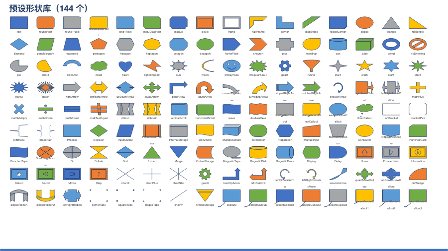

# Web-PPT

[](https://github.com/unStone/web-ppt/actions/workflows/ci.yml)
[](https://www.npmjs.com/package/@web-ppt/core)
[](LICENSE)

**简体中文** · [English](README.en.md)

纯浏览器端 PPT 渲染与编辑引擎：`.pptx` / `.ppt` → 统一 JSON Schema → SVG。零服务端，文件不出浏览器；基础包零框架，React / Vue 只在可选适配包，核心唯一运行时依赖是 fflate。

**[▶ 在线 Demo](https://unstone.github.io/web-ppt/)** · **[✎ 在线编辑器](https://unstone.github.io/web-ppt/editor.html)**



*`npm run demo-gif` 录制仓库里的 `fixtures/showcase.pptx`。*

## 为什么做这个

| 做法 | 代价 |
|---|---|
| Office Online `iframe` | 要求文件**公网可达**，机密文件不能用 |
| 服务端转换（LibreOffice / 无头 Office） | 要养常驻转换机；动画与逐步揭示被压平 |
| 提前转 PDF / 图片 | 同样压平，还丢掉文字选中与搜索 |
| 现有前端库 | 不支持老的 `.ppt`；用量最大的 npm 包[源码需付费索取](https://github.com/501351981/pptx-preview) |

Web-PPT 把文件留在客户端、把动画留住、全链路 MIT，**包括 1997–2003 的二进制 `.ppt`**。

## 包

| 包 | 作用 | 依赖 | 体积 (gzip) |
|---|---|---|---|
| [`@web-ppt/core`](packages/core) | 解析 / 渲染 / 导出，无框架无 DOM | fflate | 134.43KB |
| [`@web-ppt/edit-core`](packages/edit-core) | 编辑文档、命令历史、投影与增量保存，无框架无 DOM | `core`；lint 使用 Culori / RBush | 185.70KB |
| [`@web-ppt/editor`](packages/editor) | 编辑会话、原生 SVG 选择与变换、三层增量 DOM | `core` + `edit-core` + `viewer-core` | 59.27KB |
| [`@web-ppt/collab`](packages/collab) | 可选字段级 LWW 协同与 BroadcastChannel provider | `edit-core` optional peer | 12.20KB |
| [`@web-ppt/react`](packages/react) | React 组件 + hook | `editor` + React optional peer | 1.12KB |
| [`@web-ppt/vue`](packages/vue) | Vue 组件 + composable | `editor` + Vue optional peer | 1.34KB |
| [`@web-ppt/viewer-core`](packages/viewer-core) | 导航 / 缩放 / 搜索 / 动画批次 | `core` | 13.77KB |
| [`@web-ppt/fonts`](packages/fonts) | 字体替换与按需加载（包里零字体字节） | `core` | 2.69KB |

体积按默认入口及全部相对静态分块逐文件 gzip 求和，不含 peer 与动态入口。

## 快速开始

### 查看与导出

```bash
npm i @web-ppt/core @web-ppt/viewer-core
```

```ts
import { parse, slideToSvgFile } from '@web-ppt/core';
import { Viewer } from '@web-ppt/viewer-core';

const pres = await parse(file);                      // File | Blob | ArrayBuffer | Uint8Array
const viewer = new Viewer(container, pres, { animate: true });
viewer.next();                                       // 有动画先播，否则翻页
viewer.search('关键词');
await viewer.exportPng(2);                           // → Blob

const svg = await slideToSvgFile(pres, pres.slides[0]);
```

图片 ZIP、打印 HTML、Worker 解析、媒体播放、直接驱动 `PresentationState` 见[查看器与渲染](docs/api/viewer.md)。

### 编辑

编辑能力在 beta 线，整套依赖必须使用同一 `next` 版本：

```bash
npm i @web-ppt/core@next @web-ppt/edit-core@next @web-ppt/viewer-core@next @web-ppt/editor@next
```

```ts
import { openEditor } from '@web-ppt/editor';

const session = await openEditor(file);
const view = session.mount(container, { mode: 'edit', zoom: 1 });
const slideId = session.editor.doc.slideOrder[0];
session.editor.exec({ type: 'SetXfrm', id: session.editor.doc.slides[slideId].children[0], x: 120 });
session.dispose();
```

模板、设计画布、选择窗格、快捷键与剪贴板、低层 `EditDoc`、预设调节柄与保存链路见[编辑器接入](docs/api/editor.md)。

0.7 的模板旅程（`npm run test:v07`）覆盖“模板 → 主题 → 母版 → 版式 → 普通页面 → 保存重开”，细节见[编辑器接入](docs/api/editor.md)。

### 按需入口

- 图片 / 立体效果：[外观效果](docs/api/appearance-editing.md)
- 画布读屏、EditContext、现代图表自动加载：[浏览器增强](docs/api/browser-editing.md)
- 批注面板与导出开关：[批注](docs/api/comments.md)
- 图表深度编辑、SmartArt/OLE/墨迹、PDF/WebM 与原生 PPT 保存：[扩展能力](docs/api/expanded-capabilities.md)
- 实验性矢量 PDF：[支持范围与待验收项](docs/wayfinder/ppt-portability-fidelity/notes/vector-pdf-implementation.md)

## 能力与边界

- `.pptx` 与 `.ppt` 覆盖 187 个 ECMA-376 预设、自定义几何、填充 / 描边 / 效果、主题继承、表格、图表、媒体、组合、切换、动画、备注、超链接与加密。
- 两条文本渲染路径：`foreignObject` + HTML 排版用于屏幕预览；原生 `<text>` + 自实现断行用于独立 SVG 与打印，交出去的文件不依赖浏览器。
- 编辑闭环以源值 + 覆盖、命令历史、补丁 / 生成保存、恢复与协同为基础；普通页面不能越权修改母版 / 版式。

完整矩阵见[格式能力](docs/api/format-capabilities.md)，按需入口见[扩展能力](docs/api/expanded-capabilities.md)，缺失与近似实现见[格式限制](docs/api/format-limitations.md)。

## 性能与保真

- 210 页 / 11280 元素：惰性首屏 **42ms**，全量解析 376ms，单页渲染 0.09ms，JS 堆 40MB。
- 210 个渲染快照（29 个测试文件 × 全部页 × 两条文本路径）逐字节比对；`npm run compare` 再用 LibreOffice 做 ground truth。
- Worker 解析主线程零阻塞；图片以 `asset:N` 令牌跨线程传递。

详见[性能与保真基准](docs/engineering/performance.md)。

## 架构

`.pptx`、`.ppt`、EMF/WMF 与图表四条解析链路各自收敛到统一 Schema，再由 `render/` 输出 SVG；编辑器在 `EditDoc` 上做覆盖、历史与三层增量视图。依赖方向、数据流与质量体系见[架构总览](docs/engineering/architecture.md)，硬性约束见[架构规则](docs/engineering/architecture-rules.md)。

## 开发

| 命令 | 说明 |
|---|---|
| `npm run dev` | 启动 viewer（`?file=/showcase.pptx` 指定文件） |
| `npm run dev:site` | 启动官网（含浏览器内实时 Demo） |
| `npm run check` | TypeScript 类型检查 |
| `npm test` | 全部测试 |
| `npm run build` | 构建八个发布包（core / edit-core / viewer-core / editor / react / vue / fonts / collab） |
| `npm run verify` | 许可证 / 版本 / 链接 / 文档数字与实测比对 |

测试分套件、断言数与快照说明见[测试规范](docs/engineering/testing.md)，其余命令与调试页见[本地开发](docs/engineering/development.md)，提交约定与已知陷阱见[AGENTS.md](AGENTS.md)，全部文档的阅读顺序见[文档地图](docs/README.md)。

## 交流

| 渠道 | 地址 |
|---|---|
| 问题反馈 / 需求 | [GitHub Issues](https://github.com/unStone/web-ppt/issues) |
| 讨论 | [GitHub Discussions](https://github.com/unStone/web-ppt/discussions) |
| 微信交流群 | [置顶 Issue 里的二维码](https://github.com/unStone/web-ppt/issues?q=is%3Aissue+label%3A%E4%BA%A4%E6%B5%81%E7%BE%A4) |

## 许可

[MIT](LICENSE)
