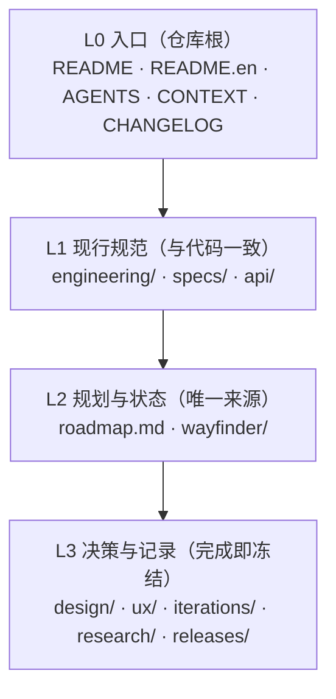

# 文档地图

文档按读者与时效分四层：入口在仓库根目录，现行规范必须与代码一致，规划与状态只有一个来源，决策与记录完成即冻结。新增文档先判断属于哪一层再放置。

| 层 | 位置 | 读者 | 维护规则 |
|---|---|---|---|
| L0 入口 | 根目录 `README.md` / `README.en.md` / `AGENTS.md` / `CONTEXT.md` / `CHANGELOG.md` | 所有人 | 随每次改动同步；数字由 `npm run verify` 比对实测 |
| L1 现行规范 | `engineering/`、`specs/`、`api/` | 改代码的人与 Agent、外部宿主开发者 | 代码变了就改；`tooling/check-doc-sync.mjs` 在提交时提示复查 |
| L2 规划与状态 | `roadmap.md`、`wayfinder/` | 维护者 | 单票状态只写在票据 `status` 与 Resolution，跨地图汇总只写在 roadmap |
| L3 决策与记录 | `design/`、`ux/`、`iterations/`、`research/`、`releases/` | 追溯原因的人 | 完成后冻结，只修链接与明显失真；新决策另写新文档 |

类型词汇沿用 [Diátaxis](https://diataxis.fr/)：**reference**（持续查阅的事实）、**how-to**（面向任务的步骤）、**explanation**（理解背景的决策与历史）。

## 阅读入口

| 顺序 | 文档 | 内容 |
|---|---|---|
| 1 | [AGENTS.md](../AGENTS.md) | 仓库约束、已知陷阱、门禁命令 |
| 2 | [engineering/architecture.md](engineering/architecture.md) | 包依赖、解析链路、编辑闭环的全局架构 |
| 3 | [engineering/architecture-rules.md](engineering/architecture-rules.md) · [engineering/design-standard.md](engineering/design-standard.md) | 分层依赖规范、功能设计标准 |
| 4 | [CONTEXT.md](../CONTEXT.md) | 领域语言：源值 / 覆盖 / 有效投影 / 补丁与生成保存 |
| 5 | [api/viewer.md](api/viewer.md) · [api/editor.md](api/editor.md) | 查看器 / 编辑器接入与低层 API |
| 6 | [engineering/testing.md](engineering/testing.md) · [engineering/development.md](engineering/development.md) | 测试与本地开发 |
| 7 | [roadmap.md](roadmap.md) | 当前完成度、缺口取舍与下一步 |

## L1 现行规范

### engineering/

| 文档 | 内容 | 性质 |
|---|---|---|
| [architecture.md](engineering/architecture.md) | 包与依赖、数据流、编辑闭环、字体体系、产品层、质量体系 | reference |
| [architecture-rules.md](engineering/architecture-rules.md) | 分层模型、依赖方向、落位决策、内聚耦合判定、反模式；由 `check-architecture-boundary` 机械审计 | reference |
| [design-standard.md](engineering/design-standard.md) | 五态与世代令牌、错误回退、兼容演进、确定性、验收、资源生命周期 | reference |
| [pitfalls.md](engineering/pitfalls.md) | 交付与交互层面的坑索引（实现陷阱在 AGENTS） | reference |
| [testing.md](engineering/testing.md) | 门禁关系、新增套件与固件、断言计数登记、测试套件表、测试分层 | how-to |
| [performance.md](engineering/performance.md) | 浏览器实测性能、Worker 收益、LibreOffice 保真基准与对照方法 | reference |
| [development.md](engineering/development.md) | 启动、构建、对照与基准命令，调试页 | how-to |
| [releasing.md](engineering/releasing.md) | 流水线行为、发版 checklist、OIDC 环境要求、常见失败 | how-to |
| [powerpoint-runner.md](engineering/powerpoint-runner.md) | Windows PowerPoint 真机门禁的 runner 约束与证据 | how-to |

### specs/

| 文档 | 内容 |
|---|---|
| [pptx-spec-map.md](specs/pptx-spec-map.md) | ECMA-376 体系：功能域 → 规范章节 → 仓库模块，规范没写清的坑 |
| [ppt-spec-map.md](specs/ppt-spec-map.md) | MS-PPT / CFB / Escher：记录模型与仓库模块映射 |

### api/

查看器 / 编辑器的用法、能力矩阵、API 契约与验收边界，面向外部宿主开发者；`packages/*/README` 与 npm 页面以绝对链接引用，**路径保持不变**。

| 文档 | 主题 |
|---|---|
| [viewer.md](api/viewer.md) | 查看器、图片 ZIP / 打印导出、Worker 解析、状态机接法与稳定渲染 |
| [editor.md](api/editor.md) | 编辑器会话、模板、设计画布、交互 / 剪贴板、低层 EditDoc 与保存 |
| [agent-describe.md](api/agent-describe.md) | Agent 结构化读出、稳定 ID、预算截断与 JSON Schema |
| [agent-layout-lint.md](api/agent-layout-lint.md) | Agent 七项布局检查、字体/颜色输入、取消与 SVG 采样协议 |
| [agent-node-render.md](api/agent-node-render.md) | Agent Node 无 Office 渲染：测字 / 光栅化注入、稳定 reason 与确定性 |
| [format-capabilities.md](api/format-capabilities.md) | `.pptx` / `.ppt` 能力矩阵与文本细项 |
| [format-limitations.md](api/format-limitations.md) | 格式缺失、近似实现与待验收边界 |
| [expanded-capabilities.md](api/expanded-capabilities.md) | 全部按需扩展入口的能力矩阵（索引层） |
| [api-stability.md](api/api-stability.md) | 1.0 API 契约边界与宿主迁移动作 |
| [appearance-editing.md](api/appearance-editing.md) | 图片效果与立体效果编辑 |
| [browser-editing.md](api/browser-editing.md) | 画布读屏、EditContext、现代图表自动加载 |
| [chart-hierarchical-categories.md](api/chart-hierarchical-categories.md) | 经典图表多级类别编辑 |
| [chartex-native.md](api/chartex-native.md) | ChartEx 原生按需解析与验收边界 |
| [comments.md](api/comments.md) | 只读批注面板与导出开关 |
| [font-glyphs.md](api/font-glyphs.md) | 字体字形 Provider、Worker、HarfBuzz 接线 |
| [local-file-save.md](api/local-file-save.md) | FSA + 下载双路径保存与交付语义 |
| [media-insertion.md](api/media-insertion.md) | 音视频插入、海报替换、恢复与协同 |
| [portable-rich-text.md](api/portable-rich-text.md) | 生成保存与跨文稿复制（公式 / 艺术字） |

## L2 规划与状态

[roadmap.md](roadmap.md) 汇总跨地图的完成度与下一步。`wayfinder/` 是研发地图：每张地图一个 `map.md`（目标、约束、已关闭任务的一句话索引）加 `tickets/`（子任务，`status` 是进度的唯一事实来源）；`verify-v06/v07-readiness` 直接读取 0.6 与 0.7 地图，**勿移动、勿改结构**。

| 地图 | 主题 | 状态 |
|---|---|---|
| [ppt-editor](wayfinder/ppt-editor/map.md) | 纯 Web PPT 编辑能力 M0–M6 | open（010 PowerPoint 真机验收暂缓、075 稳定版发布未完成） |
| [ppt-editing-completeness](wayfinder/ppt-editing-completeness/map.md) | 0.6 高频编辑能力 | closed |
| [ppt-template-theme](wayfinder/ppt-template-theme/map.md) | 0.7 模板与主题编辑 | closed |
| [ppt-data-fidelity](wayfinder/ppt-data-fidelity/map.md) | 0.8 数据与保真（含 `research/` ChartEx 调研） | closed |
| [ppt-expanded-capabilities](wayfinder/ppt-expanded-capabilities/map.md) | 七类扩展编辑、渲染与导出 | closed |
| [ppt-portability-fidelity](wayfinder/ppt-portability-fidelity/map.md) | 内容流转、矢量 PDF、音视频与格式保真；[执行计划](wayfinder/ppt-portability-fidelity/plan.md)，实现记录与证据在 `notes/` | open |
| [ppt-agent-interface](wayfinder/ppt-agent-interface/map.md) | Agent 读写接口：结构化读出、布局检查、Node 渲染、命令工具面、MCP / WebMCP、模板填充与评测集 | open |

## L3 决策与记录

### design/：技术设计

| 文档 | 主题 |
|---|---|
| [editing-design.md](design/editing-design.md) | 编辑能力技术总纲：EditDoc / src-ovr / 补丁保存 / 三层视图（D1–D14 决策） |
| [cordis-editor.md](design/cordis-editor.md) | 编辑器产品层 Cordis 插件分层、生命周期与红绿证据 |

### ux/：界面设计与验收

| 文档 | 主题 |
|---|---|
| [editor-interaction-redesign.md](ux/editor-interaction-redesign.md) | 编辑页缩略图、任务型功能区、形状 / 表格选择器 |
| [editor-desktop-layout.md](ux/editor-desktop-layout.md) | 对象列表、分区拖动、属性页签桌面排版 |
| [site-home-layout.md](ux/site-home-layout.md) | 官网首页排版与窄屏导航 |
| [site-i18n.md](ux/site-i18n.md) | 官网三页中英文验收矩阵（契约文件清单） |

界面评审工具的产出保存在仓库根目录 `.impeccable/critique/`（由工具维护，不移动）。

### iterations/：轮次迭代记录

每份是一轮「目标 → 场景 → 范围 → 调研 → 方案 → 验收 → 自评」的完整记录。同主题多轮成组，后续轮次建立在早期轮次之上，按组阅读：

| 组 | 文档（按轮次序） |
|---|---|
| 放映基础 | [present-mode](iterations/playback/present-mode.md) → [present-bar](iterations/playback/present-bar.md) → [present-vertical](iterations/playback/present-vertical.md) |
| 后退三连 | [present-rewind](iterations/playback/present-rewind.md) → [present-backspace](iterations/playback/present-backspace.md) → [present-prev-letter](iterations/playback/present-prev-letter.md) |
| 黑白屏三连 | [blank-screen](iterations/playback/blank-screen.md) → [blank-period](iterations/playback/blank-period.md) → [white-screen](iterations/playback/white-screen.md) |
| 跳页与网格 | [slide-number](iterations/playback/slide-number.md)、[slide-ends](iterations/playback/slide-ends.md)、[slide-grid](iterations/playback/slide-grid.md) |
| 演讲者辅助 | [speaker-aids](iterations/playback/speaker-aids.md)、[notes-key](iterations/playback/notes-key.md) |
| 滑动翻页 | [swipe-nav](iterations/playback/swipe-nav.md)（官网）→ [viewer-swipe-nav](iterations/playback/viewer-swipe-nav.md)（查看器） |
| 打开世代 | [open-session](iterations/viewer/open-session.md) 为全部打开类轮次的根 |
| 认文件两连 | [open-kind](iterations/viewer/open-kind.md) → [editor-open-kind](iterations/viewer/editor-open-kind.md) |
| 深链三连 | [viewer-open-page](iterations/viewer/viewer-open-page.md) → [sample-open-page](iterations/viewer/sample-open-page.md) → [open-start-page](iterations/viewer/open-start-page.md) |
| 打开收口 | [viewer-open-lazy](iterations/viewer/viewer-open-lazy.md)、[viewer-clear-file](iterations/viewer/viewer-clear-file.md)、[viewer-file-progress](iterations/viewer/viewer-file-progress.md)、[viewer-password](iterations/viewer/viewer-password.md)、[viewer-small-viewport](iterations/viewer/viewer-small-viewport.md)、[viewer-notes-clear](iterations/viewer/viewer-notes-clear.md) |
| 查找四连 | [viewer-search-lazy](iterations/viewer/viewer-search-lazy.md) → [viewer-search-highlight](iterations/viewer/viewer-search-highlight.md) → [viewer-search-occurrence](iterations/viewer/viewer-search-occurrence.md) → [viewer-search-again](iterations/viewer/viewer-search-again.md) |
| 惰性解析三步曲 | [advanced-prepare](iterations/parsing/advanced-prepare.md) → [parse-preview-parts](iterations/parsing/parse-preview-parts.md) → [parse-preview-slides](iterations/parsing/parse-preview-slides.md) |

### research/：调研

| 文档 | 主题 |
|---|---|
| [agent-loop.md](research/agent-loop.md) | Agent Loop 方案调研与本仓库的限定域循环 |
| [ai-presentation-landscape.md](research/ai-presentation-landscape.md) | AI 演示文稿产品、Agent 操作 PPT 的做法与研究方向，及本仓库的 Agent 读写接口定位 |
| [browser-platform.md](research/browser-platform.md) | WebKit LBSE、EditContext、File System Access 的平台现状与对策 |

### releases/：版本交付记录

| 文档 | 内容 |
|---|---|
| [0.5.0-beta.5.md](releases/0.5.0-beta.5.md) | beta.5 交付时的模块进度、提交与验证证据；CHANGELOG 以绝对链接引用，**路径保持不变** |
