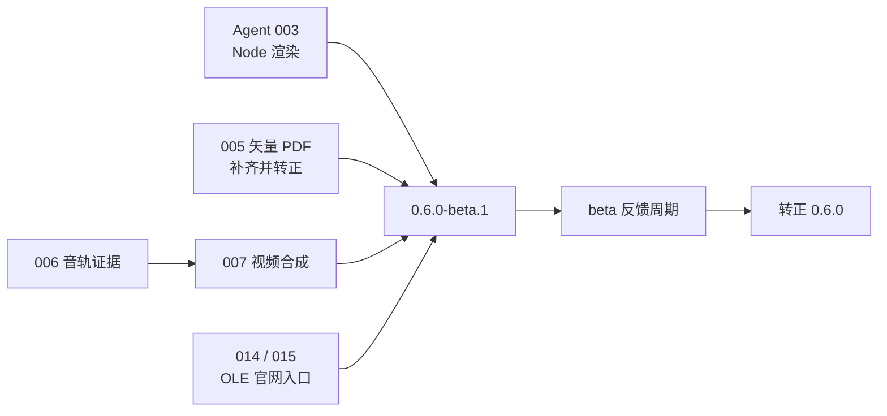

# 0.6.0 技术方案

> 状态：待评审。前提：[0.6.0 PRD](../product/0.6.0.md) 的用户流程、范围与验收经用户确认。票据内已有的技术细节不在本文复述，本文只做实施编排、新增决策与风险。

## 1. 实施顺序

| 批次 | 票据 | 理由 |
|---|---|---|
| 1（可同时开工） | Agent [003](../wayfinder/ppt-agent-interface/tickets/003-node-render.md)、[005](../wayfinder/ppt-portability-fidelity/tickets/005-vector-pdf.md)、[006](../wayfinder/ppt-portability-fidelity/tickets/006-video-audio-track.md)、[014](../wayfinder/ppt-portability-fidelity/tickets/014-ole-docx-runs-tables.md) / [015](../wayfinder/ppt-portability-fidelity/tickets/015-ole-xlsx-styles-richtext.md) | 五项互不依赖；003 是 0.7 MCP 的前置，优先级最高 |
| 2 | [007](../wayfinder/ppt-portability-fidelity/tickets/007-video-media-composition.md) | 依赖 006 的混音链路 |
| 3 | 0.6.0-beta.1 发布与反馈 | 全部票据关闭后 |

每张票的自底向上路径：存储 / 模型层 → 解析或渲染适配 → SDK 入口 → 官网或 Node 消费方，与仓库既有分层一致；各票新增固件随能力同步（[测试规范](../engineering/testing.md)）。

## 2. 本级新增决策

| 决策 | 内容 |
|---|---|
| 开发与合入流程 | 每张票据一个特性分支，经 PR 合入 master，PR 描述引用票据并写明升级功能；票据关闭时在 Resolution 登记证据。0.5.x 补丁线同样走 PR |
| 版本发布流程 | `0.6.0-beta.N` 发 `next`、转正发 `latest`；tag 触发 `release.yml`，绿色 CI 时走门禁信任快路径（见[发布流程](../engineering/releasing.md)） |
| Node 渲染的依赖边界 | 测字与光栅化全部宿主注入；core 不新增运行时依赖、不碰 `document`；未注入时报稳定 reason 而非估算回退（票据完成条件） |
| 实验性标记的去除时点 | 005 关闭时同步去掉矢量 PDF 实验性标记并更新 CHANGELOG 与能力矩阵；`videoOverlay` 若未达 007 完成条件则保留默认关闭 |

## 3. 风险与对策

| 风险 | 对策 |
|---|---|
| Node 与浏览器 SVG 指纹不一致的根因分散（字体度量、环境差异） | 003 完成条件要求逐页定位不一致原因；`ppt-fingerprint` 独立进程比对是既有手段 |
| 007 长视频内存边界 | 有界解封装 + 关键帧定位为票据验收项；不按页面长度一次性解码 |
| WebCodecs / Opus 支持差异 | 导出前能力检测，不支持时明确拒绝（006 验收项） |
| beta 反馈周期引入的外部缺陷 | 以 `0.6.0-beta.N` 修复，不混入新能力 |

## 4. 验证方案

- 每张票据按自身完成条件验收；PR 合入前本地四门禁 + CI 绿。
- 0.6.0 发布检查项按 [roadmap §7.1](../roadmap.md#710-下一阶段收口--agent-第一批) 执行。
- Windows 真机（010）按用户决定执行或豁免并在 CHANGELOG 记录。
