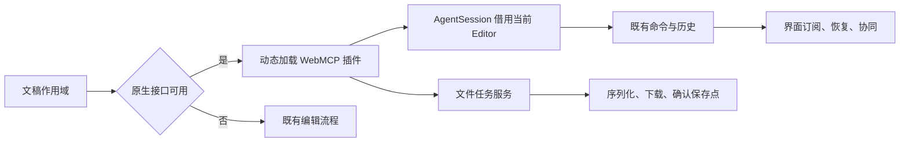

# 编辑器 WebMCP

执行范围为 [Agent 006](../wayfinder/ppt-agent-interface/tickets/006-editor-webmcp.md)：浏览器 Agent 操作官网当前文稿，复用现有命令、历史、恢复及协同。页面不调用模型服务，发布 SDK 不新增接口。

## 规范与入口

2026-11-02 完整核对 [Chrome Imperative API](https://developer.chrome.com/docs/ai/webmcp/imperative-api) 与 [2026-10-27 WebMCP 草案](https://webmachinelearning.github.io/webmcp/)。当前入口为 `document.modelContext`；`registerTool` 返回 Promise，注册信号取消后注销工具，执行信号独立控制一次调用；注销本身不取消已经开始的执行。

| 决策 | 实现约束 |
|---|---|
| 工具协议 | `ppt_describe/element/lint/render/edit/undo/redo/save` 复用 004 的输入 Schema 和稳定错误，根 Schema 展开为对象 |
| 文稿所有权 | `AgentSession` 借用现有 Editor，不调用其 dispose；Editor 仍由文稿作用域最终释放 |
| 写入权限 | 每次调用及排队完成后重查当前 session、writable、只读、转换确认与文件忙碌状态 |
| 串行 | 同一文稿的工具调用排队；排队任务开始前再次检查关闭及调用取消 |
| 只读异步操作 | 通过 `editorFiles.withDocumentTask` 纳入 busy 和 whenIdle，失败向工具调用者传播 |
| 保存交付 | 使用 `prepareFileSave`，生成期间变化则拒绝；下载成功后确认保存点，不向协议返回整个文件的 Base64 |
| 渲染与字体 | 使用当前文稿投影和浏览器真实测字/光栅化；缺少字体库存等检查前提时显式返回 reason |
| 按需成本 | 探测条件之外不导入插件；现有首屏和首次打开总闭包预算继续执行 |

## 生命周期与失败

| 状态 | 行为 |
|---|---|
| 加载中 | 文稿初始化等待注册；注册失败撤销本作用域已注册的工具 |
| 成功 | 返回结构化结果；修改触发同一 Editor 的历史、恢复和订阅 |
| 失败 | 返回稳定 reason 与定位信息；非法命令不改变文稿或历史，下载失败不确认保存点 |
| 取消 | 调用信号传入异步检查；已完成的同步命令不会伪装回滚；未执行的队列项拒绝 |
| 过期 | 文稿切换/关闭先撤销注册并取消调用，等待活动任务结束后释放视图、字体与会话 |

## 实施与验收顺序

| 顺序 | 可独立验证的路径 |
|---|---|
| 1 | 文件任务服务提供带结果和错误的文稿任务；验证 busy、pause、释放与 whenIdle |
| 2 | 文稿插件绑定已有 Editor、复用工具协议并接入真实浏览器渲染；验证工具命令、历史、保存重开 |
| 3 | 条件动态加载与 Cordis 生命周期接线；验证切换、关闭、重新打开、注册失败和旧回调拒绝 |
| 4 | 原生 WebMCP 浏览器验收及不支持路径分块检查；运行原有官网回归和包体积预算 |
| 5 | 顺序执行 check、完整 test、build、verify，检查最终差异并更新 API 与研发票据 |

前序能力验收发现的 SetLink 目标分类和 MCP 文件任务队列缺陷同步补回归修复；它们直接影响本票依赖的工具正确性。
