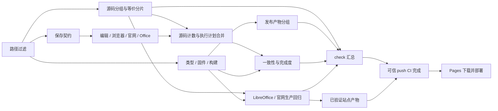

# CI 并行执行与产物复用

## 验收

| 项目 | 验收条件 |
|---|---|
| 基线 | 使用 gh 保存最近 50 次 workflow 的全部 attempt、job 和 step 时间，分别统计排队、准备、执行及收尾 |
| 覆盖 | package.json 的功能测试及 verify 生命周期为唯一清单，CI 分片完整覆盖，失败与缺失报告阻断汇总检查 |
| 并发 | 同一 PR 新推送取消旧运行；master / main 按 run_id 独立，逐提交完整执行 |
| 文档 | paths 过滤控制重测试，始终生成 check 结论，不让必需检查停在 Pending |
| 构建 | 连续构建命中本地缓存；源码、配置和运行时变化失效；删除或损坏输出恢复 |
| 真实验证 | 本地四条门禁与真实 push 测量均完成，按实测进行第二轮优化 |

## 数据依赖

## 实施约束

| 机制 | 约束 |
|---|---|
| 自动展开 | npm script 的 pre / post 生命周期一并进入执行计划；新套件默认归入编辑组，未知命令语法立即失败 |
| 跨机传输 | 保存契约独立产生 PPTX，消费者尽早启动；仅传必要清单、源码报告、计数、dist 和三份默认入口证明，不传浏览器 profile、Python 环境或 node_modules |
| 完整性 | 汇总前核对每组结果与当前入口计划；等价分片按固件唯一覆盖，其他计数冲突立即失败 |
| 缓存 | setup-node / setup-python 负责下载缓存；Turbo 仅本地缓存构建，不占 Actions 的额外缓存配额 |
| 发布信任 | 只有同 SHA 的可信 push CI 全绿才能跳过重复门禁；没有完整 CI 证据仍全量执行 |
| Pages | 只消费本仓库 master / main 的成功 push CI 站点产物，不执行 PR 工件中的代码 |
