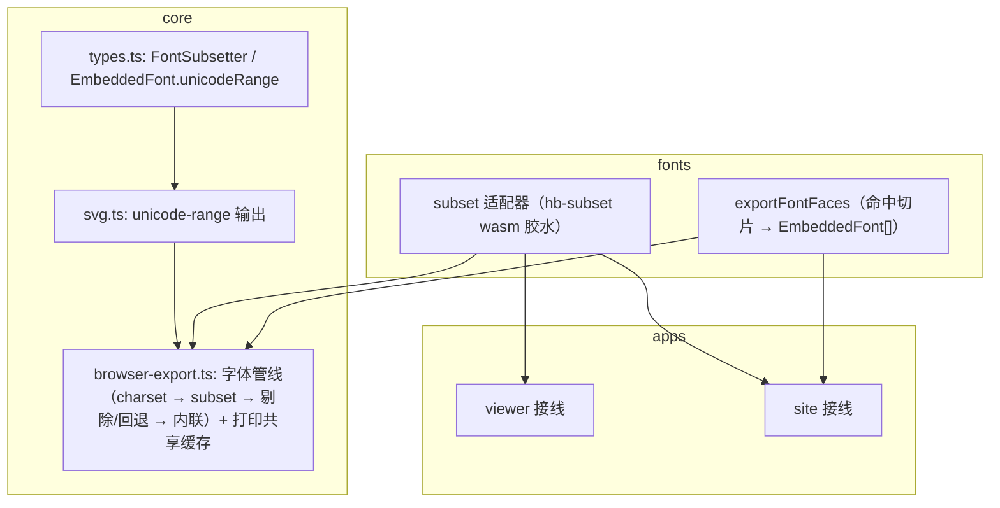

# 导出字体子集化与替代字体内联

状态：已实施，验收记录见[票据 016](../wayfinder/ppt-portability-fidelity/tickets/016-export-font-subset.md)。实施与方案的两处偏差：`?url` 导入改为 `public/vendor` 固定路径 + `tooling/sync-font-wasm.mjs` 同步（官网 WebMCP 测试用 esbuild 打包 site 源码，vite 专属的 `?url` 语义会把两套构建拆成两种行为）；`EmbeddedFont` 除 `unicodeRange` 外补了 `sizeAdjust`（等线西文替代的前进宽度缩放必须随脸走，否则导出排版与预览不一致）。

## 1. 问题与目标

三条导出链路（PNG / 独立 SVG / 打印 HTML）的字体现状：

| 现状 | 位置 | 代价 |
|---|---|---|
| `pres.embeddedFonts` 的**整字体**被 base64 内联，且单页导出会带上**全部**嵌入字体，包括本页没用到的家族 | [browser-export.ts:36-73](../../packages/core/src/browser-export.ts) 的 `inlineImages` | 一份全量嵌入 CJK 字体的文稿，单页导出内联数 MB |
| 替代字体（fontsource 切片）只在页面上下文按需加载，导出**完全不内联** | [load.ts](../../packages/fonts/src/load.ts) 只注入 `doc.head` | 导出的独立 SVG 在没装该字体的机器上回退系统字体，外观漂移 |

目标（均可验收）：

1. 导出时嵌入字体按**导出范围的字符集**精确子集化后再内联；未用到的家族不再进入导出产物。
2. 替代字体在导出时内联**命中的 woff2 切片**（首一次具备导出内联能力）。
3. 默认关闭时导出产物**逐字节不变**；子集化失败显式回退整字体内联，带稳定 reason code。
4. 同输入同参数产出相同字节（确定性，可进快照）。

### 非目标

| 排除项 | 原因 |
|---|---|
| 预览路径重新切分 | [sources.ts:4-8](../../packages/fonts/src/sources.ts) 实测：按字频重切 460–700KB vs 现成切片 538KB，分布约束决定省不下来 |
| 编辑器 FontFace 注册子集化 | 编辑需要未来输入的字符，子集会造成缺字；注册的字节来自本地解析，无网络成本 |
| 服务端精确子集 / IFT | 违反零服务端；IFT 浏览器未实现 |
| woff2 压缩输出 | 需要引入 brotli 编码器；v1 输出 sfnt 已比整字体小一个量级，后续单独评估 |

## 2. 引擎评估：为什么不是 cn-font-split

| 候选 | 浏览器运行时可用性 | 结论 |
|---|---|---|
| cn-font-split@7.4.3（npm latest） | 发布形态 `dependencies` 含 `koffi`（Node 原生 FFI）、`commander`、`fs-extra`、`google-protobuf`，主入口**浏览器不可用**；其 wasm 能力（仓库 `packages/vite` 插件、demo）面向**构建期**切分自有字体 | 不作为运行时引擎。保留其构建期定位：未来若自托管替代字体数据，可用它预切 |
| harfbuzzjs 1.6.1 的 `harfbuzz-subset.wasm` | **site 已声明该依赖**（[editor-font-worker.ts:9](../../packages/site/src/editor-font-worker.ts) 字形整形在用）；`dist/harfbuzz-subset.wasm` 622KB 随包分发；已核对导出符号，子集化闭环所需的 C API 齐全（见下） | **采用**。缺 JS 胶水 → 按既有 `createHarfBuzzShaper` 适配器模式自写，宿主注入 wasm 字节，发布包不携带 wasm |

`harfbuzz-subset.wasm` 已核对的关键导出符号：输入 `hb_blob_create/get_data/get_length/destroy`、字形面 `hb_face_create/destroy/reference_blob`、字符集 `hb_set_create/add/destroy` + `hb_subset_input_unicode_set`、子集化 `hb_subset_input_create_or_fail/set_flags/pin_all_axes_to_default` + `hb_subset_or_fail`、内存 `malloc/free/memory/_initialize`。仅接受 sfnt（TTF/OTF/CFF）输入；pptx 嵌入字体在解析期已由 [eot.ts](../../packages/core/src/font/eot.ts) 剥壳还原为 sfnt，正好满足；WOFF/WOFF2 输入（`sfntMime` 直通的那种）直接走回退。

适配器与两个既有先例同构：core 的 `setFontDecoder()`（MTX 解码器不进 core）和 `glyphs/harfbuzz.ts`（宿主提供引擎、包不打包 wasm）。

## 3. 设计决策

### D1 core 导出选项：引擎与脸集都由调用方注入

```ts
// packages/core/src/types.ts
export interface FontSubsetter {
  /** 引擎必须确定性：同 bytes + chars 产出相同输出字节 */
  subset(input: { bytes: Uint8Array; mime: string; chars: string; family: string; bold: boolean; italic: boolean }):
    Promise<{ ok: true; bytes: Uint8Array; mime: string } | { ok: false; reason: string }>;
  /** 释放引擎持有的 wasm 实例与线性内存；调用后 subset 抛错 */
  dispose(): void;
}

export interface ExportFontOptions {
  /** 嵌入字体按导出范围字符集子集化；缺省 = 现状（整字体内联） */
  subsetter?: FontSubsetter;
  /** 追加的 @font-face（替代字体切片等），src 为 blob:/data: 均可，随导出内联 */
  extraFontFaces?: EmbeddedFont[];
  /** 子集化被跳过或失败时的观察口；reason 稳定（见 D5） */
  onFontFallback?: (family: string, reason: string) => void;
}
```

`PngExportOptions`、`slideToSvgFile`、`PrintableOptions` 增加可选 `fonts?: ExportFontOptions`。core 不持有全局子集化状态——引擎是导出动作的参数，作用域与导出一致（资源注册与使用同作用域）。`image-zip` 批量导出入口透传既有 options，自动获得该能力。

### D2 `EmbeddedFont` 增加可选 `unicodeRange`

替代字体一个家族对应多个切片脸，靠 `unicode-range` 区分。[svg.ts:165-167](../../packages/core/src/render/svg.ts) 生成 `@font-face` 时存在则输出 `unicode-range:...` 声明。可选字段，向后兼容；渲染快照默认无变化。

### D3 字符集口径：按家族匹配，超集直接复用

- `collectFonts`（[collect.ts](../../packages/core/src/font/collect.ts)）的 `chars` 是按 run 的 latin/ea/cs 三元组算的**超集**——每个家族拿到整段文字，宁多勿少，子集化直接用它，不会缺字。
- 家族匹配按 trim + 大小写归一（`embeddedFonts` 的家族名与 run 字体名都来自同一份 OOXML，正常一致；归一兜底大小写差异）。
- 开启子集化时，导出范围内**没有任何用量的家族整脸剔除**（不进入产物）。现状是把全部嵌入字体都塞进单页导出，剔除是纯收益。
- 匹配不到用量的原因也走 `onFontFallback`（reason `unused-family`），可观察。
- 批注标记只渲染数字气泡（[svg.ts:518-542](../../packages/core/src/render/svg.ts)），正文在 `<title>` 里不渲染，无需扩展 `collectFonts`。

### D4 打印导出跨页共享一份子集

现状 `presentationToPrintableHtml` 逐页调 `slideToSvgFile`，每页独立 `inlineImages`。开启子集化后若逐页子集，同一字体每页一份不同的 base64。改为：打印任务先 `collectFonts(pres.slides)` 取**并集**字符集，data URI 缓存提升到任务级（`inlineImages` 的 encoded Map 由调用方传入），同字体全稿一份子集。默认关闭时行为与字节均不变。

### D5 显式回退与稳定 reason

| reason | 场景 | 行为 |
|---|---|---|
| `subset-failed` | 引擎返回失败（非 sfnt 输入、字形面损坏等） | 回退整字体内联 |
| `unused-family` | 导出范围无用量 | 剔除该脸 |
| `subsetter-error` | 引擎抛异常 | 回退整字体内联，不吞——`onFontFallback` 必须收到通知 |

回退结果永不劣于现状（整字体内联就是现状）。`onFontFallback` 是唯一观察口，core 不打日志。

### D6 fonts 包新增两个公开能力

1. `@web-ppt/fonts/subset` 入口：`createHarfBuzzSubsetter(wasm: BufferSource): Promise<FontSubsetter>`——自写约 150 行 wasm 胶水（blob 输入 → face → unicode set → `hb_subset_or_fail` → reference_blob 拷出），变量字体调 `hb_subset_input_pin_all_axes_to_default`，钉死默认 flags。宿主用 vite 的 `?url` 导入 `harfbuzzjs/dist/harfbuzz-subset.wasm` 惰性加载。边界规则（`check-font-glyph-boundary.mjs`）同步登记：该入口禁止 DOM、禁止打包 wasm。
2. `exportFontFaces(usages: FontUsage[], options): Promise<EmbeddedFont[]>`——替代字体的导出脸集：复用 `load.ts` 既有的家族解析 / 就近字重 / CSS 抓取逻辑（重构出共用段），解析 fontsource CSS 的 `unicode-range`，**只 fetch 与 `usage.chars` 相交的切片**，以 data URI 形式返回 `EmbeddedFont[]`（含 `unicodeRange`，家族名写回原名）。本机已装原字体（`isInstalled` 探针）或 `cjk: false` 时跳过，与页面加载条件一致。

### D7 默认关闭；应用层显式开启

SDK 侧缺省不传 `fonts` → 产物逐字节不变（含 `image-zip`）。site 与 viewer 的导出入口（[viewer main.ts:510-523](../../packages/viewer/src/main.ts)、site 的 WebMCP 渲染 / 批注导出 / 导出对话框）显式传选项：首次导出时才动态 import 引擎。viewer 需补 `harfbuzzjs` 依赖声明（private 应用，不影响发布包）。

### D8 确定性

HarfBuzz subsetter 对同输入同 flags 确定性输出；适配器不引入时间戳 / 随机数。导出 SVG 快照可钉子集化产物。固件生成不涉及（引擎是运行时注入，不进 fixtures 生成脚本）。

## 4. 实施路径（自底向上，每阶段独立可验证）



| 阶段 | 内容 | 首个验证节点 |
|---|---|---|
| 1 | core：类型 + `unicode-range` 渲染输出 | `npm run check` + 现有 212 快照全绿（默认路径零变化） |
| 2 | core：导出管线（选项消费、collectFonts 字符集、剔除 / 回退、打印任务级缓存） | node 侧用 fake subsetter 测管线逻辑：charset 传递、剔除、回退、默认关闭字节不变 |
| 3 | fonts：`/subset` 适配器 | node 直接实例化真实 wasm + 固件字体（`tooling/font-glyph-samples/`）；与 pyftsubset 交叉验证 cmap 覆盖与字形集一致；两次运行字节一致 |
| 4 | fonts：`exportFontFaces` + load.ts 共用段重构 | node 测 CSS 解析与切片筛选；命中集合断言 |
| 5 | site / viewer 接线 + 浏览器验收 | 浏览器断言见下节 |
| 6 | 文档与数字 | `npm run verify` 比对实测 |

## 5. 测试与验收

| 层 | 断言 |
|---|---|
| 适配器（node，真实 wasm） | 固件字体子集后：fontTools 读出的 cmap 覆盖 == 请求字符集；组合字形闭包保留（拼音标注等）；同输入两次字节一致；非 sfnt 输入返回 `subset-failed` 不抛 |
| 交叉验证（tooling） | pyftsubset 同字符集产物的字形集合与我们的输出等价（编码器不同，不比字节） |
| core 管线（node，fake subsetter） | 默认关闭 → 导出字符串与现状逐字节一致；开启后未用家族被剔除、charset 按家族传递、fake 失败触发回退且 `onFontFallback` 收到稳定 reason；`unicode-range` 出现在 `@font-face` |
| 浏览器（site / viewer） | 同一页**子集开 / 关两次导出 PNG 字节一致**（同字形同字体，光栅不应有差）；全量嵌入 CJK 固件下导出 SVG 中字体 data URI 显著小于整字体（实测数字登记，不预填）；替代字体导出的独立 SVG 含命中切片且在干净浏览器（无该字体）下文本不回退 |
| 门禁 | `npm run check && npm test && npm run build && npm run verify` 全绿；新增断言数同步进 testing.md / README / AGENTS；包体积数字实测更新 |

## 6. 风险与边界

| 风险 | 对策 |
|---|---|
| 手写 wasm 胶水对 ABI 的维护面 | `harfbuzzjs` 钉死版本（与 `PACKAGES` 钉版本同理）；39 个导出符号已核对闭环；harfbuzzjs 未来出官方 subset 胶水则替换实现，`FontSubsetter` 接口不变 |
| 大字体子集化耗时 | HarfBuzz subsetter 与 pyftsubset 同源，CJK 全量字体量级在几十毫秒；引擎在导出动作内串行执行，无并发面 |
| 嵌入字体本身已是「按使用字符」子集（PowerPoint 默认嵌入） | 子集化对它近似幂等，收益小但无害；真正的收益来自全量嵌入文件与未用家族剔除 |
| 打印并集字符集比单页大 | 并集仍远小于整字体；跨页共享一份 data URI 抵消 |
| 替代字体切片依赖 jsDelivr 可达 | 与现状页面加载同一依赖、同一 `base` 约定（可自托管）；导出时 fetch 失败按现状回退（该字体不内联） |
