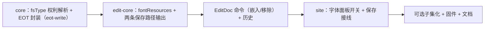

# 嵌入字体写入 PPTX

状态：SDK 能力已交付（core 写入边界 + edit-core 保存与命令）；产品入口与可选子集化待后续。实施记录与 LibreOffice 环境限制见[票据 012](../wayfinder/ppt-desktop-parity/tickets/012-font-embedding-write.md)。实施相对本方案的两处偏差：`FontEmbedResource` 直接挂在 EditDoc（未走 extensions），patch 形态与 `imageResources` 同型；移除回收在保存计划内完成（orphan 部件置 null + 关系与 Lst 引用剪除），未用 extension runtime。另有一处实施教训：动态创建的 XML 子元素 `namespaceUri` 字段恒为 null（由序列化按 xmlns 解析），查找这类子元素必须按 localName，按 URI 过滤永远落空。

## 1. 问题

用户在本机字体下完成的文稿，需要把许可允许的字体写进 `.pptx`，让没有该字体的电脑按原样显示。读侧（[parser.ts:53-72](../../packages/core/src/pptx/parser.ts) 的 `p:embeddedFontLst`）与预览链路（glyphs Provider）已完备；写入侧为零——EditDoc 不承载字体资源，保存不输出 `p:embeddedFontLst`。

## 2. 现状要点（调查结论）

| 事项 | 现状 | 写入侧落点 |
|---|---|---|
| 保存链路 | 补丁保存（`patchOpcPackage`）与生成保存（`generateEditDoc`）在 [save/index.ts:184-188](../../packages/edit-core/src/save/index.ts) 分叉 | 两条路径都要输出字体部件 |
| 读侧 | `p:embeddedFontLst` → presRels → `ppt/fonts/*.fntdata`；Content-Type `Default Extension="fntdata"` 在固件生成器出现 | 写侧照 `patchContentTypes` 模式登记 |
| EOT | core [eot.ts](../../packages/core/src/font/eot.ts) 只剥不封；固件构造先例 [tooling/lib/font.mjs:256](../../tooling/lib/font.mjs) | 正式 EOT 封装进 core（不压缩，XOR 可选） |
| fsType | 权利解析在 fonts/glyphs（[permissions.ts:16](../../packages/fonts/src/glyphs/permissions.ts)）；fonts→core peer 方向不允许反向复用 | fsType / 嵌入位解析下沉 core，fonts 包后续改为复用 core（本次不动其行为） |
| 子集 | hb-subset 引擎已由 016 提供（`FontSubsetter`） | 写入侧可选「仅嵌入使用字符」，复用同一引擎注入 |
| 产品 | 字体工具弹窗明示「新增字体不会写入 PPTX」 | 弹窗加 per-family 嵌入开关，同步改提示 |

## 3. 设计决策

### D1 资源模型：照 imageResources，字节不进 patch 载荷

EditDoc 新增 `fontResources: { id, family, bytes, mime, styles }`（内容寻址）。嵌入 / 移除是 doc 级命令（`SetEmbeddedFonts`），undo/redo 走既有 patch 历史，patch 只携带资源 id 列表，字节本体存资源存储——协同补丁与历史不放大。

### D2 许可检查在写入边界，fast-fail

写 `.fntdata` 前按 OS/2 `fsType` 判定：Restricted / Bitmap-only 拒绝并抛稳定 reason（`embedding-restricted` 等，与 glyphs Provider 现有语义一致）；Preview & Print 允许写入但记入 `p:embeddedFont` 的可编辑边界语义由读方自判。EOT 容器头的 fsType 字段回写字体真实值，不再伪造 0。

### D3 子集化可选，默认整字体

`writeEmbeddedFonts(doc, { subsetter?, chars? })`：传引擎与字符集（`collectFonts` 整稿并集）时先子集化，EOT Flags 置 `TTEMBED_SUBSET`。默认整字体，与 PowerPoint「包括所有字符」等价。

### D4 两条保存路径同构输出

补丁路径：patch presentation.xml（`p:embeddedFontLst` 追加 / 移除）+ presRels（`.../font` 关系）+ Content-Type Default + 写 `ppt/fonts/`。生成路径：`generatedTemplateParts` 与 materialize 闭包加同构输出。两条路径的字体部件命名与关系 Type 一致。

### D5 不做

- 不绕过许可位；CFF / 变量字体的嵌入按读侧现有边界拒绝（TTF/glyf 才写）。
- 不在本次重构 fonts/glyphs 的权利解析（它保持自足，行为不变）。

## 4. 实施路径

每阶段独立验证：A 用固件字体断言 EOT 头与剥头往返；B 保存重开读回字节一致 + LibreOffice 打开；C 历史往返；D 浏览器契约。

## 5. 验收（对齐票据完成条件）

- 嵌入后保存重开，core 读回字体与原字节（或子集）一致；LibreOffice 使用嵌入字体显示。
- `fsType` 各取值有正反例固件；禁止嵌入的字体原子拒绝。
- 复杂脚本、CFF、变量字体的限制与 `api/font-glyphs.md` 边界一致并写明。
