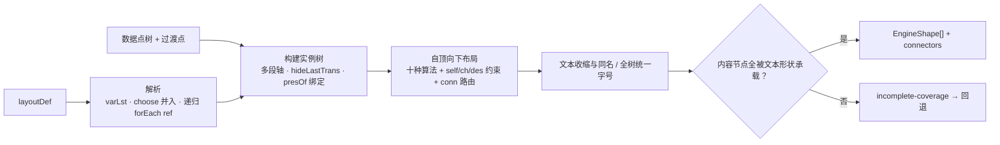

# SmartArt 布局定义引擎

状态：已完成（十种 ECMA-376 Part 1 §21.4.2 标准算法、条件分支、多段轴与过渡点、`for="self|ch|des"` 约束代数及 `ruleLst` 收缩全部交付）。实施与验收记录见[票据 001](../wayfinder/ppt-desktop-parity/tickets/001-smartart-layout-engine.md)。

## 1. 问题

没有缓存 drawing 的 SmartArt、以及编辑节点后的重排，需要按文件自带的 `dgm:layoutDef`（ECMA-376 Part 1 §21.4.2）求出与 PowerPoint 一致的形状、连线、位置和字号。仅有顶层算法名的第三方极简定义（无 `forEach` / `layoutNode` 子树）返回稳定 `minimal-layout-definition`，继续由轻量族布局兜底。

## 2. 求值模型

| 构造 | 语义 |
|---|---|
| 轴 | `self` / `ch` / `des` / `desOrSelf` / `par` / `anc`(`ancst`) / `ancOrSelf`(`ancstOrSelf`) / `sib` / `precedSib` / `followSib` / `preced` / `follow` / `root`；显式请求 `parTrans` / `sibTrans` / `nonNorm` 时展开完整过渡点序列，`hideLastTrans`（缺省 `true`）抑制末尾兄弟过渡点；支持 `st`（1 起计与负索引）、`cnt`、`step` |
| 元素类型过滤 | `ST_ElementType`：`node` 覆盖普通节点与 `asst` 助理节点，`norm` 仅普通节点，`asst` 仅助理节点，`nonAsst` 排除助理与过渡点 |
| choose / if | `var`（`dir`、`hierBranch` 等，数据点 `presLayoutVars` 显式覆盖优先于布局节点 `varLst`）、`cnt`、`depth`、`maxDepth`（支持 `axis="des"` 与 `axis="par des"` 子树深度）、`pos`、`revPos`、`posOdd`、`posEven`；op = `equ` / `neq` / `gte` / `lte` / `gt` / `lt` |
| 约束与规则 | 全部 64 种 `ST_ConstraintType`（含 `userA`..`userZ` 自定义变量、`for="des"` 后代作用域继承、兄弟引用 `refForName`）；`ruleLst` 支持 `primFontSz` / `secFontSz` / `w` / `h` / `sp` / `sibSp` / `secSibSp` |
| `composite` | 由 `w` / `h` / `l` / `t` / `r` / `b` / `ctrX` / `ctrY` 及 `*Off` 解出子矩形；`ar` 按宽高比内接居中 |
| `snake` | 自动滤除纯 `sibTrans` 过渡间距节点后求解最大单元网格；支持 `grDir` / `flowDir` / `contDir`（含折返 `revDir`）/ `off=ctr` |
| `lin` | 横向（`fromL`/`fromR`）与纵向（`fromT`/`fromB`）线性流式排布，超宽/超高时按期望尺寸等比压缩，支持显式过渡形状与 `sibSp`/`sp` 间距 |
| `cycle` | 按 `stAng` / `spanAng` 圆周分布；`ctrShpMap=fNode` 首节点居中、其余环绕（径向图）；支持 `rotPath=alongPath` 与相邻节点间的 `conn` 连线 |
| `pyra` | 按正置 `fromT` / 倒置 `fromB` 切分梯形层级带，`composite` 子层交由子约束拆分侧边标注 |
| `hierRoot` / `hierChild` / `conn` | 自底向上测量子树包络并等比收进画框：支持顶层多根、助理容器（`asst` 位于上级与普通下属层之间）、`hierBranch="init"` 按 `maxDepth <= 1` 自动在横向排布与纵向侧挂之间切换；`conn` 按 `begPts` / `endPts` / `srcNode` 生成三段折线（`bentConnector3`）或侧挂 L 形折线（`bentConnector2`）并按 `zOrderOff` 置于底层 |
| 字号与旋转 | `primFontSz`：自身 `self` > 父 `ch` > 最近祖先 `des`；溢出收缩后同名节点统一最小字号，根声明 `for="des" op="equ"` 时全树统一字号；90°/270° 宽高对调保持视觉外框 |

## 3. 真值与验收（`test-smartart-engine`，源码 + dist）

| 样本 / 固件 | 真值来源 | 结果 |
|---|---|---|
| `fixtures/sample-smartart-engine.pptx`（7 页确定性固件） | ECMA-376 §21.4.2 规范语义 + XSD / OpenXmlValidator / LibreOffice | 覆盖全部十种算法、`revPos` / `posOdd` / `maxDepth`、`ruleLst` 收缩、补丁与生成双保存重开（保留 `type="asst"` 与 9 条连线）；双通道 OOXML 零错误 |
| `tdf145528_SmartArt_Matrix`（matrix1） | PowerPoint 缓存 drawing | 4 块 tile 与中心形状的位置、尺寸、旋转逐个一致（误差 < 0.5px） |
| `smartart-snake-rows`（bList2） | LibreOffice `testSnakeRows` | 3 × 2 网格，`zOrderOff` 层级与直设 11pt / 16pt 字号一致 |
| `smartart-cycle-matrix`（cycle4） | LibreOffice `testCycleMatrix` | 四角与四象限方位、C2 四点合并文本、象限旋转一致 |
| `smartart-org-chart` / `smartart-org-chart2`（orgChart1） | LibreOffice `testOrgChart` / `testOrgChart2` | 引擎直接接管：Manager 居中、Assistant 位于上下级之间、3 条连线；orgChart2 四层树 `B1` 横排、`B2`/`C2` 纵向侧挂、8 条连线 |
| POI `60810.pptx` / `customGeo.pptx` / `smartart-rotated-text.pptx` / `smartart-simple.pptx` | PowerPoint 缓存 drawing | `hProcess9` 背景大箭头与 7 个流程节点尺寸与缓存逐个一致；`lProcess2`、`vList5`、`venn1`、`AlternatingHexagons`、`hierarchy4`、`hList1` 全部 `reason=null` 零回退 |
