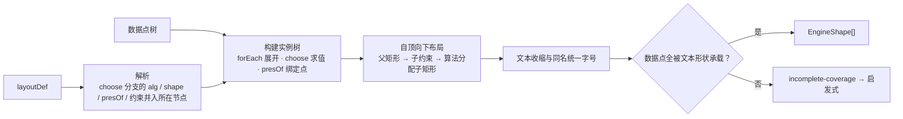

# SmartArt 布局定义引擎

状态：两阶段求值（实例树构建 + 自顶向下约束布局）已交付，composite 约束代数与 snake 网格经真值对照；层级算法（hierRoot / hierChild）与 lin / cycle / pyra / conn 未实现，返回稳定 reason 交启发式。实施记录见[票据 001](../wayfinder/ppt-desktop-parity/tickets/001-smartart-layout-engine.md)。

## 1. 问题

没有缓存 drawing 的 SmartArt、以及编辑节点后的重排，需要按文件自带的 `dgm:layoutDef`（ECMA-376 Part 1 §21.4.2）求出与 PowerPoint 一致的形状、位置和字号。六个「布局族」的启发式排布只能覆盖少数布局。

## 2. 求值模型

| 构造 | 语义 |
|---|---|
| 轴 | `self` / `ch` / `des` / `desOrSelf` / `par` / `anc` / `ancOrSelf` / `sib` / `precedSib` / `followSib` / `root`；多段轴（`axis="ch ch desOrSelf"`）逐段求值，`ptType` / `st` / `cnt` 按段对应；`st` 从 1 计、负数从末尾计，`cnt=0` 为全部 |
| choose / if | `func=var`（`dir`、`hierBranch` 取缺省 `std`）、`func=cnt`（带多段轴）、`depth` / `maxDepth`；op = equ / neq / gte / lte / gt / lt。分支里的 `alg` / `shape` / `presOf` / `constrLst` / `ruleLst` 并入所在 layoutNode |
| presOf | 轴选择决定形状承载的数据点，可多个（cycle4 的 C2 承载 C2-1…C2-4），文本按点序合并；空 `presOf` 的形状是装饰，不承载点 |
| 约束 | 父节点 `for="ch"` 的约束作用于 `forName` 指名的子节点，按文档序求值；`refForName` 引用同批兄弟已求出的量（未约束时取缺省），`refFor` 缺省引用父节点自身；`ptType` 按子节点承载的点判定 |
| composite | 由 `w` / `h` / `l` / `t` / `r` / `b` / `ctrX` / `ctrY` 及 `*Off` 偏移解出子矩形（如 `r` 与 `w` 得 `l = r − w`）；`ar` 参数把自身矩形按宽高比收进父矩形并居中 |
| snake | 单元宽高比取子节点 `ar` 或自身 w/h 约束，`sp` 引用子节点宽时按比例计间距；遍历每行个数取单元最大者；`grDir` / `flowDir` / `contDir` / `off=ctr` |
| 字号 | `primFontSz`：自身 `self` > 父节点 `ch` > 最近祖先 `des`；溢出时逐步收缩（下限 rule `val`，缺省 5pt），同名节点取最小值。调用方把结果作为文本继承链缺省字号解析，数据模型 run 直设的 `sz` 优先 |
| 旋转 | `shape rot`；90° / 270° 时宽高对调、中心不变，旋转后视觉外框等于布局矩形（与 PowerPoint 缓存一致） |
| 绘制顺序 | 父实例先于子实例；兄弟按「文档序 + `zOrderOff`」稳定排序，键相同时偏移大的在后（snake 的 parentText `+1` 画在 parentRect 之上，cycle4 同为 `-2` 的背景与文本保持组内顺序） |

不认识的算法、轴、函数测试、约束或规则类型终止求值并返回稳定 reason（`unsupported-algorithm` / `unsupported-axis` / `unsupported-function` / `unsupported-constraint` / `unsupported-rule`）。入口节点没有任何子树的极简定义（第三方工具只写算法名）返回 `minimal-layout-definition`。

## 3. 真值与验收（`test-smartart-engine`，源码 + dist）

LibreOffice 语料里除 matrix1 外的样本缓存 drawing 都为空（436 字节的空 `spTree`），不能当 PowerPoint 真值；这些样本以 LibreOffice 同一固定提交的导入测试断言为准。

| 样本 | 真值来源 | 结果 |
|---|---|---|
| tdf145528_SmartArt_Matrix（matrix1） | PowerPoint 缓存 drawing | 4 块 tile 与中心形状的位置、尺寸、旋转逐个一致（误差 < 0.5px） |
| smartart-snake-rows（bList2） | `testSnakeRows`：6 个节点 2 行 | 3 × 2 网格，形状全在 frame 内；默认渲染路径保留数据模型直设的 11pt / 16pt |
| smartart-cycle-matrix（cycle4） | `testCycleMatrix` | A2 左上、B2 右上、C2 右下、D2 左下；A1 象限宽高相等；整体高度等于 frame 高；象限按分支 rot 旋转 |
| smartart-org-chart / org-chart2（orgChart1） | `testOrgChart` | hierRoot / hierChild 未实现 → `unsupported-algorithm`，启发式排布满足 Manager 在 Employee 正上方 |

## 4. 后续

- 层级算法 hierRoot / hierChild（orgChart1，含 `hierBranch` 变量与助理点）与 conn 连线，以 `testOrgChart` 系列断言为验收。
- lin / cycle / pyra 需要先取得带真值的样本（portability 008 登记），radial 类样本仍缺。
- 文本框旋转随形状旋转；PowerPoint 缓存的 `txXfrm` 对部分旋转形状单独校正文本方向，引擎未实现。
