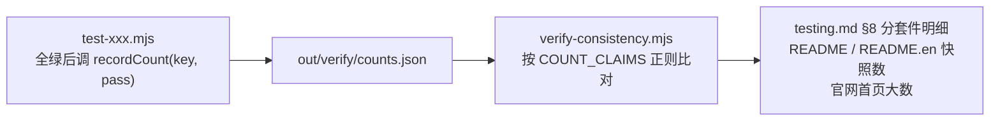

# 测试贡献规范

给贡献者与编码代理的操作指南（how-to）：在这个仓库里怎么加测试、加固件、登记计数、过门禁。门禁命令见 [AGENTS.md](../../AGENTS.md)，分套件命令见 §8，开发与调试命令见 [development.md](development.md)；本文解释每条约定背后的机制，写新测试前先读完。

## 1. 四条门禁各自拦什么

| 门禁 | 命令 | 拦截目标 | 为什么排这个位置 |
|---|---|---|---|
| 类型与静态检查 | `npm run check` | 走源码的 tsc 全仓类型错误；Biome 检查未使用的导入 / 变量、不可达代码、重复键等缺陷类规则 | 不需要构建，最快失败 |
| 测试 | `npm test` = `test:functional` + `test:editor:performance` | 行为回归、快照漂移、契约破坏 | 唯一入口清单，见 §2 |
| 构建 | `npm run build` | 九个发布包的产物编译与各能力边界审计（§6） | verify 要读 dist |
| 跨产物一致性 | `npm run verify` | 文档数字照抄旧值、死链、发布包清单漂移、`--dist` 复验 | 必须最后跑：读 dist 体积与测试落盘的断言数 |

## 2. 新增测试套件

1. 测试写进 `tooling/test-<name>.mjs`（Node 直跑，jsdom 供 DOM，esbuild 打 `src/` 后跑真实解析与渲染，不 mock 解析逻辑）。
2. `package.json` 挂 script，并**加入 `test:functional`**——它是本地 `npm test`、PR CI 与发布流水线共用的唯一入口，单独挂 script 不进清单就会漏跑。
3. 发布产物也要覆盖的能力，script 里支持 `--dist`（改从 `packages/*/dist` 加载），并把它加进 `npm run verify` 的 `--dist` 序列；否则只验了源码没验交付物。

Agent describe 使用 `pretest:functional` 接入同一个功能门禁，并由 `postverify` 校验 Schema、按需闭包与发布入口；本地和发布流水线通过 npm 执行，CI 自动展开同一份清单及其生命周期后分组执行。

模板二进制边界调用 npm 使用的 `@npmcli/map-workspaces`、`@npmcli/arborist` 与 `npm-packlist` 正式 API，覆盖全部非 private workspace，保留祖先忽略规则及捆绑依赖；仓库中的评测文稿不属于 SDK 交付物。三库在根开发依赖中锁定，审计不进入生命周期脚本；`preverify` 用真实 npm 清单对照及正反例验证边界，不允许发布包夹带 PPTX / POTX 等二进制模板。

此审计仅处理受控仓库配置，不接收 PPT 或 Agent 提供的 glob / ignore 模式。开发依赖仍有既有 glob / minimatch 审计告警，不能把工程门禁通过表述为 `npm audit` 清零。

官网语言与迟到响应契约将 `FontFaceSet.load` 的真实完成回调延后至场景清理，避免后台字体刷新与语言操作同时改变视图容器；原生结果、异常和全部视图/下载断言保留。测试在清理阶段恢复方法并移除脚本，`test:site:font-gate` 验证该边界；触屏场景用 CDP 输入能力仿真，并恢复原触点及 hover / pointer 能力。

[Agent 任务评测票据 008](../wayfinder/ppt-agent-interface/tickets/008-agent-task-eval.md)明确不作为发布门禁：其自测由 `npm run test:agent-eval` 独立执行，真实模型调用仅通过 `eval:agent:run` 显式发起，`eval:agent` 仅重判保存证据。确定性评测固件仍挂入统一生成与 CI 字节检查，不以模型成功率决定发布。

同一生命周期也执行布局检查及无 dist 的编辑基准回归。语料对照使用真实 Canvas 字宽和 SVG 前景/底图取色，Node 注入这些真实观测复核纯计算，另用真实 HarfBuzz Provider 覆盖七项正反例；未准备字宽不得作为最终报告交付。

布局检查的发布浏览器复验显式使用空 paths 配置，并审计构建输入图不含 packages/*/src，避免自动读取工作区 tsconfig 后混用源码与发布运行时。

### CI 分组与构建复用

`tooling/ci/plan.mjs` 从 npm scripts 推导执行计划；新增命令默认进入源码 editing / 产物 base 组，出现不支持的 shell 语法立即失败。变更分组时必须同步检查产物依赖，避免在新机器上依赖另一组未传输的文件。

| 组 | 顺序与产物依赖 |
|---|---|
| saving | 独立执行保存契约，尽早提供 PPTX，供 integration、browser、site 和模型外部打开验证并行消费 |
| editing | 核心、图表数据、媒体和模型测试直接并行；提供批注源码报告及集成所需的生成文件，保留图元的 LibreOffice 环境 |
| integration | 消费 saving 与 editing 产物执行 0.7 集成、外部打开及 0.8 完整清单；只上传已经齐备的最终 Office 工件 |
| browser-unit | 不依赖保存产物的页面、会话和浏览器工具契约，直接并行执行 |
| browser | 下载 saving 产物后执行官网真实浏览器契约及下载产物的外部打开；需要 PDF 独立读取依赖和 LibreOffice |
| agent / expanded / render / charts | 各组内部保留唯一入口顺序；源码和发布产物分别复验 |
| equivalence-0…3 | 按排序后的固件索引分片，每份恰好覆盖一次，仍在独立进程计算指纹 |
| migration-0 / migration-1 | 迁移形状矩阵与其余用例分别执行；从唯一 cases 对象核对完整顶层用例集合，保留逐用例进程及冷恢复子进程 |
| dist/base | 全部源码结果合并后才运行，核对文档计数、完成度、默认入口和跨产物契约 |
| external/office | 从 `test:ci:office` 执行完整模型清单和 OLE 真实打开；计数随源码结果合并，缺失即失败 |
| external/ooxml | 从 `test:ci:ooxml` 执行 XSD + Open XML SDK 双通道合法性门禁；下载 saving、integration 与 agent 分组的保存产物及 dist，计数随源码结果合并 |
| node-minimum | 在 `engines` 声明的最低 Node 上复验 MCP、Node 渲染与 ZIP 安全的发布产物 |
| check | 始终生成结论；代码提交要求全部 job 成功且执行计划、计数、固件全集完整，文档提交允许重任务跳过 |

每组写入 `out/ci-results/<phase>-<group>/`；合并校验提交 SHA、run ID、执行计划和实测计数，缺失或冲突立即失败。源码和 external 合并完成后才运行一致性校验，确保 OLE、OOXML 数字与官网总数也被实际核对；只有有真实数据依赖的 job 使用 `needs`。性能采样不在 PR CI 中执行（见 §7）。

`npm run build` 用 Turbo 的本地任务缓存复用完整串行构建，缓存包含九包 dist 与三份默认入口证明；源码、构建配置、依赖锁和实际 Node / 平台 / 架构参与缓存键。`node tooling/test-build-cache.mjs` 验证连续命中、环境失效及删除或篡改产物后的逐字节恢复，`npm run build -- --force` 可强制重建。

CI 的 npm / pip 下载缓存分别由 setup-node / setup-python 管理，不把 node_modules、浏览器 profile 或构建缓存放进 Actions 缓存。Pages 直接部署可信 push CI 已验证的站点产物，相关信任规则见 [releasing.md](releasing.md)。

纯文档路径跳过重任务；发布包内的 `packages/*/skills/**` 属于 Agent 工具输入，其 Markdown 改动仍触发完整验证。

## 3. 登记断言计数

文档与官网的断言数字由实测产生，链路是：

- `recordCount` 只在测试全绿路径调用（`tooling/lib/measured.mjs` 的约定：失败运行不留半截数字）。
- 文档里新增一处数字声明，必须同时在 `verify-consistency.mjs` 的 `COUNT_CLAIMS` 登记对应正则——漏登记不会被抽查，改了文案却没同步正则会报「正则没匹配到，文案改了就来这里同步」。
- 本地没跑过测试时 `counts.json` 不存在，verify 跳过这组而不判错；所以「verify 绿」要以前一轮跑过 `npm test` 为准。

## 4. 新增固件（fixture）

| 约定 | 原因 |
|---|---|
| 固件只能由 `tooling/make-*-fixture.mjs` 生成，手写 OOXML、内置编码器、零外部样本 | 字节必须确定性：CI 用 `git diff --exit-code --stat fixtures/` 验证重跑一致，生成脚本里出现时间戳或随机数会让任何人跑一次都带进 diff |
| 生成脚本挂进 `npm run fixtures`（依赖序复杂时用 `prefixtures` / `postfixtures` 两段） | 测试样本与脚本永远同步 |
| **新能力必须同时加固件** | 历史教训：隐藏页曾零固件覆盖，`skipHidden` 的真 bug 在近千项断言下存活；快照挡得住「变了」，挡不住「一开始就没测过」 |
| 固件本身必须是合法 OOXML（sequence 顺序、枚举取值、关系与 Content Types 闭合） | 引擎原样保留来源内容，固件里的非法结构会流进保存产物、被 OOXML 门禁（§7.6）拦下；「未知内容被保留」的探针用 `urn:web-ppt:*` 命名空间的属性或元素，放在 schema 允许扩展的位置（`extLst`），MS 扩展属性在根上声明 `mc:Ignorable` |

`.ppt` 样本特殊：LibreOffice 转换非确定性，`make-ppt-samples.mjs` 按**渲染结果**而非字节比对，内容没变就保留原文件。

`sample-metafile.pptx` 的项目自有 EMF/WMF 固定存于 `tooling/metafile-assets/`，清单记录来源、字节数和 SHA256；生成器不读取 `out/` 中的本机 LibreOffice 缓存。更换资源必须明确更新基线，缺失或损坏不能跳过生成。

## 5. 渲染快照基线

- 基线在 `test/snapshots/`（`fixture × 页 × 两条文本路径`），比对前归一化 blob URL、data URI（转摘要）与 defs id，跨机器稳定。
- 有意的渲染改动：`UPDATE_SNAPSHOTS=1 npm run test:core` 更新基线，然后 `git diff test/snapshots/` 逐行确认符合预期再提交——自动更新不是免审。
- 快照只证明「没变」。判断保真度用 LibreOffice ground truth：`npm run compare <file>` 产出 SSIM / MAE / 热力图，用途是横向比较改动前后与定位整片偏色，不是及格线。
- 渲染结果同进程不可重复（defs id 来自跨解析累加的全局计数器），比对渲染指纹必须独立进程，见 `tooling/lib/ppt-fingerprint.mjs`。

## 6. 边界审计与门禁契约

- `tooling/check-*-boundary.mjs` 系列守模块边界：模板配方必须只在 `edit-core/templates` 动态入口（默认入口不许碰运气靠 tree-shaking）、图表数据、媒体、chartex、字体字形、站点 i18n 等，多数在 `npm run build` 末尾对 dist 产物做 sentinel 检查；`check-architecture-boundary.mjs` 则审计源码的分层依赖方向（render 白名单、geometry 零依赖、DOM 边界、包依赖单向），规则见 [architecture-rules.md](architecture-rules.md)，build 与 verify 双挂。
- `test-test-gate-contract.mjs`（verify 第一步）守的是测试框架自身的契约——失败用例必须把 request 传给后续打开检查这类门禁有效性，属于「测试自己的测试」。
- 测试套件经过变异验证：把已修复的 bug 逐个改回去确认能被抓到，新增回归锚点时照此自检。

## 7. 性能门禁的现状

浏览器性能契约（如复制 16ms 预算）受宿主并行负载影响，历史上固定基线曾从 5ms 漂到 40ms。因此 PR CI 与发布流水线不跑性能采样，`performance.yml` 每周一在 master 上采样 `test:editor:performance` 与 `bench:edit` 观察趋势；本地 `npm test` 仍包含编辑器性能采样，独立运行（隔离环境）必须过预算。判定性能回归时先跑隔离复测，再下结论。

## 7.5 本地跑不全的套件

`npm run test:site:i18n` 的触屏悬停契约（`site-present-bar-browser-contract`）依赖 `Emulation.setEmulatedMedia` 改写 `hover` / `pointer` 媒体特性：CI 的 Linux headless Chrome 没有输入设备、默认即 `(hover: none)`，断言恒过；macOS Chrome 实测（2026-10-30 headless 最小复现）仿真不生效、`matchMedia` 仍报可悬停，本地必红。本地验证该套件的其他契约时跑到此断言即止，以 CI 结果为准。

## 7.6 OOXML 合法性门禁

`npm run test:ooxml`（票据 [桌面 005](../wayfinder/ppt-desktop-parity/tickets/005-ooxml-validation-gate.md)）对**全部保存产物**做两道独立校验，任一错误失败并打印错误 Id、部件与 XPath：

| 通道 | 工具 | 覆盖 |
|---|---|---|
| 结构校验 | `xmllint` + ECMA-376 5th edition Transitional XSD（下载经 SHA256 钉版，见 `prepare-ooxml-schemas.mjs`） | 每个部件按根命名空间映射到 XSD，sequence 顺序、必填子元素、枚举与取值范围 |
| 语义校验 | .NET `OpenXmlValidator`（`tooling/ooxml-validate/`，Microsoft365 档案） | 属性共存约束、关系目标存在性、跨部件不变量 |

输入集是 `out/edit-save`、`out/v07-integration`、`out/v08-integration` 的 office-artifacts 清单加 `out/agent-tools`、`out/agent-mcp`、`out/template-fill` 的生成产物——所以必须**先跑功能测试**再跑本门禁（`pretest:ooxml` 只负责 build 与 .NET 还原）。人为注入的结构错误（改坏根元素）与语义错误（关系目标缺失）各一例必须被拦截（负例测试）。CI 中作为 `external/ooxml` 分组在构建与产出这些产物的分组之后执行；依赖 `xmllint`（Ubuntu: `libxml2-utils`）与 .NET SDK 8。

两道通道校验**同一份等价归一化副本**（SDK 通道把归一化后的部件重新打包，包结构与关系不变），归一化只剥非 OOXML 词汇：MCE `AlternateContent` 取 Fallback 展开并按根 `mc:Ignorable` 丢弃可忽略前缀；`urn:web-ppt:*` 的测试标记（固件用来证明未知内容被保留的探针，其存活性由功能断言负责），标记剥空后的 `ext` 空壳整只移除，但 `<ext uri="urn:web-ppt:*">` 是产品写入的真实扩展（如图表数据身份清单），内容原样保留；`a:t` 上的 `xml:space="preserve"`。SDK 的 `[load-error]`（包无法加载）与 `[Sch_*]` / `[Sem_*]` 一样计为失败。例外逐条登记在 `tooling/lib/ooxml-validation.mjs`（XSD 与生态实践的已知分歧，如 `buSzPct` 千分比整数；`a:p` 内的裸 `m:oMath` 两个校验器都不认，双通道放行；无 ECMA XSD 的 chartex / InkML 部件），**不允许按部件或文件整类忽略**，新增例外必须写明规则形态与原因。

通过校验不等于 PowerPoint 验收通过：XSD 与 SDK 都不覆盖渲染语义和 PowerPoint 的私有宽容度，Windows 真机门禁（[powerpoint-runner.md](powerpoint-runner.md)）仍是正式发布条件。反过来，LibreOffice 能容忍的顺序错误 PowerPoint 会要求修复——本门禁正是为这类差距存在。

## 8. 测试套件

`npm test` 运行全部功能套件；下表的分套件命令用于定位问题。断言数由 §3 的链路实测比对，改文案前先跑测试拿实测值。

| 命令 | 覆盖 |
|---|---|
| `npm run test:core` | 核心解析 / 渲染，2491 项断言 + 212 个渲染快照 |
| `npm run test:zip` | ZIP 安全 57 项断言：中央目录、声明与实际大小、条目数、压缩比、重复名称、路径穿越、真实 parse 与内存峰值；`test:zip:dist` 复验发布入口 |
| `npm run test:describe` | Agent 结构化读出：全部固件 Schema 校验、两独立进程字节一致与逐 ID 选择；另验组合变换、当前设计投影、只读及预算错误；发布入口由 `test:describe:dist` 复验 |
| `npm run test:lint` | 布局七项正反例、真实字体、普通组合去重、裁剪、复杂采样、取消及只读；全固件 Node/Canvas reason 对照与独立进程确定性；发布入口由 `test:lint:dist` 复验 |
| `npm run test:agent` | Agent 命令工具面 79 项断言：全命令 Schema、三类原子拒绝、超链接与设计目标区分、批量一次撤销、样式 / lint / 渲染、补丁 / 生成保存；发布入口由 `test:agent:dist` 复验，`test:agent:libreoffice` 补充外部读取器证据 |
| `npm run test:mcp` | 本机 MCP 58 项断言：包清单唯一来源的真实握手版本、文件会话、并发顺序、关闭等待文件写入、交付成功后确认保存点、取消、原子保存、真实 stdio 全链路、根 Schema、无网络调用与发布边界；`test:mcp:dist` 复验，真实 Claude Code / Codex 任务由 `validate-agent-mcp-evaluation.mjs` 机判 |
| `npm run test:webmcp` | 官网 WebMCP 127 项浏览器断言：工具注册、真实编辑与保存重开、渲染、同一历史、恢复、协同、只读、取消及切换；注册平台边界可注入失败，不支持路径检查动态块未加载，原生浏览器另验 |
| `npm run test:fill` | 模板填充 483 项 + 浏览器 70 项断言：六类页面、八种原生图表、完整七项检查与副本设计修复、POTX 类型转换、输入保护、Unicode、调用快照、裁剪精度、动态字段、备注闭包、独立进程确定性和双文字路径；`test:fill:dist` 检查类型、Schema、按需闭包和纯发布入口 |
| `npm run test:agent-eval` | 独立评测自测：八类输入/参考固件、真实字体、完整七项检查、原文/可见性/媒体/原生设计保护、实际 MCP 修复可达性，以及进程、协议变换、保存哈希和证据完整性；不调用模型，不进入发布门禁 |
| `npm run test:fonts` | 字体 Provider 100 + Worker 136 + 文稿 30 + 测量 15 项断言；另含真实浏览器字体文稿 112 项断言、缺字诊断及取消 / 释放验收，[接口与边界](../api/font-glyphs.md) |
| `node tooling/test-agent-node-render.mjs` | Agent Node 渲染 21 项断言：缺测字 / 光栅化注入的稳定 reason、注入渲染、跨进程确定性、HarfBuzz 真实测量整页渲染与 PNG 尺寸换算；`--dist` 复验 `@web-ppt/core/node` 发布入口 |
| `node tooling/test-agent-node-render-parity.mjs` | Agent Node 双端对照 4 项断言：同一字体字节双端注册（浏览器 FontFace / Node Provider）下全部固件整页 SVG 指纹比对，差异页必须归因（公式测量源 / textPath 字距放大）；缺字固件不满足同一字体前提，跳过并计数；`--dist` 复验 |
| `npm run test:animation` | 动画统一验收 809 项断言：全部动画效果与切换共用同一套 Web Animations 驱动，`currentTime` seek 到 t=0 / 0.5 / 1 断言计算样式端点 == 关键帧声明、中点命中精确中间帧或严格介于两端、painted 包围盒按效果族核对（fly 离场 / 伸展锚边 / 运动路径终点位移）；morph 断言子元素级配对进度；代表性效果中间态截图落盘 `out/animation-acceptance/midpoints/`。新效果进 `sample-animation-effects.pptx` 固件矩阵即自动纳入；`test:animation:dist` 复验发布入口 |
| `npm run test:ole:libreoffice` | OLE 外部打开 11 项断言：嵌入 DOCX run 改字与 XLSX 样式 / 富文本改写后重组为独立文档，LibreOffice 打开转换（fodt / fods / xlsx）核对文字、颜色与 run 边界；CI 在功能测试后单独执行 |
| `npm run test:ooxml` | OOXML 合法性 4 项断言：全部保存产物过 ECMA-376 XSD 与 OpenXmlValidator 双通道，结构与语义负例各一例必须被拦截（§7.6）；依赖 xmllint 与 .NET 8，先跑功能测试落盘产物 |
| `npm run test:edit` | 编辑模型 1154 项 + 保存 584 项 + PowerPoint 证据 9 项 + 181 份固件、1210 对独立进程 SVG 指纹 |
| `npm run test:templates` | 内置模板 29 项断言：确定性生成、编辑/恢复、保存与双文字路径指纹 |
| `npm run test:design-journey` | 设计旅程 31 项断言：模板 → 主题 → 母版 → 版式 → 普通页面 → 保存重开，三套模板、权限隔离、恢复、补丁/生成保存与 `.ppt` 另存 |
| `npm run test:chart-media` | 经典图表数据编辑 258 项断言：类别/散点/气泡/组合图、历史、协同、缓存与工作簿同步；兼容回退 197 项断言 |
| `npm run test:chartex` | ChartEx 原生 104 项断言：层级与统计边界、配置继承、两种文本及保存路径 |
| `npm run test:comments` | 批注保存与导出 31 项断言：复制/恢复、两条保存、只读面板、默认关闭与安全转义；[批注交付](../api/comments.md) |
| `npm run test:media` | 媒体插入 892 项断言：WAV/MP4、外链、海报、历史、复制、恢复/协同、两种保存、经典引用为 NULL 时回退 p14:media 和严格 XML；[阶段 API](../api/media-insertion.md) |
| `npm run test:editor` | 451 项会话 / adapter / 三层 DOM / 选择变换 / 文字、触屏与 engine 行盒断言 + 真实 Chrome 框架生命周期、可信输入、系统剪贴板、pointer capture 与性能门禁 |
| `node tooling/test-open-kind.mjs` | 打开前认文件 19 项断言：魔数识别、扩展名不能盖过魔数、word/excel/odp 识别、错误映射与拒绝 |
| `node tooling/test-open-page.mjs` | 页码参数解析与回写 32 项断言：非法值钳制、`?p=` 迁移、hash 保留与清空 |
| `npm run test:collab` | 字段级协同 134 项断言：双副本收敛、离线回放、协议与原子提交、保存、BroadcastChannel 契约与排除 peer 的测试薄包体积 |
| `npm run test:adapters` | React / Vue 的 12 项 SSR、依赖边界、公开入口与排除 peer 后 5KB 体积门禁 |
| `npm run test:metafile` | EMF / WMF / PICT 解码器，130 项断言 + 模糊测试 |
| `npm run test:metafile:fixture` | 图元固件确定性 115 项断言：原有复杂媒体保留、缓存独立、资源哈希、失败不覆盖和双进程重建；`test:metafile:fixture:dist` 使用发布入口复验 |
| `npm run test:expanded` | 扩展能力 2047 项断言；`test:expanded:dist` 验证独立发布入口，参见[能力矩阵](../api/expanded-capabilities.md) |
| `npm run test:portability` | 高级文本流转 797 项断言；`test:portability:dist` 验证发布入口，参见[公式、艺术字与文字效果](../api/portable-rich-text.md) |
| `npm run test:chart-hierarchy` | 多级类别 178 项断言；源码与发布入口、层级/空槽、工作簿、历史、协同及重建；[支持矩阵](../api/chart-hierarchical-categories.md) |
| `npm run test:edit:equivalence` | 单独运行全固件只读 / 编辑投影逐字节等价门禁 |
| `npm run test:edit:m1` | M1 最小写回验收 + 71 份模型保存产物的 LibreOffice 真实打开测试 |
| `npm run test:edit:libreoffice` | 用 LibreOffice 打开补丁保存产物并导出 PDF |
| `npm run test:design-journey:libreoffice` | 用 LibreOffice 无修复打开设计旅程单一清单中的 11 份跨能力产物 |
| `npm run test:templates:libreoffice` | 兼容命令；转发到同一份设计旅程 LibreOffice 清单，不再维护模板子集 |
| `npm run test:edit:powerpoint` | Windows + PowerPoint：禁用修复后用 COM 打开同一份设计旅程十一件清单，运行手册见 [powerpoint-runner.md](powerpoint-runner.md) |

## 9. 测试分层

在 Node 里用 jsdom 提供 DOM，esbuild 把 `src/` 打成 ESM 后跑真实解析与渲染——不 mock 任何解析逻辑。

| 层次 | 覆盖 |
|---|---|
| **结构断言** | 几何（54 形状 × 5 组调节值 + 648 例模糊输入）、颜色、文本继承链、动画/切换、播放引擎、表格还原、图表、文本提取 |
| **不变量** | 每个元素包围盒有限、路径无 `NaN`、Schema 必填字段齐全、SVG 结构合法、无悬空 `url(#id)`、无重复 id、导出路径无 `foreignObject` |
| **渲染快照** | 30 个测试文件 × 全部页 × 两条文本路径 = 212 个归一化 SVG 基线，逐字节比对（更新流程见 §5） |
| **回归锚点** | 针对已修复的真实 bug 写死断言：`.ppt` 字号错位、动画时长取错节点、飞入方向映射反、BLIP 未解压 |
| **健壮性** | 70 例畸形输入——截断（5%~95%）、随机字节破坏、空文件、假魔数、全零；要求要么正常解析、要么抛可读 Error，不得崩溃或吐半成品。单个形状解析失败只降级为占位，不连累整页 |
| **查看器交互** | 超链接分流（内部跳页 vs 外链回调）、索引夹紧、destroy 清理 |

变异验证记录：把已修复的 bug 逐个改回去后的捕获情况。

| 变异 | 捕获 |
|---|---|
| 填充规则 `nonzero` → `evenodd` | 40 项 |
| `.ppt` 段落字段表插入错位字段 | 33 项 |
| 关闭几何安全网 | 47 例模糊输入越界 |
| 单元格边框标签拼回 `lnLeft` | 2 项 |
| `shade` 退回 sRGB 空间 | 3 项 |
| `cs` 字体不进字体栈 | 1 项 |

单元格边框那个 bug 是被**外部 ground truth 对照**抓出来的，而非测试套件：快照与 LibreOffice 对照互补，缺一不可。

## 10. 代表性固件

全部固件由 `npm run fixtures` 确定性生成；下表列出覆盖面最广的几份。

可选 Agent 评测的八类输入与参考产物另存于 `tooling/agent-eval/fixtures/`，由同一生成入口覆盖，但不改变下表默认解析样本计数；其 `manifest.json` 记录每份生成字节的 SHA256。

| 文件 | 覆盖内容 |
|---|---|
| `showcase.pptx` | 预设形状 / 效果 / 填充 / 线条箭头 / 文字特性 / 表格 / 图片 / custGeom / 嵌套组合 / 3D / 动画 / 7 种切换 |
| `sample-chart.pptx` | 14 个图表：柱 / 条 / 堆叠 / 折线 / 面积 / 饼 / 环 / 散点 / 次坐标轴组合 / 3D 柱 / 3D 饼 |
| `sample-effects.pptx` | 内/外阴影 / 发光 / 柔化 / 倒影 / 15 种艺术字变形 / RTL |
| `sample-media.pptx` | 视频/音频封面 / 墨迹 / 评论 / 分节 / 气泡·股价·复合饼·曲面图 |
| `sample-metafile.pptx` | 内嵌 EMF 与 WMF |
| `sample.pptx` · `sample.ppt` | 母版继承 / 最小合法 CFB |
| `sample-hidden.pptx` · `.ppt` | 隐藏页导航：可见 · 隐 · 隐 · 可见 · 隐（pptx 走 `sld@show`，ppt 走 `F_HIDDEN`） |
| `sample-cjk-squeeze.pptx` | 标点挤压完整规则：连续标点对 / 行首开标点 / 行尾句读 / 放不下才挤 / 无标点对照 |
| `sample-autofit.pptx` | 文本自动缩放五种情形（溢出/放得下 × 裸 normAutofit、无 autofit、显式 fontScale、缩到 25% 下限），外加百分比行距与绝对行距的对照 |
| `sample-placeholder.pptx` | 占位符几何继承：图片占位符空 spPr / 图片自带 xfrm / 形状占位符 |
| `sample-agent-describe.pptx` | Agent 结构化读出：版式/母版占位符链、组合缩放、段落层级、中文与代理对、节、备注和隐藏页 |
| `sample-agent-lint.pptx` | 七项检查的正反例及裁剪反例；对比度临界颜色验证比较前不四舍五入 |
| `sample-agent-tools.pptx` | Agent 命令工具面：可编辑标题、越界观察与第二页；用于原子命令、历史和两种保存 |
| `sample-agent-mcp.pptx` | 本机 MCP：标题、溢出文本与可替换图片；用于真实 stdio 及 Claude Code / Codex 四项任务 |
| `sample-agent-webmcp.pptx` | 官网 WebMCP：两页同文标题、溢出文本与可替换图片，覆盖全稿编辑、浏览器资源和保存重开 |
| `sample-template-fill.pptx` | 模板填充：六种占位符版式、两页原始示例与包内保留锚点；覆盖生成、替换原始示例、图表和输入保护 |
| `sample-wps-interop.pptx` | WPS / PowerPoint 默认结构：fontRef 白字与显式颜色对照、仅 svgBlip 图标、两种楔形标注尾巴方向、归一化组合内标注、bgRef 1001 背景、拉丁与阿拉伯文的 cs 字体 |
| `sample-ole.pptx` | OLE 预览图：可解码格式渲染成图片 / 认不出的格式退回占位框 |
| `sample-embedfont.pptx` | 嵌入字体的四种容器：未压缩 EOT / 未压缩+异或 / 标记 MTX 压缩 / 裸 TTF |

`.ppt` 样本由 `npm run ppt-samples` 用 LibreOffice 从 pptx 转换（pptx 固件变更后需重跑），保留策略见 §4。
