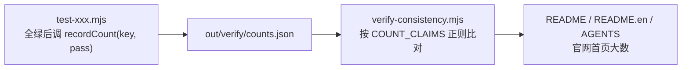

# 测试贡献规范

给贡献者与编码代理的操作指南（how-to）：在这个仓库里怎么加测试、加固件、登记计数、过门禁。门禁命令见 [AGENTS.md](../../AGENTS.md)，分套件命令见 §8，开发与调试命令见 [development.md](development.md)；本文解释每条约定背后的机制，写新测试前先读完。

## 1. 四条门禁各自拦什么

| 门禁 | 命令 | 拦截目标 | 为什么排这个位置 |
|---|---|---|---|
| 类型检查 | `npm run check` | 走源码的 tsc 全仓类型错误 | 不需要构建，最快失败 |
| 测试 | `npm test` = `test:functional` + `test:editor:performance` | 行为回归、快照漂移、契约破坏 | 唯一入口清单，见 §2 |
| 构建 | `npm run build` | 八个包的产物编译 + 七个边界审计（§6） | verify 要读 dist |
| 跨产物一致性 | `npm run verify` | 文档数字照抄旧值、死链、发布包清单漂移、`--dist` 复验 | 必须最后跑：读 dist 体积与测试落盘的断言数 |

## 2. 新增测试套件

1. 测试写进 `tooling/test-<name>.mjs`（Node 直跑，jsdom 供 DOM，esbuild 打 `src/` 后跑真实解析与渲染，不 mock 解析逻辑）。
2. `package.json` 挂 script，并**加入 `test:functional`**——它是本地 `npm test`、PR CI 与发布流水线共用的唯一入口，单独挂 script 不进清单就会漏跑。
3. 发布产物也要覆盖的能力，script 里支持 `--dist`（改从 `packages/*/dist` 加载），并把它加进 `npm run verify` 的 `--dist` 序列；否则只验了源码没验交付物。

Agent describe 使用 `pretest:functional` 接入同一个功能门禁，并由 `postverify` 校验 Schema、按需闭包与发布入口；CI 和发布流水线的 npm 调用均包含这些生命周期脚本。

同一生命周期也执行布局检查及无 dist 的编辑基准回归。语料对照使用真实 Canvas 字宽和 SVG 前景/底图取色，Node 注入这些真实观测复核纯计算，另用真实 HarfBuzz Provider 覆盖七项正反例；未准备字宽不得作为最终报告交付。

布局检查的发布浏览器复验显式使用空 paths 配置，并审计构建输入图不含 packages/*/src，避免自动读取工作区 tsconfig 后混用源码与发布运行时。

## 3. 登记断言计数

文档与官网的断言数字由实测产生，链路是：

- `recordCount` 只在测试全绿路径调用（`tooling/lib/measured.mjs` 的约定：失败运行不留半截数字）。
- 文档里新增一处数字声明，必须同时在 `verify-consistency.mjs` 的 `COUNT_CLAIMS` 登记对应正则——漏登记不会被抽查，改了文案却没同步正则会报「正则没匹配到，文案改了就来这里同步」。
- 本地没跑过测试时 `counts.json` 不存在，verify 跳过这组而不判错；所以「verify 绿」要以前一轮跑过 `npm test` 为准。

## 4. 新增固件（fixture）

| 约定 | 原因 |
|---|---|
| 固件只能由 `tooling/make-*-fixture.mjs` 生成，手写 OOXML、内置编码器、零外部样本 | 字节必须确定性：CI 用 `git diff --exit-code --stat fixtures/` 验证重跑一致，生成脚本里出现时间戳或随机数会让任何人跑一次都带进 diff |
| 生成脚本挂进 `npm run fixtures`（依赖序复杂时用 `prefixtures` / `postfixtures` 两段） | 测试样本与脚本永远同步 |
| **新能力必须同时加固件** | 历史教训：隐藏页曾零固件覆盖，`skipHidden` 的真 bug 在近千项断言下存活；快照挡得住「变了」，挡不住「一开始就没测过」 |

`.ppt` 样本特殊：LibreOffice 转换非确定性，`make-ppt-samples.mjs` 按**渲染结果**而非字节比对，内容没变就保留原文件。

## 5. 渲染快照基线

- 基线在 `test/snapshots/`（`fixture × 页 × 两条文本路径`），比对前归一化 blob URL、data URI（转摘要）与 defs id，跨机器稳定。
- 有意的渲染改动：`UPDATE_SNAPSHOTS=1 npm run test:core` 更新基线，然后 `git diff test/snapshots/` 逐行确认符合预期再提交——自动更新不是免审。
- 快照只证明「没变」。判断保真度用 LibreOffice ground truth：`npm run compare <file>` 产出 SSIM / MAE / 热力图，用途是横向比较改动前后与定位整片偏色，不是及格线。
- 渲染结果同进程不可重复（defs id 来自跨解析累加的全局计数器），比对渲染指纹必须独立进程，见 `tooling/lib/ppt-fingerprint.mjs`。

## 6. 边界审计与门禁契约

- `tooling/check-*-boundary.mjs` 系列守模块边界：模板配方必须只在 `edit-core/templates` 动态入口（默认入口不许碰运气靠 tree-shaking）、图表数据、媒体、chartex、字体字形、站点 i18n 等，多数在 `npm run build` 末尾对 dist 产物做 sentinel 检查；`check-architecture-boundary.mjs` 则审计源码的分层依赖方向（render 白名单、geometry 零依赖、DOM 边界、包依赖单向），规则见 [architecture-rules.md](architecture-rules.md)，build 与 verify 双挂。
- `test-test-gate-contract.mjs`（verify 第一步）守的是测试框架自身的契约——失败用例必须把 request 传给后续打开检查这类门禁有效性，属于「测试自己的测试」。
- 测试套件经过变异验证：把已修复的 bug 逐个改回去确认能被抓到，新增回归锚点时照此自检。

## 7. 性能门禁的现状

浏览器性能契约（如复制 16ms 预算）受宿主并行负载影响，历史上固定基线曾从 5ms 漂到 40ms。现状：CI 与发布流水线保留采样并落红灯证据，但 `continue-on-error` 不阻断发布；独立运行（隔离环境）则必须过预算。判定性能回归时先跑隔离复测，再下结论。

## 7.5 本地跑不全的套件

`npm run test:site:i18n` 的触屏悬停契约（`site-present-bar-browser-contract`）依赖 `Emulation.setEmulatedMedia` 改写 `hover` / `pointer` 媒体特性：CI 的 Linux headless Chrome 没有输入设备、默认即 `(hover: none)`，断言恒过；macOS Chrome 实测（2026-10-30 headless 最小复现）仿真不生效、`matchMedia` 仍报可悬停，本地必红。本地验证该套件的其他契约时跑到此断言即止，以 CI 结果为准。

## 8. 测试套件

`npm test` 运行全部功能套件；下表的分套件命令用于定位问题。断言数由 §3 的链路实测比对，改文案前先跑测试拿实测值。

| 命令 | 覆盖 |
|---|---|
| `npm run test:core` | 核心解析 / 渲染，2592 项断言 + 212 个渲染快照 |
| `npm run test:describe` | Agent 结构化读出：全部固件 Schema 校验、两独立进程字节一致与逐 ID 选择；另验组合变换、当前设计投影、只读及预算错误；发布入口由 `test:describe:dist` 复验 |
| `npm run test:lint` | 布局七项正反例、真实字体、普通组合去重、裁剪、复杂采样、取消及只读；全固件 Node/Canvas reason 对照与独立进程确定性；发布入口由 `test:lint:dist` 复验 |
| `npm run test:fonts` | 字体 Provider 100 + Worker 136 + 文稿 30 + 测量 15 项断言；另含真实浏览器字体、缺字诊断及取消 / 释放验收，[接口与边界](../api/font-glyphs.md) |
| `node tooling/test-agent-node-render.mjs` | Agent Node 渲染 21 项断言：缺测字 / 光栅化注入的稳定 reason、注入渲染、跨进程确定性、HarfBuzz 真实测量整页渲染与 PNG 尺寸换算；`--dist` 复验 `@web-ppt/core/node` 发布入口 |
| `node tooling/test-agent-node-render-parity.mjs` | Agent Node 双端对照 4 项断言：同一字体字节双端注册（浏览器 FontFace / Node Provider）下全部固件整页 SVG 指纹比对，差异页必须归因（公式测量源 / textPath 字距放大）；缺字固件不满足同一字体前提，跳过并计数；`--dist` 复验 |
| `npm run test:edit` | 编辑模型 1154 项 + 保存 575 项 + PowerPoint 证据 9 项 + 177 份固件、1196 对独立进程 SVG 指纹 |
| `npm run test:templates` | 内置模板 29 项断言：确定性生成、编辑/恢复、保存与双文字路径指纹 |
| `npm run test:v07` | 0.7 跨能力集成 31 项断言：三套模板、权限隔离、恢复、补丁/生成保存与 `.ppt` 另存 |
| `npm run test:v08` | 经典图表数据编辑 258 项断言：类别/散点/气泡/组合图、历史、协同、缓存与工作簿同步；兼容回退 197 项断言 |
| `npm run test:chartex` | ChartEx 原生 104 项断言：层级与统计边界、配置继承、两种文本及保存路径 |
| `npm run test:comments` | 批注保存与导出 31 项断言：复制/恢复、两条保存、只读面板、默认关闭与安全转义；[批注交付](../api/comments.md) |
| `npm run test:media` | 媒体插入 892 项断言：WAV/MP4、外链、海报、历史、复制、恢复/协同、两种保存、经典引用为 NULL 时回退 p14:media 和严格 XML；[阶段 API](../api/media-insertion.md) |
| `npm run test:editor` | 451 项会话 / adapter / 三层 DOM / 选择变换 / 文字、触屏与 engine 行盒断言 + 真实 Chrome 框架生命周期、可信输入、系统剪贴板、pointer capture 与性能门禁 |
| `npm run test:adapters` | React / Vue 的 12 项 SSR、依赖边界、公开入口与排除 peer 后 5KB 体积门禁 |
| `npm run test:metafile` | EMF / WMF / PICT 解码器，130 项断言 + 模糊测试 |
| `npm run test:expanded` | 扩展能力 2047 项断言；`test:expanded:dist` 验证独立发布入口，参见[能力矩阵](../api/expanded-capabilities.md) |
| `npm run test:portability` | 高级文本流转 797 项断言；`test:portability:dist` 验证发布入口，参见[公式、艺术字与文字效果](../api/portable-rich-text.md) |
| `npm run test:chart-hierarchy` | 多级类别 178 项断言；源码与发布入口、层级/空槽、工作簿、历史、协同及重建；[支持矩阵](../api/chart-hierarchical-categories.md) |
| `npm run test:edit:equivalence` | 单独运行全固件只读 / 编辑投影逐字节等价门禁 |
| `npm run test:edit:m1` | M1 最小写回验收 + 71 份模型保存产物的 LibreOffice 真实打开测试 |
| `npm run test:edit:libreoffice` | 用 LibreOffice 打开补丁保存产物并导出 PDF |
| `npm run test:v07:libreoffice` | 用 LibreOffice 无修复打开 0.7 单一清单中的 11 份跨能力产物 |
| `npm run test:templates:libreoffice` | 兼容命令；转发到同一份 0.7 LibreOffice 清单，不再维护模板子集 |
| `npm run test:edit:powerpoint` | Windows + PowerPoint：禁用修复后用 COM 打开同一份 0.7 十一件清单，运行手册见 [powerpoint-runner.md](powerpoint-runner.md) |

## 9. 测试分层

在 Node 里用 jsdom 提供 DOM，esbuild 把 `src/` 打成 ESM 后跑真实解析与渲染——不 mock 任何解析逻辑。

| 层次 | 覆盖 |
|---|---|
| **结构断言** | 几何（54 形状 × 5 组调节值 + 648 例模糊输入）、颜色、文本继承链、动画/切换、播放引擎、表格还原、图表、文本提取 |
| **不变量** | 每个元素包围盒有限、路径无 `NaN`、Schema 必填字段齐全、SVG 结构合法、无悬空 `url(#id)`、无重复 id、导出路径无 `foreignObject` |
| **渲染快照** | 30 个测试文件 × 全部页 × 两条文本路径 = 212 个归一化 SVG 基线，逐字节比对（更新流程见 §5） |
| **回归锚点** | 针对已修复的真实 bug 写死断言：`.ppt` 字号错位、动画时长取错节点、飞入方向映射反、BLIP 未解压 |
| **健壮性** | 70 例畸形输入——截断（5%~95%）、随机字节破坏、空文件、假魔数、全零；要求要么正常解析、要么抛可读 Error，不得崩溃或吐半成品。单个形状解析失败只降级为占位，不连累整页 |
| **查看器交互** | 超链接分流（内部跳页 vs 外链回调）、索引夹紧、destroy 清理 |

变异验证记录：把已修复的 bug 逐个改回去后的捕获情况。

| 变异 | 捕获 |
|---|---|
| 填充规则 `nonzero` → `evenodd` | 40 项 |
| `.ppt` 段落字段表插入错位字段 | 33 项 |
| 关闭几何安全网 | 47 例模糊输入越界 |
| 单元格边框标签拼回 `lnLeft` | 2 项 |
| `shade` 退回 sRGB 空间 | 3 项 |
| `cs` 字体不进字体栈 | 1 项 |

单元格边框那个 bug 是被**外部 ground truth 对照**抓出来的，而非测试套件：快照与 LibreOffice 对照互补，缺一不可。

## 10. 代表性固件

全部固件由 `npm run fixtures` 确定性生成；下表列出覆盖面最广的几份。

| 文件 | 覆盖内容 |
|---|---|
| `showcase.pptx` | 预设形状 / 效果 / 填充 / 线条箭头 / 文字特性 / 表格 / 图片 / custGeom / 嵌套组合 / 3D / 动画 / 7 种切换 |
| `sample-chart.pptx` | 14 个图表：柱 / 条 / 堆叠 / 折线 / 面积 / 饼 / 环 / 散点 / 次坐标轴组合 / 3D 柱 / 3D 饼 |
| `sample-effects.pptx` | 内/外阴影 / 发光 / 柔化 / 倒影 / 15 种艺术字变形 / RTL |
| `sample-media.pptx` | 视频/音频封面 / 墨迹 / 评论 / 分节 / 气泡·股价·复合饼·曲面图 |
| `sample-metafile.pptx` | 内嵌 EMF 与 WMF |
| `sample.pptx` · `sample.ppt` | 母版继承 / 最小合法 CFB |
| `sample-hidden.pptx` · `.ppt` | 隐藏页导航：可见 · 隐 · 隐 · 可见 · 隐（pptx 走 `sld@show`，ppt 走 `F_HIDDEN`） |
| `sample-cjk-squeeze.pptx` | 标点挤压完整规则：连续标点对 / 行首开标点 / 行尾句读 / 放不下才挤 / 无标点对照 |
| `sample-autofit.pptx` | 文本自动缩放五种情形（溢出/放得下 × 裸 normAutofit、无 autofit、显式 fontScale、缩到 25% 下限），外加百分比行距与绝对行距的对照 |
| `sample-placeholder.pptx` | 占位符几何继承：图片占位符空 spPr / 图片自带 xfrm / 形状占位符 |
| `sample-agent-describe.pptx` | Agent 结构化读出：版式/母版占位符链、组合缩放、段落层级、中文与代理对、节、备注和隐藏页 |
| `sample-agent-lint.pptx` | 七项检查的正反例及裁剪反例；对比度临界颜色验证比较前不四舍五入 |
| `sample-wps-interop.pptx` | WPS / PowerPoint 默认结构：fontRef 白字与显式颜色对照、仅 svgBlip 图标、两种楔形标注尾巴方向、归一化组合内标注、bgRef 1001 背景、拉丁与阿拉伯文的 cs 字体 |
| `sample-ole.pptx` | OLE 预览图：可解码格式渲染成图片 / 认不出的格式退回占位框 |
| `sample-embedfont.pptx` | 嵌入字体的四种容器：未压缩 EOT / 未压缩+异或 / 标记 MTX 压缩 / 裸 TTF |

`.ppt` 样本由 `npm run ppt-samples` 用 LibreOffice 从 pptx 转换（pptx 固件变更后需重跑），保留策略见 §4。
