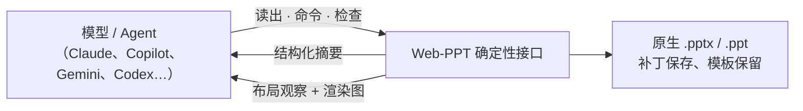

# AI 与演示文稿：行业现状与本仓库定位

> 调研于 2026-10-15，基线 `68781e5`。结论：生成入口已被 Office 套件与大模型厂商占据，竞争点转向「生成后能否继续改」和「能否被 Agent 可靠地验证」。本仓库不做模型与生成服务，转而提供 Agent 读写 PPT 所需的确定性接口：结构化读出、布局检查、无 Office 渲染、原生命令编辑与模板保留保存。路线见 [roadmap §7](../roadmap.md#7-下一步计划与交付)。

## 1. 产品格局

| 类别 | 代表 | 2026 现状 | 产物形态 |
|---|---|---|---|
| Office 套件内置 | Copilot in PowerPoint（Agent Mode）、Gemini in Google Slides、WPS AI | Agent Mode 2026-02 起在 PowerPoint 网页版推送，随后桌面版；Gemini 于 2026-06 底支持单提示生成完整可编辑幻灯片 | 原生可编辑文稿，保留品牌与版式 |
| 大模型厂商 | Claude for PowerPoint 插件、Claude pptx Skill、ChatGPT / Codex 生态 Skill | Claude 插件在 PowerPoint 内读写已打开文稿；pptx Skill 用 pptxgenjs 生成、解压改 XML 编辑 | 原生 `.pptx` |
| 独立生成器 | Gamma、Genspark、Beautiful.ai、Canva、Kimi、豆包、AiPPT | 主打一句话或文档生成；评测普遍指出 Gamma 导出 PPTX 版式错乱 | 自有格式为主，PPTX 为导出 |
| 图像生成路线 | codex-ppt-skill 等 | 整页生成图片，部分项目再把图片重建为可编辑页 | 图片页，文字不可编辑 |
| 开源 | PPTAgent（EMNLP 2025）、Presenton（Apache-2.0）、PPTist（AGPL-3.0） | Presenton 以 HTML/Tailwind 模板生成再导出 PPTX；PPTist 的 AI 是附加能力 | HTML 或 PPTX |

国内评测的共同判断是：差距正在从「一句话生成」转向「生成之后还能不能继续改」。

## 2. Agent 操作 PPT 的现行做法

| 环节 | 现行做法 | 问题 |
|---|---|---|
| 读取 | markitdown 抽文字；解压读 XML | 丢失几何、继承、占位符角色；XML 体量大，消耗上下文 |
| 生成 | pptxgenjs / python-pptx 从零生成；HTML → PPTX 转换（Microsoft html2pptx、dom-to-pptx） | 从零生成不继承模板；HTML 转换在动画、公式、字体上失真 |
| 编辑 | 解压改 XML 再打包；Windows 上用 COM 驱动 PowerPoint（多个 MCP server） | 改 XML 易产生需修复的文件；COM 仅限 Windows 且依赖桌面 Office |
| 验证 | LibreOffice 转 PDF → pdftoppm 出图 → 模型看图；`validate.py` 做结构校验 | 需要装 LibreOffice，慢；LibreOffice 本身与 PowerPoint 不一致；看图难以发现细微溢出 |

Anthropic pptx Skill 的完整流程是：生成或改 XML → 打包 → 结构校验 → markitdown 查残留占位文本 → LibreOffice 渲染出图 → 逐页检查溢出、重叠、对比度 → 修正后重新渲染。验证环节是整个流程中依赖最重的一段。

## 3. 研究方向

| 工作 | 要点 | 对本仓库的含义 |
|---|---|---|
| [PPTAgent](https://arxiv.org/abs/2501.03936)（EMNLP 2025） | 把生成改写为「基于参考页的编辑」：分析参考文稿的页面功能与内容结构，再生成编辑动作 | 模板保留与原生编辑命令比从零生成更有效 |
| [ReDeck](https://arxiv.org/abs/2609.00194)（2026-08） | 「一次编辑，一次观察」：每个原子编辑动作后返回渲染得到的溢出、重叠、裁切、越界信息；提交前做硬性布局校验 | 编辑命令需要逐步返回布局观察，而不是整页重画后再看图 |
| [AeSlides](https://arxiv.org/abs/2604.22840)（2026-04） | 用可验证的布局指标（比例、留白、碰撞、失衡）作为强化学习奖励；碰撞下降 43%，VLM 自我反思常在一轮后停止 | 确定性布局检查比模型看图可靠，可以直接作为奖励和门禁 |
| [SlidesGen-Bench](https://arxiv.org/abs/2601.09487)、[DECKBench](https://arxiv.org/abs/2602.13318)、[PresentBench](https://presentbench.github.io/) | 评测维度扩展到可编辑性、多轮编辑与细粒度检查表 | 可编辑性成为正式评测项 |

## 4. 浏览器平台

| 能力 | 状态 | 对本仓库的含义 |
|---|---|---|
| WebMCP（`document.modelContext`） | Chrome 149–156 origin trial；早期接口 `navigator.modelContext` 在 Chrome 150 弃用；W3C 社区组草案，Edge 需开关，Firefox / Safari 未承诺 | 编辑器可以把编辑命令注册为页面工具，由浏览器内 Agent 调用；只能做特性检测下的渐进增强 |
| Chrome 内置模型（Prompt API，Gemini Nano） | 第三方报道称 Chrome 148 起对网页稳定；仅桌面，模型需数 GB 磁盘与独立显存 | 设备门槛高、模型能力有限，不适合作为生成主路径 |

## 5. 前端 PPTX 渲染库

[pptx-glimpse](https://libraries.io/npm/pptx-glimpse) 在 Node 与浏览器内把 PPTX 转为 SVG / PNG，不依赖 Office 或 LibreOffice；pptx-browser、PptxViewJS 走 Canvas。说明「无 Office 渲染」已有竞品，本仓库的差异在于：`.ppt` 二进制解析、原生编辑命令与补丁保存、两条文字路径、确定性指纹与 LibreOffice 对照体系。

## 6. 定位判断

| 选项 | 使用者成本 | 可行路径 | 判断 |
|---|---|---|---|
| 内置模型或生成服务 | 有：需要服务端或模型下载，违背零服务端与文件不出浏览器 | 有，但与 Office 套件和模型厂商正面竞争 | 维持范围外 |
| Agent 读写接口（读出、检查、渲染、命令、模板填充） | 按需入口，未使用者零成本 | 现有 `Presentation`、`EditDoc` 命令、`layoutText`、字体 Provider、补丁保存可直接复用 | 纳入下一阶段 |
| MCP / WebMCP / Skill 适配 | 独立包或站点插件，不进基础包 | MCP SDK 成熟；WebMCP 需特性检测 | 纳入，WebMCP 作为渐进增强 |

## 来源

- 产品：[Copilot Agent Mode 消息中心（Itelio 镜像）](https://www.itelio.com/en/microsoft-message-center/MC1219792)、[Gemini in Google Slides 帮助页](https://support.google.com/docs/answer/17111393?hl=en)、[Chrome Unboxed 报道](https://chromeunboxed.com/gemini-comes-to-google-slides-to-generate-fully-native-and-editable-presentations/)、[Claude for PowerPoint（TechRepublic）](https://www.techrepublic.com/article/news-claude-excel-powerpoint-integration-anthropic-ai-workflows/)、[Anthropic pptx Skill](https://github.com/anthropics/skills/blob/main/skills/pptx/SKILL.md)、[Gamma / Copilot / Genspark 对比](https://palpa.co.jp/en/blog/ai-slide-tool/)、[2026 AI 演示工具评测](https://guptadeepak.com/tools/top-5-ai-presentation-tools-2026/)、[国内六款工具横评](https://damodev.csdn.net/6a43598e10ee7a33f2848b1b.html)、[Codex PPT Skill](https://open-design.ai/blog/codex-ppt-skill/)
- 开源与工具：[Presenton 文档](https://docs.presenton.ai/general/overview)、[Microsoft html2pptx Skill](https://mcpservers.org/agent-skills/microsoft/html2pptx)、[dom-to-pptx](https://cdn.jsdelivr.net/npm/dom-to-pptx@2.1.1/README.md)、[Office-PowerPoint-MCP-Server](https://agentpedia.codes/mcp/office-powerpoint-mcp-server)、[PowerPoint COM MCP（PptMcp）](https://nuget.org/packages/pptmcp.mcpserver)
- 平台：[WebMCP Intent to Experiment](https://groups.google.com/a/chromium.org/g/blink-dev/c/gmYffo5WOE8/m/OJxuQRP3AAAJ)、[WebMCP 接口迁移说明](https://mcpplaygroundonline.com/blog/what-is-webmcp)、[Prompt API 文档](https://developer.chrome.com/docs/ai/prompt-api)、[Chrome 148 内置 AI 报道](https://pasqualepillitteri.it/en/news/3145/gemini-nano-chrome-built-in-ai-client-side-en)

产品价格、授权范围与第三方评测结论来源于博客与镜像页面，彼此存在出入；本文只采用多个来源一致的事实，未采用市场份额数字。
