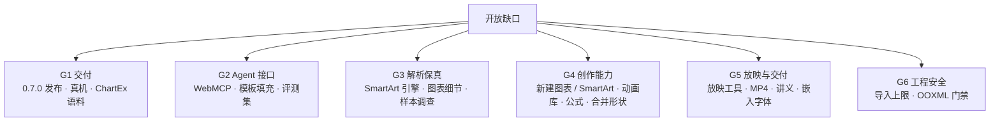
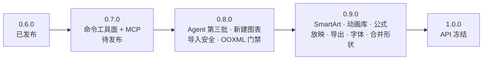
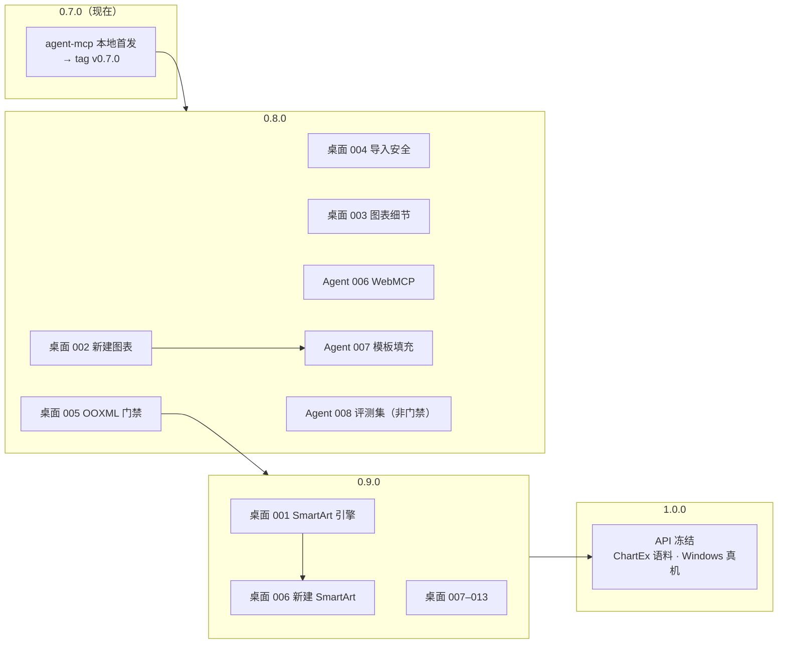
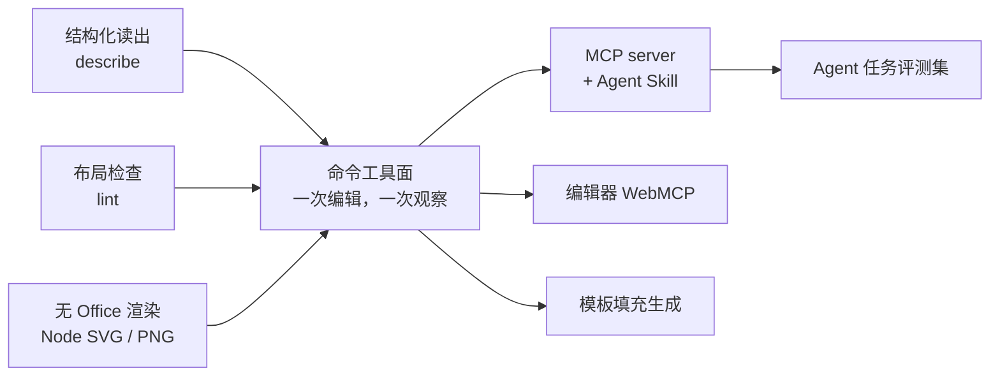

# 能力盘点与演进路线

> 更新于 2026-11-03，代码基线 `f0f7a15`，包版本号 `0.7.0`（**尚未发布**；npm `latest` 为 `0.6.0`）。本文是跨地图的唯一状态汇总：单票状态以各 wayfinder 票据的 `status` 为准，扩展能力与限制见[能力矩阵与格式边界](api/expanded-capabilities.md)，版本交付记录见 CHANGELOG 与 [0.5.0-beta.5 交付记录](releases/0.5.0-beta.5.md)。Windows 真机按用户要求继续跳过。

盘点当前的真实完成度，列全「读 / 写 / 交付」三条线的能力和缺口，给出到 1.0 的版本路径。缺口来自三处：现有开放票据、与 [HeyPuter presentation](https://github.com/HeyPuter/everything/tree/007af35ff7e31684d29030c0056c9d5a238dfc62/src/presentation)（2026-11-02 版本）的逐模块对比、上游 [office-kit/pptx](https://github.com/office-kit/pptx/tree/18b7e75cfa7fd1c6e9891ce1285a76c7889b644b) 0.28.0 的能力核对。
范围与词汇沿用 [编辑能力技术方案](design/editing-design.md) 与 [CONTEXT.md](../CONTEXT.md)。

判断做不做只用两条：**对使用者有没有成本**（运行时、体积、复杂度落不落到用户头上）、**有没有解法**。
工作量不是理由；能做成按需入口 / 可 tree-shake 的等于零成本。

---

## 1. 当前完成度

### 1.1 现状

| 线 | 状态 |
|---|---|
| 发布 | `0.6.0` 于 2026-11-02 发布，八个既有包 `latest` 一致。`0.7.0` 的代码与版本号已提交（`f0f7a15`），**未打 tag、未发布**；新包 `@web-ppt/agent-mcp` 在 npm 上不存在，需要维护者先本地首发并配置 Trusted Publishing |
| 读：解析与渲染 | `.pptx` / `.ppt` / EMF / WMF / EMF+ / PICT 收敛到统一 Schema；187 个预设几何、三维相机投影、15 种艺术字变形、OMML、ChartEx 与地图、加密文件、嵌入字体读取均已完成 |
| 写：编辑与保存 | 编辑主线（M0–M7）、七类扩展（图表深度编辑、批注、页面适配、SmartArt / OLE / 墨迹内部编辑、高级渲染、PDF / WebM、原生 `.ppt`、无来源复制）与内容流转（高级文本、多级类别、共享工作簿、字体 Provider、矢量 PDF、视频音轨与内嵌视频合成、旧 PPT 外观写入、OLE 深度编辑）已完成 |
| Agent 接口 | [研发地图](wayfinder/ppt-agent-interface/map.md) 001–005（describe、lint、Node 渲染、命令工具面、MCP 与 Skill）已完成；006–008 未开始 |
| 桌面能力补齐 | 新建[研发地图](wayfinder/ppt-desktop-parity/map.md)，20 张票处于规划状态，范围与判定见 §3 |
| 外部缺陷 | #7 组合缩放与 #8 英文撇号已于 2026-10-29 修复并关闭 |

### 1.2 验证状态

门禁关系与测试套件见[测试规范](engineering/testing.md)。断言数、快照数、指纹数和包体积由 `npm run verify` 按测试与构建产物核对，入口文档不另维护一套总数。
Windows PowerPoint 真机继续按用户要求暂缓；独立读取器通过不等于 Windows 验收通过。当前没有 OOXML 结构与语义校验门禁，由[桌面 005](wayfinder/ppt-desktop-parity/tickets/005-ooxml-validation-gate.md)补齐。

### 1.3 里程碑

| M | 内容 | 状态 |
|---|---|---|
| M0 | 地基：core 加法 + `EditDoc` + 投影渲染 | ✅ 全固件编辑等价指纹逐字节一致 |
| M1 | 保存链路：保留型 XML + zip 直通 + 补丁引擎 | ⚠️ 自动证明全绿，**PowerPoint 真机验收缺席** |
| M2 | 选择与变换：三层视图、命中、手柄、吸附、层级、对齐、剪贴板、历史 | ✅ |
| M3 | 文本编辑：覆盖层、IME、扁平模型、段落/run 属性、autofit、Safari engine 行盒 | ✅ |
| M4 | 内容能力：插入形状/图片/表格、填充描边效果、裁剪、超链接、页管理、备注 | ✅ |
| M5 | 打磨：格式刷、查找替换、选择窗格、锁定、崩溃恢复、切换效果 | ✅ |
| M6 | 扩展：动画、顶点、表样式、协同适配包 | ✅ 四项全部独立验收 |
| M7 | 设计：主题、母版、版式、三套按需模板与统一交付旅程 | ✅ Chrome + 11 件 Office 清单 |
| 扩展 | 图表/批注/页面适配/内部对象编辑、高级渲染、直接导出与旧 PPT | ✅ 七类能力完成；支持边界见能力矩阵 |
| M8 | Agent 读写接口 | ⚠️ 001–005 完成；WebMCP、模板填充、评测集未开始 |
| M9 | 桌面能力补齐：新建图表 / SmartArt、SmartArt 引擎、动画库、公式、放映、导出、导入安全与 OOXML 门禁 | 规划中 |

---

## 2. 功能清单

“缺口”列的票据编号：**桌面**指[桌面能力补齐](wayfinder/ppt-desktop-parity/map.md)，**Agent** 指 [Agent 读写接口](wayfinder/ppt-agent-interface/map.md)。

### 2.1 读：解析与渲染

| 域 | `.pptx` | `.ppt` | 缺口 |
|---|---|---|---|
| 预设几何 | ✅ 187 个（ECMA-376 全集） | ✅ MSOSPT 全表 | — |
| 自定义几何 | ✅ custGeom + gdLst 公式 + arcTo | ✅ pVertices / pSegmentInfo | — |
| 填充 | ✅ 纯色/线性/径向渐变/图片/平铺/图案/主题色变换 | ✅ 纯色/渐变/图片 | — |
| 描边 | ✅ 虚线/箭头/端点/连接 | ✅ 虚线/箭头 | — |
| 效果 | ✅ 外阴影/内阴影/发光/柔化/倒影 | ⚠️ 格式本身没有 | 无解，非缺陷 |
| 3D | ✅ 挤出/斜角/轮廓/材质/视角 | ⚠️ 缺可信样本 | 真实相机投影；材质、光照与网格为近似 |
| 文本 | ✅ 完整 + 15 种艺术字变形 | ✅ 基础字符与段落 | 包络型艺术字只弯基线 |
| 样式继承 | ✅ 母版→版式→占位符→段落→run | ✅ TxMasterStyle | — |
| 图片 | ✅ 裁剪/裁进形状/透明度/灰度/双色调 | ✅ Pictures 流 | — |
| EMF/WMF/PICT | ✅ 解码为 SVG | ✅ | EMF+ 按需入口支持常见绘图；未知记录按格式回退 |
| 表格 | ✅ tableStyles/条纹/合并/边框/垂直对齐 | ✅ 网格启发式 | — |
| 图表 | ✅ 经典 16 种 + 次坐标轴 + 3D | ✅ 经内嵌 EMF | 趋势线、误差线、数据表不绘制（桌面 003）；ChartEx 完整真实语料与 Office 原生验收待补 |
| SmartArt | ✅ 缓存 drawing；无缓存时 6 种布局族启发式排布 | ❌ | 布局定义引擎（桌面 001）；`.ppt` SmartArt 未实现 |
| 媒体·墨迹·评论·节 | ✅ | ❌ | — |
| 组合 | ✅ 嵌套 + 子坐标系 | ✅ 展平 | — |
| 切换 / 动画 | ✅ 40 种切换含 Morph / 四类按点击分批 | ✅ 6 种 / 5 步 | 缩放定位对象只显示回退图片（桌面 020） |
| 加密 | ✅ 标准 AES-ECB / 敏捷 AES-CBC | ✅ RC4 CryptoAPI | — |
| 数学公式 | ✅ OMML 解析与结构化 SVG 排版 | ❌ | 数学字体与复杂细节继续对照 |
| 嵌入字体 | ✅ EOT 剥壳；可选字体与字形 Provider | — | 只读不写（桌面 012） |
| 导入安全 | ⚠️ 解压前不检查声明大小、条目数与压缩比 | ⚠️ | 解压上限与 ZIP 安全（桌面 004） |

导出：PNG（data: URI + foreignObject，像素与预览一致）、独立 SVG 文件（原生 `<text>`，自包含）、
批量动画终态 PNG ZIP（按需入口、有界并发）与可打印 HTML（按动画批次展开）。直接导出有图片页面 PDF、矢量 PDF（可搜索文字）与 WebM（可选 Opus 音轨、实验性内嵌视频帧合成），均为按需入口。
缺口：MP4 / JPEG / GIF（桌面 010），讲义、备注页与大纲（桌面 011）。

### 2.2 写：编辑命令与按需扩展

| 域 | 已实现 | 未实现 |
|---|---|---|
| 变换 | `SetXfrm` `SetFlip` `AlignElements` `DistributeElements` `Group` `Ungroup` | — |
| 结构 | `RemoveElement` `SetZ` `PasteElements` `SetName` `SetAltText` `SetLocked` `SetElementHidden` | — |
| 形状 | `AddShape` `SetFill` `SetStroke` `SetEffects` `SetGeometry` `ConvertToCustomGeometry` `SetPreset` `SetAdj` + 按需 `SetScene3D` | 合并形状（桌面 013） |
| 图片 | `AddImage` `ReplaceImage` `SetCrop` + 按需 `SetPictureFx`（透明度/灰度/双色调） | — |
| 文本 | `EditText` `SetRunProps`（含高亮/字距/大小写/上下标/精确下划线与单双删除线）`ClearFormat` `SetParaProps`（含项目符号/编号）`SetBodyProps` `FitTextShape` `ReplaceText` | — |
| 公式 | 渲染、跨文稿复制与原生写入 | 插入与编辑（桌面 008） |
| 表格 | `AddTable` `InsertRow` `InsertColumn` `RemoveRow` `RemoveColumn` `MergeCells` `SplitCell` `SetRowHeight` `SetColumnWidth` `SetCellProps` `SetTableStyle` + 单元格文字 | — |
| 页面 | `AddSlide` `RemoveSlide` `MoveSlide` `DuplicateSlide` `AddSection` `RenameSection` `MoveSection` `RemoveSection` `SetSlideSize` `SetLayout` `SetBackground` `SetBackgroundImage` `SetBackgroundCrop` `SetHidden` `SetNotes` `SetTransition` | 批量页眉页脚（桌面 017） |
| 动画 | `SetAnimations`；可编辑目录 8 个效果（入场 / 退出 / 强调），其余效果原样直通 | 动画库全部预设、运动路径、动画窗格（桌面 007） |
| 页面适配 | 按需 `resize`：全稿确保适合，同步文字/效果/表格/母版/版式/批注锚点 | — |
| 链接与动作 | `SetLink`（元素级 + run 级） | 悬停动作、结束放映 / 播放声音等动作类型（桌面 017） |
| 格式 | `ApplyFormat`（格式刷） | — |
| 版式/母版/主题 | `SetTheme` + 主题目录；版式/母版设计画布 + 复用元素/背景/切换命令 + `p:txStyles`；三套按需模板 | 主题库扩充、`.thmx` / `.potx` 交换（桌面 016） |
| 经典图表 | 按需数据、多级类别与类型/样式编辑，cache/内嵌工作簿同步；`chart-shared` 共享工作簿联动编辑 | 新建图表（桌面 002）；画布未绘制父级分组轴；无法证明来源的旧数据只读 |
| 现代图表 | ChartEx 分层数据、增删行、工作簿同步 | 新建（桌面 002）；完整 Office 真机验收 |
| 批注 | 新增、修改、删除、回复与字段级历史/协同 | — |
| 媒体 | 按需 `AddMedia`：PCM WAV / MP4（含分片）/ 显式外链、默认音频图标、`ReplaceMediaPoster`；框架/官网入口、历史与保存、选中媒体播放与失败提示 | 录制旁白与摄像头（桌面 019）；Windows PowerPoint 实测 |
| SmartArt/OLE/墨迹 | 按需节点/嵌入内容/笔画内部编辑，原生保存 | 新建 SmartArt（桌面 006）；未识别宿主格式及布局边界见能力矩阵 |
| 字体 | 字体与缺字检查、本机替换（预览与导出） | 嵌入字体写入 PPTX（桌面 012） |
| 无来源复制 | 按需 `generate.copyPortableElements`：选中子树、资源、公式/艺术字/高级文字效果直接跨文稿复制 | 丢失原生语义及能力范围外的对象明确拒绝，见[支持矩阵](api/portable-rich-text.md) |

保存：补丁保存（原包直通，只改脏 part）、生成保存（无原包时确定性生成）、`.ppt` 编辑另存 `.pptx`，以及有明确能力校验的原生 `.ppt` 生成保存。
原生 `.ppt` 根据当前投影生成新文件，不保留未知二进制记录；支持内容与拒绝条件见[保存矩阵](api/expanded-capabilities.md#原生-ppt-保存矩阵)。

### 2.3 工程与产品

| 能力 | 状态 |
|---|---|
| 发布包 | ⚠️ 9 个（core / edit-core / viewer-core / editor / react / vue / fonts / collab / agent-mcp）；八个既有包 `latest` 为 `0.6.0`，`agent-mcp` 未首发 |
| 框架适配 | ✅ React + Vue 薄适配，单一 adapter contract，Svelte / WC 可直接复用 |
| 崩溃恢复 | ✅ 版本化帧 + IndexedDB 分块 + 原子换代 + 挂载前决策 |
| 协同 | ✅ 字段级 LWW、分数序、可插拔 provider、BroadcastChannel 双标签页 |
| 无障碍 | ✅ 选择窗格键盘导航 / 锁定 / 隐藏；✅ 按需画布对象目录、替代文字、选择状态及阅读顺序；面向作者的检查器缺失（桌面 014） |
| 浏览器输入 | ✅ 按需 EditContext；IME 单事务、选区与候选位置；加载失败和不支持时保留 contenteditable |
| 性能契约 | ✅ 抗环境负载，功能失败与预算超标分离 |
| 官网编辑页 | ✅ 独立 `editor.html`，本机打开/模板新建/编辑/保存/恢复；只有普通视图（大纲、备注页、阅读视图见桌面 018） |
| 放映 | ✅ 黑白屏、跳页、网格、备注与下一页、滑动翻页；演讲者双窗口、笔与激光笔、文件放映设置缺失（桌面 009） |
| 审阅 | ✅ 批注；演示文稿比较缺失（桌面 015） |
| 触屏 / 移动 | ✅ 手指细描边容差 + 双指缩放/平移 + 长按上下文 seam；查看模式保留页面滚动 |
| 国际化 | ✅ 官网三页完整中英文、SEO、原地切换、动态工具/上下文名称及错误恢复，详见[验收矩阵](ux/site-i18n.md) |
| 文件保存 UX | ✅ 产品层 File System Access + 下载双路径、会话目标与另存为、延迟保存点及失败重试；详见[本机文件保存](api/local-file-save.md) |
| 保存产物校验 | ⚠️ LibreOffice 重开 + 独立读取器；缺 XSD 与 Open XML SDK 校验（桌面 005） |

---

## 3. 缺口与取舍判定

### 3.1 对比摘要

与 HeyPuter presentation 逐模块对比后的结论如下，作为本节缺口的来源之一。

| 维度 | HeyPuter presentation | 本仓库 | 判断 |
|---|---|---|---|
| 形态与许可 | Puter 上的私有应用，AGPL-3.0-only | 9 个可发布 SDK 包，MIT | 定位不同；对方代码不可移植 |
| 格式覆盖 | 只读 `.pptx`；`.ppt`、加密、ZIP64 直接拒绝；不解码 EMF / WMF；无 ChartEx、OMML 渲染与艺术字变形 | 全部支持 | 本仓库领先 |
| 架构 | 渲染器直接依赖 pptx 库；编辑画布每次整页重绘为图片；撤销为整包快照（30 步 / 80MB） | 渲染只依赖 Schema；三层增量 DOM；命令补丁历史与协同 | 本仓库领先 |
| SmartArt 与图表细节 | layoutDef 约束 / 规则解释器；趋势线、误差线、数据表 | 6 种布局族；三类图表元素不绘制 | 对方领先 → 桌面 001、003 |
| 创作面 | 新建图表与 SmartArt、22 套主题、动画库与窗格、公式、合并形状、绘图笔、视图、审阅工具 | 编辑已有对象为主 | 对方领先 → 桌面 002、006–008、013–018 |
| 放映与交付 | 演讲者双窗口、笔与激光笔、录制、MP4 / GIF / 讲义 PDF | WebM、矢量 PDF（嵌入字体、中文可搜索） | 各有领先 → 桌面 009–011、019 |
| 工程验证 | Vitest 约 2471 用例、Playwright 约 923 用例（含 axe），无渲染快照 | 逐字节快照、LibreOffice SSIM 对照、真机门禁、确定性固件 | 本仓库领先；导入安全与 OOXML 校验缺失 → 桌面 004、005 |

外部代码的参考规则（上游 MIT 可移植、HeyPuter AGPL 不移植）见[桌面地图](wayfinder/ppt-desktop-parity/map.md#外部代码参考规则)。

### 3.2 开放缺口

| 缺口 | 用户有成本？ | 有解法？ | 判定 |
|---|---|---|---|
| 0.7.0 未发布 | 有（命令工具面与 MCP 无法安装） | 有（本地首发 agent-mcp 后走流水线） | **现在执行**，见 §7.1 |
| Windows 真机验收 | 有（PowerPoint 修复提示风险） | 有（自托管 runner） | 按用户要求延后；1.0 不再豁免 |
| ChartEx 真实语料 | 有（六类缺 PowerPoint 存出样本） | 有（公开语料或真机） | [data-fidelity 002](wayfinder/ppt-data-fidelity/tickets/002-chartex-fallback-corpus.md)，1.0 条件 |
| SmartArt / OLE 真实样本、高级渲染根因 | 依样本而定 | 有（公开语料 + `npm run compare`） | [portability 008](wayfinder/ppt-portability-fidelity/tickets/008-native-object-scope.md) / [009](wayfinder/ppt-portability-fidelity/tickets/009-render-fidelity-scope.md)，不绑定版本；008 的样本同时服务桌面 001 |
| WebMCP、模板填充、评测集 | 有（浏览器内 Agent 与按模板生成） | 有（命令工具面已就绪） | Agent [006](wayfinder/ppt-agent-interface/tickets/006-editor-webmcp.md) / [007](wayfinder/ppt-agent-interface/tickets/007-template-fill.md) / [008](wayfinder/ppt-agent-interface/tickets/008-agent-task-eval.md)，0.8.0 |
| 导入解压无上限 | 有（恶意文件可耗尽标签页内存） | 有（解压前校验目录与声明大小） | 桌面 [004](wayfinder/ppt-desktop-parity/tickets/004-import-archive-limits.md)，P1，0.8.0 |
| 缺 OOXML 结构与语义校验 | 有（LibreOffice 容忍的错误 PowerPoint 会要求修复） | 有（XSD + Open XML SDK，上游有现成工具） | 桌面 [005](wayfinder/ppt-desktop-parity/tickets/005-ooxml-validation-gate.md)，P1，0.8.0 |
| 不能新建图表 | 有（图表是第二高频对象） | 有（数据集模型已预留，上游 chart-builder 可参考） | 桌面 [002](wayfinder/ppt-desktop-parity/tickets/002-chart-authoring.md)，P1，0.8.0 |
| 趋势线 / 误差线 / 数据表不绘制 | 有（显示比 PowerPoint 少元素） | 有（上游预览器可参考） | 桌面 [003](wayfinder/ppt-desktop-parity/tickets/003-chart-analysis-rendering.md)，P1，0.8.0 |
| SmartArt 无缓存排布偏离 | 有（布局族外的布局与编辑后重排不准） | 有（ECMA-376 §21.4，须自行实现） | 桌面 [001](wayfinder/ppt-desktop-parity/tickets/001-smartart-layout-engine.md)，P1，依赖真实样本，0.9.0 |
| 不能新建 SmartArt | 有 | 有（001 之后） | 桌面 [006](wayfinder/ppt-desktop-parity/tickets/006-smartart-authoring.md)，0.9.0 |
| 动画目录只有 8 个效果 | 有（无法新增大多数动画与运动路径） | 有（上游预设表可参考） | 桌面 [007](wayfinder/ppt-desktop-parity/tickets/007-animation-catalog.md)，0.9.0 |
| 不能插入 / 修改公式 | 有（理科课件高频） | 有（OMML 渲染与写入已具备） | 桌面 [008](wayfinder/ppt-desktop-parity/tickets/008-equation-editing.md)，0.9.0 |
| 放映缺双窗口、笔、文件放映设置 | 有（演讲场景核心工具） | 有（Window Management API、InkML） | 桌面 [009](wayfinder/ppt-desktop-parity/tickets/009-presenting-tools.md)，0.9.0 |
| 无 MP4 / JPEG / GIF | 有（多数平台不收 WebM） | 有（WebCodecs + 自写封装） | 桌面 [010](wayfinder/ppt-desktop-parity/tickets/010-video-image-export.md)，0.9.0 |
| 无讲义 / 备注页 / 大纲输出 | 有（授课与会议分发） | 有（讲义与备注母版已解析） | 桌面 [011](wayfinder/ppt-desktop-parity/tickets/011-handout-notes-print.md)，0.9.0 |
| 嵌入字体只读不写 | 有（换电脑后字体丢失） | 有（EOT 容器 + 许可位） | 桌面 [012](wayfinder/ppt-desktop-parity/tickets/012-font-embedding-write.md)，0.9.0 |
| 无合并形状 | 有（图形设计常用） | 有（独立子入口的路径布尔运算） | 桌面 [013](wayfinder/ppt-desktop-parity/tickets/013-merge-shapes.md)，0.9.0 |
| 无障碍检查器、比较、主题交换、页眉页脚与动作、视图、录制、缩放定位 | 有（各自面向特定场景） | 有（复用 lint / describe / 现有命令） | 桌面 [014](wayfinder/ppt-desktop-parity/tickets/014-accessibility-checker.md)–[020](wayfinder/ppt-desktop-parity/tickets/020-zoom-objects.md)，不绑定版本 |
| 拼写检查 | 待查（编辑器主动关闭了原生拼写检查，原因未记录） | 有（浏览器原生） | 先查清关闭原因再决定，登记在桌面地图 Not yet specified |
| 同义词与翻译 | 待定 | 需要在线服务或大体积本机词典 | 词典来源与语言覆盖未确定，登记在桌面地图 Not yet specified |
| 墨迹转文字 / 转公式 | 有 | **无**（跨平台浏览器没有本机手写识别） | 不提供；墨迹转形状归入桌面 009 |
| 云端存储、账号、内置 AI 助手 / 生成服务 | — | 违背零服务端与不内置模型 | **不做**；浏览器内 Agent 走 Agent 006 WebMCP |
| 宏 / 模板市场 / 服务端转换 / `.odp` | — | — | **不做**（非目标） |

---

## 4. 演进路线

1.0 之前每批公开 API 扩展用 minor 版本标记。本节只分配内容和发布条件，不承诺日期。

| 版本 | 内容 | 票据 | 发布条件 |
|---|---|---|---|
| **0.6.0**（`latest`） | 矢量 PDF 转正、视频音轨与内嵌视频合成、OLE 官网入口；Agent describe、lint、Node 渲染 | 已关闭 | ✅ 2026-11-02 发布；Windows 真机经维护者决定延后且未计为通过 |
| **0.7.0** | Agent 命令工具面、MCP server 与 Agent Skill；新增 `@web-ppt/agent-mcp` | Agent [004](wayfinder/ppt-agent-interface/tickets/004-command-tool-surface.md) / [005](wayfinder/ppt-agent-interface/tickets/005-mcp-server-skill.md)（已关闭） | 代码与版本号已提交，**未发布**；检查项见 §7.1 |
| **0.8.0** | Agent 第三批；新建图表与图表细节渲染；导入安全与 OOXML 门禁 | Agent 006 / 007 / 008；桌面 002 / 003 / 004 / 005 | 所列票据关闭（Agent 008 不阻挡）；四项门禁 + OOXML 门禁；beta 反馈周期 |
| **0.9.0** | SmartArt 引擎与新建、动画库、公式、放映工具、MP4 / JPEG / GIF、讲义与备注页、嵌入字体写入、合并形状 | 桌面 001 / 006–013 | 所列票据关闭；beta 反馈周期 |
| **1.0.0** | 冻结 0.9 的全部公开 API 与 Agent 工具 Schema | [API 契约、迁移说明与类型回归](api/api-stability.md) | 0.9 beta 反馈收口；ChartEx 真实语料与 Windows 真机（§7.3） |

版本分配的理由：

- 0.8.0 先做导入安全与 OOXML 门禁，后续所有新建能力（图表、SmartArt、公式、字体）的保存产物都在这道门禁下验收；新建图表同时是 Agent 007 模板填充的图表数据入口。
- 桌面 001 优先级为 P1，可以立即开工，但完成条件依赖 portability 008 的真实样本，所以放在 0.9.0 发布，不让样本获取阻挡 0.8.0。
- P3 票（桌面 014–020）与长尾格式票不绑定版本，关闭时随当时的 beta 线发布；1.0 之后以 minor 版本追加，不改变已冻结的接口。

---

## 5. 已实现能力的技术方案索引

技术方案与验收证据维护在对应票据或 API 文档中，本表只做索引。

| 能力 | 方案与证据 |
|---|---|
| 表格结构与单元格格式 | [0.6 票据 001](wayfinder/ppt-editing-completeness/tickets/001-table-structure-editing.md) |
| 项目符号与自动编号 | [0.6 票据 002](wayfinder/ppt-editing-completeness/tickets/002-bullets-and-numbering.md) |
| 预设形状切换与调节柄 | [0.6 票据 003](wayfinder/ppt-editing-completeness/tickets/003-preset-shape-adjustments.md) |
| 字符高级格式与清除格式 | [0.6 票据 004](wayfinder/ppt-editing-completeness/tickets/004-advanced-run-formatting.md) |
| 分布、替代文字、节与页面尺寸 | [0.6 票据 005](wayfinder/ppt-editing-completeness/tickets/005-common-object-and-slide-commands.md) |
| 触屏编辑手势 | [0.6 票据 006](wayfinder/ppt-editing-completeness/tickets/006-touch-editing-gestures.md) |
| 批量导出幻灯片图片 | [0.6 票据 007](wayfinder/ppt-editing-completeness/tickets/007-batch-image-export.md) |
| 主题、版式、母版与内置模板 | [0.7 地图](wayfinder/ppt-template-theme/map.md)及其票据 |
| 经典图表数据编辑 | [0.8 票据 001](wayfinder/ppt-data-fidelity/tickets/001-chart-data-editing.md)；类型与样式见[能力矩阵](api/expanded-capabilities.md) |
| ChartEx 解析、回退与编辑 | [按需 API 与验收边界](api/chartex-native.md)、[兼容回退](wayfinder/ppt-data-fidelity/tickets/008-alternate-content-fallback.md)、[真实语料调查](wayfinder/ppt-data-fidelity/tickets/002-chartex-fallback-corpus.md) |
| 七类扩展编辑、渲染与导出 | [能力矩阵](api/expanded-capabilities.md)、[交付记录](wayfinder/ppt-expanded-capabilities/map.md) |
| 内容流转、矢量 PDF 与音视频 | [研发地图](wayfinder/ppt-portability-fidelity/map.md)、[执行计划](wayfinder/ppt-portability-fidelity/plan.md) |
| Agent describe / lint / Node 渲染 / 命令工具面 / MCP | [describe](api/agent-describe.md)、[lint](api/agent-layout-lint.md)、[Node 渲染](api/agent-node-render.md)、[命令工具面](api/agent-command-tools.md)、[MCP](api/agent-mcp.md) |
| 浏览器平台能力的对策 | [浏览器平台能力与对策](research/browser-platform.md) |

---

## 6. 现行范围决策

本表取代首个完整版本与历史票据中对应的范围外决策。

| 项 | 当前决定 | 边界 |
|---|---|---|
| 图表数据、类型与样式编辑 | ✅ 已实现 | 不兼容转换与不可写工作簿明确拒绝 |
| 母版 / 版式编辑 | ✅ 已实现 | 沿用统一设计画布及继承模型 |
| 审阅批注工作流 | ✅ 已实现 | 新增、修改、删除、回复与原生保存 |
| `.ppt` 原生生成保存 | ✅ 已实现 | 基于投影生成；支持矩阵外拒绝，不保留未知二进制记录 |
| SmartArt / OLE / 墨迹内部编辑 | ✅ 已实现 | 按可识别格式编辑；未知格式维持框架级操作 |
| 三维相机投影与挤出 | ✅ 已实现 | 材质/光照和纹理网格为近似，不包含通用三维建模 |
| 地图 / EMF+ / PDF / WebM | ✅ 按需实现 | 地图需 geoCache；EMF+ 有记录边界；WebM 音轨与内嵌视频合成默认关闭 |
| Agent 读写接口 | ⚠️ 001–005 已实现，006–008 进行中 | 只提供确定性读出、检查、渲染、命令与模板填充；不内置模型、不调用模型服务；MCP / WebMCP 适配放在独立包或站点插件 |
| 桌面能力补齐 | **纳入 0.8–0.9** | 范围见[桌面地图](wayfinder/ppt-desktop-parity/map.md)；涉及最终用户流程的票先确认用户流程与验收标准 |
| 外部代码参考 | **只移植 MIT 来源** | office-kit/pptx（`18b7e75`）可移植并登记来源；HeyPuter presentation（AGPL）只作功能对比，不复制、不移植 |
| 墨迹转文字 / 转公式 | **不提供** | 跨平台浏览器没有本机手写识别；墨迹转形状在桌面 009 |
| 云端存储 / 账号 / 内置 AI 助手 | **维持范围外** | 违背零服务端与不内置模型；浏览器内 Agent 走 WebMCP |
| 宏 / 模板市场 / 内置模型与生成服务 / 服务端转换 / `.odp` | **维持范围外** | 不属于当前纯浏览器渲染与编辑目标 |

---

## 7. 下一步计划与交付

### 7.1 到 1.0 的分版本计划

§4 给出每个版本装什么，本节给出执行顺序、每项剩余工作与发布前的检查项。票据关闭以各自的完成条件为准；表中「剩余」只摘要差距，不替代票据。

#### 0.7.0 发布（现在）

| 顺序 | 检查项 |
|---|---|
| 1 | 维护者本地 `npm publish` 首发 `@web-ppt/agent-mcp@0.7.0`，再在 npm 包设置中配置 Trusted Publishing（新包首发无法走 OIDC，见 AGENTS.md「发布」） |
| 2 | `release.yml` 的发布顺序包含 agent-mcp，且已发布版本跳过逻辑能处理首发后的重跑 |
| 3 | 四项门禁与 master CI 绿后推送 tag `v0.7.0` |
| 4 | `npm view` 核对九个包 `latest` 均为 `0.7.0`；CHANGELOG 记录 Windows 真机延后且未计为通过 |

#### 补丁线

| 项 | 剩余 | 完成判定 |
|---|---|---|
| CI 偶发失败 | `Runtime.evaluate` 超时的根因已定位并修复（被 `Fetch.enable` 拦截却未失败的请求永久挂起）；编辑性能预算（50MB 恢复、210 页回环超 500ms）为 `continue-on-error` 采样，根因待查 | 根因写入对应测试或[测试规范](engineering/testing.md)；master 连续推送 CI 绿 |
| 已发布版本的缺陷 | 用户反馈的问题 | 以补丁版发布，不混入下一 minor 的能力 |

#### 0.8.0：Agent 第三批 · 新建图表 · 导入安全 · OOXML 门禁

| 票据 | 剩余 | 是否阻挡发布 |
|---|---|---|
| 桌面 [004](wayfinder/ppt-desktop-parity/tickets/004-import-archive-limits.md) 导入安全 | 全部完成条件：解压前目录与大小校验、名称规范化与重复名拒绝、可配置上限、内存峰值断言 | 是 |
| 桌面 [005](wayfinder/ppt-desktop-parity/tickets/005-ooxml-validation-gate.md) OOXML 门禁 | XSD 与 Open XML SDK 两道校验进入 CI；现有保存产物零错误或逐条登记例外；负例拦截 | 是 |
| 桌面 [002](wayfinder/ppt-desktop-parity/tickets/002-chart-authoring.md) 新建图表 | 16 种经典 + 7 种现代类型的插入命令、原生内容、主题默认外观与产品入口（产品待确认） | 是 |
| 桌面 [003](wayfinder/ppt-desktop-parity/tickets/003-chart-analysis-rendering.md) 图表细节 | 趋势线、误差线、数据表进入 Schema 与两条文本路径；编辑命令与入口 | 是 |
| Agent [007](wayfinder/ppt-agent-interface/tickets/007-template-fill.md) 模板填充 | 大纲 Schema；三套内置模板与一份外部模板 lint 零错误；保存重开 describe 一致；同输入逐字节一致；非法大纲原子拒绝 | 是 |
| Agent [006](wayfinder/ppt-agent-interface/tickets/006-editor-webmcp.md) 编辑器 WebMCP | origin trial Chrome 端到端；不支持时编辑页激活闭包体积与行为不变；文稿切换 / 关闭后注册状态正确 | 是；规范或 origin trial 在发布时不可用时，按票据降级要求只发布不注册路径并说明 |
| Agent [008](wayfinder/ppt-agent-interface/tickets/008-agent-task-eval.md) 评测集 | 一条命令复跑判定；记录有无 lint 两种配置的完成率与失败分布 | 否，结果作为 1.0 冻结工具 Schema 的依据 |

#### 0.9.0：创作、放映与交付补齐

| 票据 | 剩余 | 依赖 |
|---|---|---|
| 桌面 [001](wayfinder/ppt-desktop-parity/tickets/001-smartart-layout-engine.md) SmartArt 引擎 | 布局树、全部算法、约束与规则重试；与 PowerPoint 缓存逐形状对照 | portability 008 的真实样本；可立即开工 |
| 桌面 [006](wayfinder/ppt-desktop-parity/tickets/006-smartart-authoring.md) 新建 SmartArt | 自编布局目录、插入 / 切换布局 / 文本转换命令、产品入口 | 001 |
| 桌面 [007](wayfinder/ppt-desktop-parity/tickets/007-animation-catalog.md) 动画库 | 全部预设、运动路径、时间设置、动画刷与动画窗格 | 无 |
| 桌面 [008](wayfinder/ppt-desktop-parity/tickets/008-equation-editing.md) 公式 | 线性格式与 OMML 双向转换、插入与修改命令、回退图片 | 无 |
| 桌面 [009](wayfinder/ppt-desktop-parity/tickets/009-presenting-tools.md) 笔与放映工具 | 演讲者双窗口、笔 / 激光笔与 InkML 保留、墨迹转形状、`showPr` / `custShowLst`、排练计时、本机字幕 | 无 |
| 桌面 [010](wayfinder/ppt-desktop-parity/tickets/010-video-image-export.md) MP4 / JPEG / GIF | WebCodecs 编码与自写封装、确定性图片输出 | 无 |
| 桌面 [011](wayfinder/ppt-desktop-parity/tickets/011-handout-notes-print.md) 讲义与备注页 | 讲义 / 备注页 / 大纲排版，打印 HTML 与两种 PDF 共用 | 无 |
| 桌面 [012](wayfinder/ppt-desktop-parity/tickets/012-font-embedding-write.md) 嵌入字体写入 | 许可位检查、EOT 容器、可选子集、命令与入口 | 无 |
| 桌面 [013](wayfinder/ppt-desktop-parity/tickets/013-merge-shapes.md) 合并形状 | 五种布尔运算、图片参与、独立子入口 | 无 |

#### 1.0.0：API 冻结

| 项 | 剩余 | 完成判定 |
|---|---|---|
| 冻结范围 | [API 契约](api/api-stability.md)仍写着 `0.5.0-beta.5`，需更新为 0.9 的实际公开面：九个包的 exports 子路径、describe / lint / 工具 / 大纲四份 JSON Schema、0.8–0.9 新增命令、恢复与协同协议版本 | 冻结清单逐条对应 `package.json#exports` 与生成 Schema，`verify` 比对 |
| 实验性入口 | 逐项决定转正或明确排除在冻结之外（`videoOverlay`、WebM 音轨等） | 每项在 API 契约中有「稳定 / 排除」结论 |
| 迁移说明 | 汇总 0.5–0.9 的全部语义变化（如 0.5.0 的 `elementFrameToSlideMatrix` 沿渲染链求值） | API 契约的迁移表覆盖每一项，类型契约 `tooling/type-contracts/` 有对应负例 |
| ChartEx 真实语料 | [002](wayfinder/ppt-data-fidelity/tickets/002-chartex-fallback-corpus.md)：除漏斗外六类缺 PowerPoint 存出的 PPTX | 逐类型来源、哈希、原生布局与保存重开证据；缺失的类型在[能力边界](api/chartex-native.md)中如实标注 |
| Windows 真机 | [010](wayfinder/ppt-editor/tickets/010-prove-m1-save.md)：自托管 runner 跑出绑定 revision 的 30/30 报告 | 报告通过 Node 校验器；1.0 不再适用豁免 |
| 发布 | `1.0.0-rc.N` 到 `next` 收集反馈，再转正 | 与 0.7.0 发布检查项相同 |

#### 不绑定版本

| 票据 | 下一步 |
|---|---|
| [portability 008](wayfinder/ppt-portability-fidelity/tickets/008-native-object-scope.md) SmartArt / OLE 真实样本 | 从 LibreOffice `sd/qa/unit/data/pptx` 取 matrix、radial、带 constrLst 的组织结构图与嵌入 `.xlsx`，登记到 `fixtures/corpus.json`；样本同时用于桌面 001 |
| [portability 009](wayfinder/ppt-portability-fidelity/tickets/009-render-fidelity-scope.md) 高级渲染 | 对已登记的 EMF+ 与三维样本跑 `npm run compare` 出候选清单，再做根因矩阵 |
| 桌面 [014](wayfinder/ppt-desktop-parity/tickets/014-accessibility-checker.md)–[020](wayfinder/ppt-desktop-parity/tickets/020-zoom-objects.md) | 无障碍检查器、比较、主题交换、页眉页脚与动作、视图、录制、缩放定位；开工前先确认用户流程 |

内容流转、PDF 与音视频的范围、依赖和共同验收条件见[下一阶段执行计划](wayfinder/ppt-portability-fidelity/plan.md)。

### 7.2 Agent 读写接口

范围、依赖和验收见 [研发地图](wayfinder/ppt-agent-interface/map.md)，状态以票据为准；[describe API 与 Schema](api/agent-describe.md)和[布局检查 API](api/agent-layout-lint.md)提供接入契约。

目标：让任何 Agent（Claude、Copilot、Codex、浏览器内 Agent）不依赖 LibreOffice 与桌面 Office，就能读懂、修改并验证 `.pptx` / `.ppt`，产物保持原生可编辑。仓库只提供确定性能力，不内置模型。行业现状与依据见[调研](research/ai-presentation-landscape.md)。
下表每项对应[研发地图](wayfinder/ppt-agent-interface/map.md)中的一张票（001–008，顺序同表），票据写明范围、复用和完成条件，状态以票据为准。

| 能力 | 使用者可见结果 | 复用 | 使用者成本 | 完成条件 |
|---|---|---|---|---|
| 结构化读出 `describe` | 按页输出版式名、占位符角色、稳定元素 id、类型、包围盒、层级、文字与备注，可设 token 上限；`.pptx` / `.ppt` 同一结构 | `Presentation`、`edit-metadata`、占位符匹配 | 新按需入口，基础包不变 | 发布 JSON Schema；全部固件通过 Schema 校验且两次输出逐字节一致 |
| 布局检查 `lint` | 文字溢出、元素重叠、越出画布、文字对比度不足、缺字体、占位提示文字残留、图片变形，每项带稳定 reason、元素 id 与包围盒 | `layoutText`、autofit、字体 Provider 测量、有效填充求值 | 同上 | 每类检查有正反例固件；在现有固件上统计误报并逐条复核 |
| 无 Office 渲染 | Node 中直接得到 SVG（原生 `<text>` 路径）；PNG 由宿主注入的光栅化器生成，替代 LibreOffice + pdftoppm | 原生 `<text>` 路径、字体 Provider | 光栅化器不进依赖；只在使用时注入 | 同字体下 Node 与浏览器原生路径 SVG 指纹一致；LibreOffice 对照记录差异 |
| 命令工具面 | 查询与编辑命令各有 JSON Schema 输入描述；批量命令原子提交；每次提交返回受影响元素与该页 lint 结果，失败返回稳定 reason | `EditDoc` 命令、`dispatch`、历史、补丁保存 | 独立包 | 全部公开命令都有 Schema 且由类型生成，`verify` 比对；非法输入有原子拒绝测试 |
| MCP server + Agent Skill | 本机 stdio 服务提供打开、读出、检查、渲染、编辑、保存；文件不离开本机；Skill 文档说明读出 → 编辑 → 检查 → 渲染的循环 | 命令工具面 | 独立 Node 包，MCP SDK 只在该包 | 真实 Claude Code 与 Codex 会话完成固定任务清单；保存产物由 LibreOffice 与独立读取器无修复打开 |
| 编辑器 WebMCP | 官网编辑器在支持 `document.modelContext` 时注册同一组工具，浏览器内 Agent 可直接编辑当前文稿，改动进入历史与恢复 | 命令工具面、Cordis 插件 | 站点插件，发布 SDK 不变 | 有 origin trial 的 Chrome 中端到端可用；不支持时不注册且无报错 |
| 模板填充生成 | 输入模板与内容大纲 JSON，按占位符角色选版式、填文字 / 图片 / 图表数据并适配文字，保留主题与母版 | 内置模板、`AddSlide` from layout、图表数据编辑、`FitTextShape`、生成保存 | 按需入口 | 三套内置模板与外部模板生成结果 lint 零错误；保存重开与独立读取器通过；同输入产物逐字节一致 |
| Agent 任务评测集 | 基于固件的可机判编辑任务，对比 Agent 在有无 lint 观察时的完成率 | 上述全部 | 仅仓库工具 | 任务、判定与结果落盘，可复跑 |

### 7.3 验证与发布

| 顺序 | 动作 | 当前状态 | 完成条件 |
|---|---|---|---|
| 1 | OOXML 结构与语义校验门禁 | 未建立，[桌面 005](wayfinder/ppt-desktop-parity/tickets/005-ooxml-validation-gate.md) | XSD 与 Open XML SDK 校验在 Linux CI 运行；通过不计为 PowerPoint 验收 |
| 2 | 补齐真实 ChartEx PPTX 类型语料及高级渲染对照 | 合成功能门禁和现有真实样本通过，完整类型覆盖待补 | 可信来源、可复现输入、逐类型原生布局与保存重开证据 |
| 3 | Windows + 桌面 PowerPoint 自托管验收 | **按用户要求延后**，0.5.0 与 0.6.0 发布时经维护者决定豁免，均未计为通过；后续稳定版仍需要 | 同一 Office 工件清单绑定提交与字节，无修复打开并核验原生内容 |
| 4 | beta 反馈、API 冻结与版本发布 | [API 契约与迁移准备](api/api-stability.md)已完成，尚未正式冻结；版本内容见 §4，执行顺序与发布检查项见 §7.1 | 各版本按 §7.1 的发布检查项执行发布流程 |

Windows 真机仍列为正式发布条件；它不阻挡已完成代码与 roadmap 的提交、推送。
