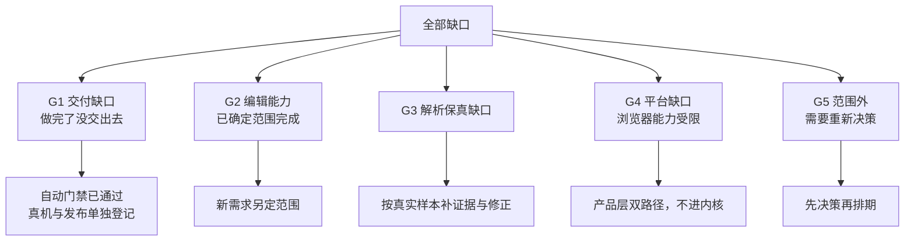
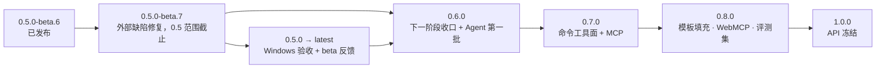
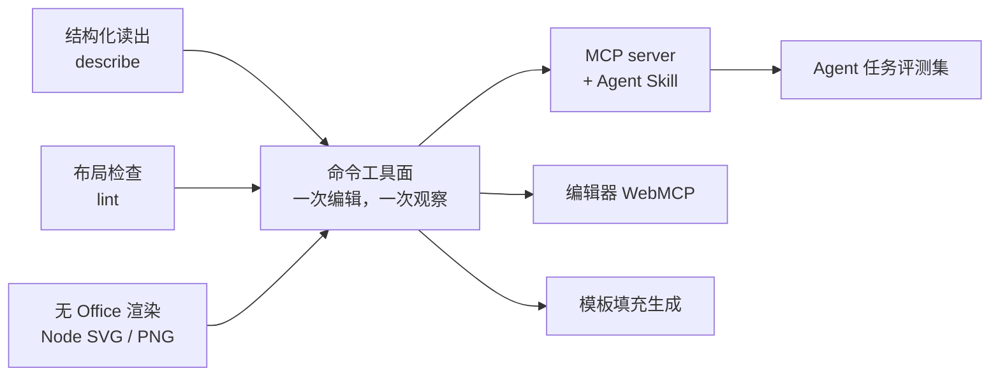

# 能力盘点与演进路线

> 更新于 2026-10-22，基线 `9ac631d`，当前包版本 `0.5.0-beta.6`。本文是跨地图的唯一状态汇总：单票状态以各 wayfinder 票据的 `status` 为准，扩展能力与限制见[能力矩阵与格式边界](api/expanded-capabilities.md)，版本交付记录见 CHANGELOG 与 [0.5.0-beta.5 交付记录](releases/0.5.0-beta.5.md)。Windows 真机按用户要求继续跳过。

盘点当前的真实完成度，列全「读 / 写 / 交付」三条线的能力清单，并给出 0.5 转正到 1.0 的路径，以及面向 AI Agent 的下一阶段（依据见 [AI 与演示文稿调研](research/ai-presentation-landscape.md)）。
范围与词汇沿用 [编辑能力技术方案](design/editing-design.md) 与 [CONTEXT.md](../CONTEXT.md)。

判断做不做只用两条：**对使用者有没有成本**（运行时、体积、复杂度落不落到用户头上）、**有没有解法**。
工作量不是理由；能做成按需入口 / 可 tree-shake 的等于零成本。

---

## 1. 当前完成度

### 1.1 一句话

**截至 `8803e07`，上一轮确认的功能范围已实现**：0.6 编辑、0.7 模板/主题、0.8 图表数据/现代图表/媒体，
以及图片效果、立体编辑、画布读屏语义、EditContext 与官网自动按需加载。2026-09-07 完成七类扩展：
图表深度编辑、批注编辑、页面确保适合、SmartArt/OLE/墨迹内部编辑、高级渲染、PDF/WebM 直接导出、
原生 PPT 生成保存及无来源复制。编辑能力已贯通历史、恢复、协同与保存重开，官网生产页面中英文工作流通过。
用户于 2026-09-06 要求跳过 Windows 真机验证，先完成功能；真实 ChartEx 类型语料、Windows 验收、
beta 反馈和正式发布继续单独登记。API 契约和迁移准备见 [1.0 API 准备](api/api-stability.md)。

下一阶段（[内容流转、导出与保真](wayfinder/ppt-portability-fidelity/map.md)）已完成高级文本流转、多级类别、
共享工作簿与正式字体 Provider；矢量 PDF（005）、视频音轨（006）与内嵌视频合成（007）进行中，其中音轨已随
`0.5.0-beta.6` 发布；旧 PPT 外观写入（012）与 SmartArt matrix / radial 验收（013）已完成，OLE DOCX / XLSX 深度编辑（014 / 015）的 SDK 已完成、官网入口与外部读取验证待补；SmartArt/OLE 真实样本（008）与高级渲染（009）待调查，外部语料中已有的样本及完成步骤已登记在票据中。

外部报告的组合缩放（#7）与英文撇号（#8）缺陷已修复，待随 `0.5.0-beta.7` 发布。Agent [研发地图](wayfinder/ppt-agent-interface/map.md)的结构化读出（001）已完成，提供按需入口、稳定编辑身份、完整 JSON 预算与生成 Schema；布局检查（002）及无 Office 渲染（003）处于前沿，其余票据继续按依赖推进。

### 1.2 验证状态

Agent [研发地图](wayfinder/ppt-agent-interface/map.md)的结构化读出（001）已完成，提供按需入口、稳定编辑身份、完整 JSON 预算与生成 Schema；布局检查（002）及无 Office 渲染（003）处于前沿。

门禁关系与测试套件见[测试规范](engineering/testing.md)。断言数、快照数、指纹数和包体积由 `npm run verify` 按测试与构建产物核对，入口文档不另维护一套总数。
Windows PowerPoint 真机继续按用户要求暂缓；独立读取器通过不等于 Windows 验收通过。

### 1.3 里程碑

| M | 内容 | 状态 |
|---|---|---|
| M0 | 地基：core 加法 + `EditDoc` + 投影渲染 | ✅ 全固件编辑等价指纹逐字节一致 |
| M1 | 保存链路：保留型 XML + zip 直通 + 补丁引擎 | ⚠️ 自动证明全绿，**PowerPoint 真机验收缺席** |
| M2 | 选择与变换：三层视图、命中、手柄、吸附、层级、对齐、剪贴板、历史 | ✅ |
| M3 | 文本编辑：覆盖层、IME、扁平模型、段落/run 属性、autofit、Safari engine 行盒 | ✅ |
| M4 | 内容能力：插入形状/图片/表格、填充描边效果、裁剪、超链接、页管理、备注 | ✅ |
| M5 | 打磨：格式刷、查找替换、选择窗格、锁定、崩溃恢复、切换效果 | ✅ |
| M6 | 扩展：动画、顶点、表样式、协同适配包 | ✅ 四项全部独立验收 |
| M7 | 设计：主题、母版、版式、三套按需模板与统一交付旅程 | ✅ Chrome + 11 件 Office 清单 |
| 扩展 | 图表/批注/页面适配/内部对象编辑、高级渲染、直接导出与旧 PPT | ✅ 七类能力完成；支持边界见能力矩阵 |

---

## 2. 功能清单

### 2.1 读：解析与渲染

| 域 | `.pptx` | `.ppt` | 缺口 |
|---|---|---|---|
| 预设几何 | ✅ 187 个（ECMA-376 全集） | ✅ MSOSPT 全表 | — |
| 自定义几何 | ✅ custGeom + gdLst 公式 + arcTo | ✅ pVertices / pSegmentInfo | — |
| 填充 | ✅ 纯色/线性/径向渐变/图片/平铺/图案/主题色变换 | ✅ 纯色/渐变/图片 | — |
| 描边 | ✅ 虚线/箭头/端点/连接 | ✅ 虚线/箭头 | — |
| 效果 | ✅ 外阴影/内阴影/发光/柔化/倒影 | ⚠️ 格式本身没有 | 无解，非缺陷 |
| 3D | ✅ 挤出/斜角/轮廓/材质/视角 | ⚠️ 缺可信样本 | 真实相机投影；材质、光照与网格为近似 |
| 文本 | ✅ 完整 + 15 种艺术字变形 | ✅ 基础字符与段落 | 包络型艺术字只弯基线 |
| 样式继承 | ✅ 母版→版式→占位符→段落→run | ✅ TxMasterStyle | — |
| 图片 | ✅ 裁剪/裁进形状/透明度/灰度/双色调 | ✅ Pictures 流 | — |
| EMF/WMF/PICT | ✅ 解码为 SVG | ✅ | EMF+ 按需入口支持常见绘图；未知记录按格式回退 |
| 表格 | ✅ tableStyles/条纹/合并/边框/垂直对齐 | ✅ 网格启发式 | — |
| 图表 | ✅ 经典 16 种 + 次坐标轴 + 3D | ✅ 经内嵌 EMF | ChartEx 含 geoCache 地图；完整真实语料与 Office 原生验收待补 |
| SmartArt | ✅ 缓存 drawing / 6 种布局族自排 | ❌ | `.ppt` SmartArt 未实现 |
| 媒体·墨迹·评论·节 | ✅ | ❌ | — |
| 组合 | ✅ 嵌套 + 子坐标系 | ✅ 展平 | — |
| 切换 / 动画 | ✅ 20 种 / 四类按点击分批 | ✅ 6 种 / 5 步 | — |
| 加密 | ✅ 标准 AES-ECB / 敏捷 AES-CBC | ✅ RC4 CryptoAPI | — |
| 数学公式 | ✅ OMML 解析与结构化 SVG 排版 | ❌ | 已覆盖分式、根式、脚标、大算子、矩阵等；数学字体与复杂细节继续对照 |
| 嵌入字体 | ✅ EOT 剥壳；可选字体与字形 Provider | — | 常规解析使用解码 hook；产品编辑器通过独占 Worker 验证权限、应用字体及检查缺字，见[支持范围](api/font-glyphs.md) |

导出：PNG（data: URI + foreignObject，像素与预览一致）、独立 SVG 文件（原生 `<text>`，自包含）、
批量动画终态 PNG ZIP（按需入口、有界并发）与可打印 HTML（按动画批次展开）。直接导出有图片页面 PDF、实验性矢量 PDF（可搜索文字）与 WebM（可选 Opus 音轨、实验性内嵌视频帧合成），均为按需入口。

### 2.2 写：编辑命令与按需扩展

| 域 | 已实现 | 未实现 |
|---|---|---|
| 变换 | `SetXfrm` `SetFlip` `AlignElements` `DistributeElements` `Group` `Ungroup` | — |
| 结构 | `RemoveElement` `SetZ` `PasteElements` `SetName` `SetAltText` `SetLocked` `SetElementHidden` | — |
| 形状 | `AddShape` `SetFill` `SetStroke` `SetEffects` `SetGeometry` `ConvertToCustomGeometry` `SetPreset` `SetAdj` + 按需 `SetScene3D` | — |
| 图片 | `AddImage` `ReplaceImage` `SetCrop` + 按需 `SetPictureFx`（透明度/灰度/双色调） | — |
| 文本 | `EditText` `SetRunProps`（含高亮/字距/大小写/上下标/精确下划线与单双删除线）`ClearFormat` `SetParaProps`（含项目符号/编号）`SetBodyProps` `FitTextShape` `ReplaceText` | — |
| 表格 | `AddTable` `InsertRow` `InsertColumn` `RemoveRow` `RemoveColumn` `MergeCells` `SplitCell` `SetRowHeight` `SetColumnWidth` `SetCellProps` `SetTableStyle` + 单元格文字 | — |
| 页面 | `AddSlide` `RemoveSlide` `MoveSlide` `DuplicateSlide` `AddSection` `RenameSection` `MoveSection` `RemoveSection` `SetSlideSize` `SetLayout` `SetBackground` `SetBackgroundImage` `SetBackgroundCrop` `SetHidden` `SetNotes` `SetTransition` `SetAnimations` | — |
| 页面适配 | 按需 `resize`：全稿确保适合，同步文字/效果/表格/母版/版式/批注锚点 | — |
| 链接 | `SetLink`（元素级 + run 级） | — |
| 格式 | `ApplyFormat`（格式刷） | — |
| 版式/母版/主题 | `SetTheme` + 主题目录；版式/母版设计画布 + 复用元素/背景/切换命令 + `p:txStyles` | — |
| 经典图表 | 按需数据、多级类别与类型/样式编辑，cache/内嵌工作簿同步；`chart-shared` 共享工作簿联动编辑 | 画布未绘制父级分组轴；无法证明来源的旧数据只读；不兼容类型转换明确拒绝 |
| 现代图表 | ChartEx 分层数据、增删行、工作簿同步 | 完整 Office 真机验收 |
| 批注 | 新增、修改、删除、回复与字段级历史/协同 | — |
| 媒体 | 按需 `AddMedia`：PCM WAV / MP4（含分片）/ 显式外链、默认音频图标、`ReplaceMediaPoster`；框架/官网入口、历史与保存、选中媒体播放与失败提示 | Windows PowerPoint 实测；无原包复制需先保存重开 |
| SmartArt/OLE/墨迹 | 按需节点/嵌入内容/笔画内部编辑，原生保存 | 未识别宿主格式及布局边界见能力矩阵 |
| 无来源复制 | 按需 `generate.copyPortableElements`：选中子树、资源、公式/艺术字/高级文字效果直接跨文稿复制 | 丢失原生语义及能力范围外的对象明确拒绝，见[支持矩阵](api/portable-rich-text.md) |

保存：补丁保存（原包直通，只改脏 part）、生成保存（无原包时确定性生成）、`.ppt` 编辑另存 `.pptx`，以及有明确能力校验的原生 `.ppt` 生成保存。
原生 `.ppt` 根据当前投影生成新文件，不保留未知二进制记录；支持内容与拒绝条件见[保存矩阵](api/expanded-capabilities.md#原生-ppt-保存矩阵)。

### 2.3 工程与产品

| 能力 | 状态 |
|---|---|
| 发布包 | ✅ 8 个（core / edit-core / viewer-core / editor / react / vue / fonts / collab），`@next` 同版本 |
| 框架适配 | ✅ React 1.12KB + Vue 1.34KB gzip，单一 adapter contract，Svelte / WC 可直接复用 |
| 崩溃恢复 | ✅ 版本化帧 + IndexedDB 分块 + 原子换代 + 挂载前决策 |
| 协同 | ✅ 字段级 LWW、分数序、可插拔 provider、BroadcastChannel 双标签页 |
| 无障碍 | ✅ 选择窗格键盘导航 / 锁定 / 隐藏；✅ 按需画布对象目录、替代文字、选择状态及阅读顺序 |
| 浏览器输入 | ✅ 按需 EditContext；IME 单事务、选区与候选位置；加载失败和不支持时保留 contenteditable |
| 性能契约 | ✅ 抗环境负载，功能失败与预算超标分离 |
| 官网编辑页 | ✅ 独立 `editor.html`，本机打开/模板新建/编辑/保存/恢复 |
| 触屏 / 移动 | ✅ 手指细描边容差 + 双指缩放/平移 + 长按上下文 seam；查看模式保留页面滚动 |
| 国际化 | ✅ 官网三页完整中英文、SEO、原地切换、动态工具/上下文名称及错误恢复；键盘/触屏、根路径/子路径生产回归通过，发布包不含站点词条，详见[验收矩阵](ux/site-i18n.md) |
| 文件保存 UX | ✅ 产品层 File System Access + 下载双路径、会话目标与另存为、延迟保存点及失败重试；详见[本机文件保存](api/local-file-save.md) |

---

## 3. 缺口分类与取舍判定

| 缺口 | 用户有成本？ | 有解法？ | 判定 |
|---|---|---|---|
| 跨产物一致性 / collab 漏列 | 有（装错包、信错数字） | 有 | ✅ **已完成** |
| 表格结构编辑 | 有（表格是 PPT 高频对象） | 稳定 rowId/colId 与合并不变量 | ✅ **已完成** |
| 项目符号 / 编号 | 有（做 PPT 必用） | 有（继承重基与自动编号求值都已具备） | ✅ **已完成** |
| 形状预设切换 + 调节柄 | 有（形状库不能变形等于半个形状库） | 有（`a:ahLst` 从固定规范源生成，惰性查表零默认成本） | ✅ **已完成** |
| 字符高级属性 + 清除格式 | 有 | 有（双层模型天然支持删覆盖） | ✅ **已完成** |
| 分布 / 替代文字 / 节 / 页面尺寸 | 有（各自小，合起来是「像不像 PowerPoint」） | 有（全是既有基础设施的加法） | ✅ **已完成** |
| 触屏手势 | 有（平板打不开等于少一半设备） | 有（Pointer Events 已统一） | ✅ **已完成** |
| 批量导出图片 | 有 | 有（复用 `slideToPng` + fflate） | ✅ **已完成** |
| 主题编辑 | 有（换配色是模板定制第一需求） | 有（phClr / fillRef 求值链路已全通） | ✅ **已完成** |
| 版式 / 母版编辑 | 有（企业模板定制） | 有（统一设计画布与反向失效索引） | ✅ **已完成** |
| 图表数据编辑 | 有（图表是 PPT 第二高频对象） | 有（同时改 cache 与 embedded xlsx，按需入口） | **0.8 P0 已完成** |
| ChartEx 解析与编辑 | 有（现代图表需显示及改数） | 七类原生布局、分层数据与工作簿同步；地图读取 geoCache | ✅ **功能完成**，继续真实语料与 Office 原生验收 |
| 图表类型/样式、批注编辑、页面确保适合 | 有（高频编辑工作流） | 独立入口，沿用事务/历史/恢复/协同 | ✅ **已完成** |
| SmartArt / OLE / 墨迹内部编辑 | 有（只移动外框无法改内容） | 按可识别格式编辑原生数据 | ✅ **能力矩阵内已完成**，未知格式保留边界 |
| PDF / WebM 直接导出 | 有（无需其他应用即可交付） | 图片页面 PDF、WebM，浏览器按需编码 | ✅ **已完成** |
| 矢量、可搜索 PDF | 有（图片 PDF 文字不可选、放大失真） | 独立入口写字体、字形与矢量路径，复杂效果局部回退 | **进行中**（005，实验性入口已发布） |
| 视频音轨 / 内嵌视频合成 | 有（导出视频无声、媒体只剩海报） | 固定时间轴混音 + Opus；`<video>` 取帧合成 | **进行中**（006 已发布待补验收证据，007 首个切片） |
| 媒体插入 | WAV / MP4 / 外链 + 海报编辑、框架/官网入口、按需恢复与播放降级已实现；PowerPoint 实测待补 | 有，独立按需入口 | **功能完成，真机验收暂缓**，见[媒体操作与 API](api/media-insertion.md) |
| File System Access | 有（Safari/Firefox 无法原地覆盖） | 部分（仅 Chromium） | ✅ **产品层双路径已完成**，不进内核 |
| EditContext | 无（contenteditable 已能用） | 部分（仅 Chromium） | ✅ 按需渐进增强，真实 Chromium 输入与失败回退已验证 |
| Safari LBSE | 无（engine 行盒已兜住） | 上游未默认开启 | **保留兜底，不要删** |
| `.ppt` 原生生成保存 / 无来源复制 | 有（旧文件需直接编辑与交付） | CFB/Escher 写入器 + 生成保存能力校验 | ✅ **已完成**，不支持的对象明确拒绝 |
| EMF+ 常见绘图 | 有（增强型图元显示缺失） | 按需解码为统一 Schema | ✅ **已完成**，未知记录按格式回退 |
| 未覆盖光栅操作码 / Region 布尔 | 依具体文件而定 | 尚无完整实现，需可信样本与 SVG 表达验证 | **保真边界**，不宣称完整支持 |
| 三维相机与挤出 | 有（相机和深度影响外观） | XYZ 矩阵、正交/透视投影及曲线斜角 | ✅ **已完成**，材质/光照及网格为近似 |
| 地图图表 regionMap | 有 | 文件内 geoCache 边界，无外部地图数据包 | ✅ 按需实现；无缓存时兼容回退 |
| Agent 读写接口：结构化读出、布局检查、无 Office 渲染、命令工具面、模板填充 | 有（Agent 现在靠解压改 XML 与 LibreOffice 出图验证，慢且易产出需修复的文件） | 有（复用 `Presentation`、`EditDoc` 命令、`layoutText`、字体 Provider 与补丁保存；独立按需包） | **下一阶段**，见 §7.2 与[研发地图](wayfinder/ppt-agent-interface/map.md) |
| 内置模型 / 生成服务 | 有（需服务端或数 GB 模型下载，违背零服务端与文件不出浏览器） | 有，但与 Office 套件和模型厂商正面竞争 | **不做**；模型由宿主或外部 Agent 提供 |
| 宏 / 模板市场 / 服务端转换 | — | — | **不做**（非目标） |

---

## 4. 演进路线

0.6 / 0.7 / 0.8 原规划的功能主题已全部随 `0.5.0-beta.N` 发布到 `@next`，无法再从 beta 线中拆出，因此并入 0.5.0。
`0.5.0-beta.7` 是 0.5.0 的范围截止点，此后 master 进入 0.6 线；0.6–0.8 按 Agent 读写接口的依赖批次重新分配，因为每批都扩展公开 API，1.0 之前用 minor 版本标记。
本节只分配内容和发布条件，不承诺日期。

| 版本 | 内容 | 票据 | 发布条件 |
|---|---|---|---|
| **0.5.0-beta.7**（`next`） | CHANGELOG「未发布」全部条目与 #8 西文字体回退修复：#7 组合缩放与解组、#8 撇号、旧 PPT 外观写入、OLE DOCX / XLSX SDK、矢量 PDF 文字装饰与描边、`videoOverlay` 失败告警 | 下一阶段 [012](wayfinder/ppt-portability-fidelity/tickets/012-legacy-ppt-appearance-write.md) / [014](wayfinder/ppt-portability-fidelity/tickets/014-ole-docx-runs-tables.md) / [015](wayfinder/ppt-portability-fidelity/tickets/015-ole-xlsx-styles-richtext.md) 的已完成部分 | 四项门禁；发布后请 #7 / #8 报告者复测 |
| **0.5.0**（`latest`） | `0.5.0-beta.7` 的全部内容：编辑主线、[0.6 编辑完整度](wayfinder/ppt-editing-completeness/map.md)、[0.7 模板与主题](wayfinder/ppt-template-theme/map.md)、[0.8 数据与保真](wayfinder/ppt-data-fidelity/map.md)、[七类扩展](wayfinder/ppt-expanded-capabilities/map.md)及下一阶段已发布入口；实验性入口保持实验性标记 | [075 转正七步](wayfinder/ppt-editor/tickets/075-0.5.0-stable-release.md)，[一致性闸门](wayfinder/ppt-editor/tickets/076-cross-artifact-consistency-gate.md) ✅ | [010](wayfinder/ppt-editor/tickets/010-prove-m1-save.md) Windows 真机（暂缓）、beta 反馈周期；beta.7 之后发现的问题在 0.5 维护分支以 `0.5.0-beta.N` 修复 |
| **0.6.0** | 下一阶段收口：矢量 PDF 转为正式入口、视频音轨与内嵌视频合成、OLE 官网入口；Agent 第一批：describe、lint、Node 渲染 | 下一阶段 [005](wayfinder/ppt-portability-fidelity/tickets/005-vector-pdf.md) / [006](wayfinder/ppt-portability-fidelity/tickets/006-video-audio-track.md) / [007](wayfinder/ppt-portability-fidelity/tickets/007-video-media-composition.md) / [014](wayfinder/ppt-portability-fidelity/tickets/014-ole-docx-runs-tables.md) / [015](wayfinder/ppt-portability-fidelity/tickets/015-ole-xlsx-styles-richtext.md)；Agent [001](wayfinder/ppt-agent-interface/tickets/001-structured-describe.md) / [002](wayfinder/ppt-agent-interface/tickets/002-layout-lint.md) / [003](wayfinder/ppt-agent-interface/tickets/003-node-render.md) | 所列票据关闭；`0.6.0-beta.N` 反馈周期；Windows 真机 |
| **0.7.0** | Agent 第二批：命令工具面、MCP server 与 Agent Skill；新增发布包 | Agent [004](wayfinder/ppt-agent-interface/tickets/004-command-tool-surface.md) / [005](wayfinder/ppt-agent-interface/tickets/005-mcp-server-skill.md) | 所列票据关闭；新包首版本地发布并配置 Trusted Publishing；beta 反馈周期；Windows 真机 |
| **0.8.0** | 模板填充生成、编辑器 WebMCP、Agent 任务评测集 | Agent [006](wayfinder/ppt-agent-interface/tickets/006-editor-webmcp.md) / [007](wayfinder/ppt-agent-interface/tickets/007-template-fill.md) / [008](wayfinder/ppt-agent-interface/tickets/008-agent-task-eval.md) | 所列票据关闭；beta 反馈周期；Windows 真机 |
| **1.0.0** | 冻结现有公开 API 与 Agent 工具 Schema | [API 契约、迁移说明与类型回归](api/api-stability.md) | 0.8 beta 反馈收口；ChartEx 真实语料与 Windows 验收（§7.3） |

长尾格式（下一阶段 [008](wayfinder/ppt-portability-fidelity/tickets/008-native-object-scope.md) / [009](wayfinder/ppt-portability-fidelity/tickets/009-render-fidelity-scope.md) 及其后续实现票）不绑定版本，关闭时随当时的 beta 线发布。
每个稳定版都需要绑定其提交的 Windows 真机结果；Windows 按用户要求暂缓期间，各版本只发布到 `next`。

---

## 5. 已实现能力的技术方案索引

技术方案与验收证据维护在对应票据或 API 文档中，本表只做索引。

| 能力 | 方案与证据 |
|---|---|
| 表格结构与单元格格式 | [0.6 票据 001](wayfinder/ppt-editing-completeness/tickets/001-table-structure-editing.md) |
| 项目符号与自动编号 | [0.6 票据 002](wayfinder/ppt-editing-completeness/tickets/002-bullets-and-numbering.md) |
| 预设形状切换与调节柄 | [0.6 票据 003](wayfinder/ppt-editing-completeness/tickets/003-preset-shape-adjustments.md) |
| 字符高级格式与清除格式 | [0.6 票据 004](wayfinder/ppt-editing-completeness/tickets/004-advanced-run-formatting.md) |
| 分布、替代文字、节与页面尺寸 | [0.6 票据 005](wayfinder/ppt-editing-completeness/tickets/005-common-object-and-slide-commands.md) |
| 触屏编辑手势 | [0.6 票据 006](wayfinder/ppt-editing-completeness/tickets/006-touch-editing-gestures.md) |
| 批量导出幻灯片图片 | [0.6 票据 007](wayfinder/ppt-editing-completeness/tickets/007-batch-image-export.md) |
| 主题、版式、母版与内置模板 | [0.7 地图](wayfinder/ppt-template-theme/map.md)及其票据 |
| 经典图表数据编辑 | [0.8 票据 001](wayfinder/ppt-data-fidelity/tickets/001-chart-data-editing.md)；类型与样式见[能力矩阵](api/expanded-capabilities.md) |
| ChartEx 解析、回退与编辑 | [按需 API 与验收边界](api/chartex-native.md)、[兼容回退](wayfinder/ppt-data-fidelity/tickets/008-alternate-content-fallback.md)、[真实语料调查](wayfinder/ppt-data-fidelity/tickets/002-chartex-fallback-corpus.md) |
| 七类扩展编辑、渲染与导出 | [能力矩阵](api/expanded-capabilities.md)、[交付记录](wayfinder/ppt-expanded-capabilities/map.md) |
| 浏览器平台能力的对策 | [浏览器平台能力与对策](research/browser-platform.md) |

---

## 6. 现行范围决策

本表取代首个完整版本与历史票据中对应的范围外决策。

| 项 | 当前决定 | 边界 |
|---|---|---|
| 图表数据、类型与样式编辑 | ✅ 已实现 | 不兼容转换与不可写工作簿明确拒绝 |
| 母版 / 版式编辑 | ✅ 已实现 | 沿用统一设计画布及继承模型 |
| 审阅批注工作流 | ✅ 已实现 | 新增、修改、删除、回复与原生保存 |
| `.ppt` 原生生成保存 | ✅ 已实现 | 基于投影生成；支持矩阵外拒绝，不保留未知二进制记录 |
| SmartArt / OLE / 墨迹内部编辑 | ✅ 已实现 | 按可识别格式编辑；未知格式维持框架级操作 |
| 三维相机投影与挤出 | ✅ 已实现 | 材质/光照和纹理网格为近似，不包含通用三维建模 |
| 地图 / EMF+ / PDF / WebM | ✅ 按需实现 | 地图需 geoCache；EMF+ 有记录边界；图片页面 PDF 稳定、矢量 PDF 实验性；WebM 音轨与内嵌视频合成默认关闭 |
| Agent 读写接口 | **纳入下一阶段** | 只提供确定性读出、检查、渲染、命令与模板填充；不内置模型、不调用模型服务；MCP / WebMCP 适配放在独立包或站点插件 |
| 宏 / 模板市场 / 内置模型与生成服务 / 服务端转换 | **维持范围外** | 不属于当前纯浏览器渲染与编辑目标 |

---

## 7. 下一步计划与交付

### 7.1 待开发能力

| 优先级 | 内容 | 当前状态 |
|---|---|---|
| P0 | 外部用户报告的渲染缺陷：组内形状缩放与位置错误（[#7](https://github.com/unStone/web-ppt/issues/7)）、英文撇号被标点挤压与文字溢出（[#8](https://github.com/unStone/web-ppt/issues/8)） | 组合外框映射、定时音频、英语撇号已修复；附件复验中的楔形标注方向、fontRef 白字、仅 svgBlip 图标、音频封面点击播放已修复，等线西文改为按 PowerPoint 实测缩放的 Arial 度量合成字族（粗体 95.4%、下划线 74.6%），附件断行与原图一致；待发布给报告者复测 |
| P0 | 收口进行中票据：矢量 PDF（005）、音轨验收证据（006）、内嵌视频合成（007） | 005 实验性入口已发布；006 已随 beta.6 发布；007 失败告警已补 |
| P1 | Agent 读写接口第一批：结构化读出、布局检查、无 Office 渲染 | 001 结构化读出与 002 布局检查已完成；003 Node 渲染处于前沿 |
| P2 | Agent 读写接口第二批：命令工具面、MCP server 与 Agent Skill | 依赖第一批 |
| P3 | 模板填充生成；编辑器 WebMCP；SmartArt/OLE、高级渲染、原生 PPT 的增量能力 | 模板填充依赖命令工具面；旧 PPT 外观写入（012）与 SmartArt matrix / radial（013）已完成，OLE 014 / 015 待补官网入口与外部读取，其余长尾格式先调查真实样本 |
| P4 | Agent 任务评测集 | 依赖第二批 |

内容流转、PDF 与音视频的范围、依赖和共同验收条件见[下一阶段执行计划](wayfinder/ppt-portability-fidelity/plan.md)。

### 7.2 Agent 读写接口

范围、依赖和验收见 [研发地图](wayfinder/ppt-agent-interface/map.md)，状态以票据为准；[describe API 与 Schema](api/agent-describe.md)和[布局检查 API](api/agent-layout-lint.md)提供接入契约。

目标：让任何 Agent（Claude、Copilot、Codex、浏览器内 Agent）不依赖 LibreOffice 与桌面 Office，就能读懂、修改并验证 `.pptx` / `.ppt`，产物保持原生可编辑。仓库只提供确定性能力，不内置模型。行业现状与依据见[调研](research/ai-presentation-landscape.md)。
下表每项对应[研发地图](wayfinder/ppt-agent-interface/map.md)中的一张票（001–008，顺序同表），票据写明范围、复用和完成条件，状态以票据为准。

| 能力 | 使用者可见结果 | 复用 | 使用者成本 | 完成条件 |
|---|---|---|---|---|
| 结构化读出 `describe` | 按页输出版式名、占位符角色、稳定元素 id、类型、包围盒、层级、文字与备注，可设 token 上限；`.pptx` / `.ppt` 同一结构 | `Presentation`、`edit-metadata`、占位符匹配 | 新按需入口，基础包不变 | 发布 JSON Schema；全部固件通过 Schema 校验且两次输出逐字节一致 |
| 布局检查 `lint` | 文字溢出、元素重叠、越出画布、文字对比度不足、缺字体、占位提示文字残留、图片变形，每项带稳定 reason、元素 id 与包围盒 | `layoutText`、autofit、字体 Provider 测量、有效填充求值 | 同上 | 每类检查有正反例固件；在现有固件上统计误报并逐条复核 |
| 无 Office 渲染 | Node 中直接得到 SVG（原生 `<text>` 路径）；PNG 由宿主注入的光栅化器生成，替代 LibreOffice + pdftoppm | 原生 `<text>` 路径、字体 Provider | 光栅化器不进依赖；只在使用时注入 | 同字体下 Node 与浏览器原生路径 SVG 指纹一致；LibreOffice 对照记录差异 |
| 命令工具面 | 查询与编辑命令各有 JSON Schema 输入描述；批量命令原子提交；每次提交返回受影响元素与该页 lint 结果，失败返回稳定 reason | `EditDoc` 命令、`dispatch`、历史、补丁保存 | 独立包 | 全部公开命令都有 Schema 且由类型生成，`verify` 比对；非法输入有原子拒绝测试 |
| MCP server + Agent Skill | 本机 stdio 服务提供打开、读出、检查、渲染、编辑、保存；文件不离开本机；Skill 文档说明读出 → 编辑 → 检查 → 渲染的循环 | 命令工具面 | 独立 Node 包，MCP SDK 只在该包 | 真实 Claude Code 与 Codex 会话完成固定任务清单；保存产物由 LibreOffice 与独立读取器无修复打开 |
| 编辑器 WebMCP | 官网编辑器在支持 `document.modelContext` 时注册同一组工具，浏览器内 Agent 可直接编辑当前文稿，改动进入历史与恢复 | 命令工具面、Cordis 插件 | 站点插件，发布 SDK 不变 | 有 origin trial 的 Chrome 中端到端可用；不支持时不注册且无报错 |
| 模板填充生成 | 输入模板与内容大纲 JSON，按占位符角色选版式、填文字 / 图片 / 图表数据并适配文字，保留主题与母版 | 内置模板、`AddSlide` from layout、图表数据编辑、`FitTextShape`、生成保存 | 按需入口 | 三套内置模板与外部模板生成结果 lint 零错误；保存重开与独立读取器通过；同输入产物逐字节一致 |
| Agent 任务评测集 | 基于固件的可机判编辑任务，对比 Agent 在有无 lint 观察时的完成率 | 上述全部 | 仅仓库工具 | 任务、判定与结果落盘，可复跑 |

### 7.3 验证与发布

| 顺序 | 动作 | 当前状态 | 完成条件 |
|---|---|---|---|
| 1 | 补齐真实 ChartEx PPTX 类型语料及高级渲染对照 | 合成功能门禁和现有真实样本通过，完整类型覆盖待补 | 可信来源、可复现输入、逐类型原生布局与保存重开证据 |
| 2 | Windows + 桌面 PowerPoint 自托管验收 | **按用户要求暂缓**，未计为通过 | 同一 Office 工件清单绑定提交与字节，无修复打开并核验原生内容 |
| 3 | beta 反馈、API 冻结与版本发布 | [API 契约与迁移准备](api/api-stability.md)已完成，尚未正式冻结；版本内容与发布条件见 §4 | 各版本按 §4 的发布条件执行发布流程 |

Windows 真机仍列为正式发布条件；它不阻挡已完成代码与 roadmap 的提交、推送。
