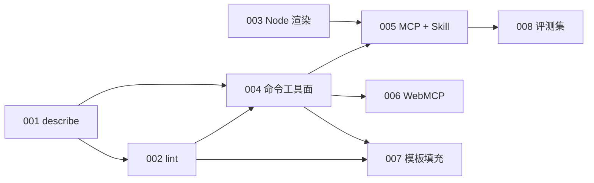

## Destination

任何 Agent（Claude Code、Codex、Copilot、浏览器内 Agent）不依赖 LibreOffice 与桌面 Office，就能读懂、修改并验证 `.pptx` / `.ppt`，产物保持原生可编辑。仓库只提供确定性能力：结构化读出、布局检查、无 Office 渲染、命令编辑、模板填充与保存；不内置模型，也不调用模型服务。

规划基线 `9ac631d`。范围与行业依据见 [roadmap §7.2](../../roadmap.md#72-agent-读写接口) 与 [AI 与演示文稿调研](../../research/ai-presentation-landscape.md)，版本分配见 [roadmap §4](../../roadmap.md#4-演进路线)。

## Notes

- 领域词汇沿用 [CONTEXT.md](../../../CONTEXT.md)：读取以 `Presentation` 为准，编辑语义以 `EditDoc` 命令为准；Agent 接口不另造一套对象模型或 XML 操作器。
- 新能力全部按需加载：基础包体积与运行时不变；MCP SDK 只出现在独立的 MCP 包；WebMCP 只出现在官网 Cordis 插件。
- 每张票的输出必须确定：同一输入两次运行逐字节一致，在独立进程中比较（渲染 defs id 的同进程不可重复陷阱见 AGENTS）。
- 失败一律给稳定 reason 与定位信息（页号、元素 id），不返回空结果或部分成功，遵循[设计标准](../../engineering/design-standard.md)。
- `tickets/*.md` 是本地子票。`status: open`、`blocked_by` 全部关闭的票处于前沿；按 `priority` 和文件顺序选择。开始工作先认领，完成时记录 Answer、证据与状态，再在下方加入标题链接。一次会话最多解决一张票。
- 每张票都要满足[下一阶段共同完成条件](../ppt-portability-fidelity/plan.md#共同完成条件)中适用的维度；Windows PowerPoint 真机按用户要求继续暂缓，不能记为通过。

## 任务与依赖

| 批次 | 票据 | 依赖 |
|---|---|---|
| 第一批（P1） | [001 结构化读出](tickets/001-structured-describe.md) | 无 |
| 第一批（P1） | [002 布局检查](tickets/002-layout-lint.md) | 001 |
| 第一批（P1） | [003 Node 无 Office 渲染](tickets/003-node-render.md) | 无 |
| 第二批（P2） | [004 命令工具面](tickets/004-command-tool-surface.md) | 001、002 |
| 第二批（P2） | [005 MCP server 与 Agent Skill](tickets/005-mcp-server-skill.md) | 003、004 |
| 第三批（P3） | [006 编辑器 WebMCP](tickets/006-editor-webmcp.md) | 004 |
| 第三批（P3） | [007 模板填充生成](tickets/007-template-fill.md) | 002、004 |
| 第四批（P4） | [008 Agent 任务评测集](tickets/008-agent-task-eval.md) | 005 |

## Decisions so far

- 范围已在 roadmap §6 确定：只提供确定性读出、检查、渲染、命令与模板填充；MCP / WebMCP 适配放在独立包或站点插件。
- describe 使用 `@web-ppt/edit-core/describe` 独立子入口，输入为现有 `EditDoc`，直接返回其稳定身份；JSON Schema 以同包 `describe/schema.json` 子路径发布。实现与验收方案见 [001 技术方案](../../design/agent-describe.md)。

## Not yet specified

- lint 的公开入口位置由 002 确定；命令工具面与 MCP 是否合并为同一个新包由 004 确定。新增发布包会使「八包同版本」变为九包，并且首版须本地发布后再配置 Trusted Publishing（见 AGENTS「发布」）。
- lint 各检查项的阈值（重叠面积比例、对比度标准）在 002 用固件误报统计确定，不预设数值。
- WebMCP 接口仍处于 Chrome origin trial，006 启动时按当时的规范草案重新核对接口名。

## Out of scope

- 内置模型、调用模型服务、提示词模板或生成服务。
- 依赖 COM 或桌面 Office 的自动化；LibreOffice 只作为对照工具，不作为运行依赖。
- 把 Agent 接口做成第二套编辑模型；所有写操作经 `EditDoc` 命令，享有同一套历史、恢复、协同与保存。

## Resolution

- [结构化读出 describe](tickets/001-structured-describe.md)
