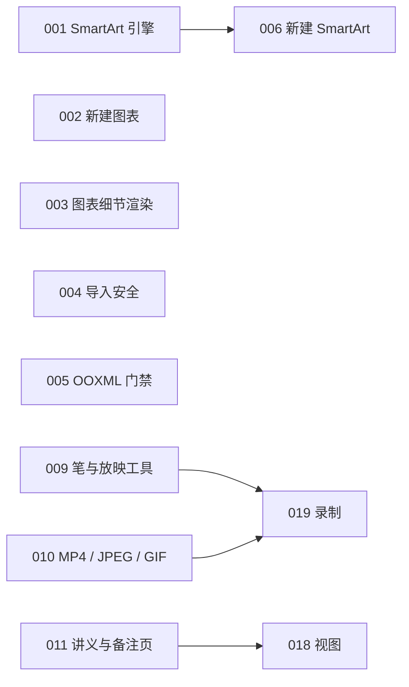

## Destination

用户在官网编辑器或接入 SDK 的宿主中，能完成桌面演示软件里的高频创作（新建图表与 SmartArt、公式、合并形状、完整动画库）、放映（演讲者双窗口、笔与激光笔、遵循文件放映设置）与交付（MP4、讲义 PDF、嵌入字体），产物保持原生可编辑。同时把 SmartArt 无缓存排布和图表细节补到可与 PowerPoint 对照的程度，并为导入与保存补齐安全边界和 OOXML 合法性门禁。

规划基线 `f0f7a15`（2026-11-03）。缺口来自与 [HeyPuter presentation](https://github.com/HeyPuter/everything/tree/007af35ff7e31684d29030c0056c9d5a238dfc62/src/presentation) 的逐模块对比；范围与版本分配见 [roadmap §3、§4](../../roadmap.md#3-缺口与取舍判定)。

## Notes

- 领域词汇沿用 [CONTEXT.md](../../../CONTEXT.md)：读取以 `Presentation` 为准，编辑经 `EditDoc` 命令，享有同一套历史、恢复、协同与两条保存。
- 新能力全部按需加载：基础包默认闭包逐字节不变；需要第三方库的能力（布尔运算、视频编码封装等）只进入独立子入口。
- 渲染层仍只依赖 `types.ts`；新增解析结果先进 Schema，再由 `render/` 消费。
- 涉及最终用户流程的票（标注“产品待确认”），开工前先按产品设计流程写出用户流程、空状态 / 失败 / 取消 / 恢复分支与验收标准，经维护者确认后再进入技术方案。
- 每张票都要满足[共同完成条件](../ppt-portability-fidelity/plan.md#共同完成条件)中适用的维度；Windows PowerPoint 真机按用户要求继续暂缓，不能记为通过。
- `tickets/*.md` 是本地子票。`status: open`、`blocked_by` 全部关闭的票处于前沿；按 `priority` 和文件顺序选择。开始工作先认领，完成时记录 Answer、证据与状态，再在下方加入标题链接。一次会话最多解决一张票。

## 外部代码参考规则

| 来源 | 许可 | 用法 |
|---|---|---|
| [office-kit/pptx](https://github.com/office-kit/pptx/tree/18b7e75cfa7fd1c6e9891ce1285a76c7889b644b)（0.28.0，提交 `18b7e75`） | MIT | 可以阅读、参考并移植；移植的代码在文件头注明来源提交，并在根目录 LICENSE 旁登记第三方声明 |
| 上游仓库内 Dewiride 派生的 74 个内置表格样式 | Apache-2.0 | 本仓库已有自己的内置表格样式，不引入 |
| HeyPuter presentation（`lib/pptx`、`lib/pptx-preview`、`src/`） | AGPL-3.0-only | **不复制、不移植**，只作为功能对比对象；尤其 SmartArt 布局引擎须按 ECMA-376 自行实现 |

上游可参考的位置在各票的“参考”一行列出。上游没有 SmartArt 布局引擎（`src/internal/diagram/index.ts` 只保留直通），也没有 `.ppt`、加密、EMF+、ChartEx 与 OMML 渲染，这些方向本仓库已领先，不从上游取。

## 任务与依赖

| 批次 | 票据 | 依赖 |
|---|---|---|
| P1 | [001 SmartArt 布局定义引擎](tickets/001-smartart-layout-engine.md) | 无 |
| P1 | [002 新建图表](tickets/002-chart-authoring.md) | 无 |
| P1 | [003 图表趋势线、误差线与数据表渲染](tickets/003-chart-analysis-rendering.md) | 无 |
| P1 | [004 导入解压上限与 ZIP 安全](tickets/004-import-archive-limits.md) | 无 |
| P1 | [005 OOXML 合法性门禁](tickets/005-ooxml-validation-gate.md) | 无 |
| P2 | [006 新建 SmartArt](tickets/006-smartart-authoring.md) | 001 |
| P2 | [007 动画预设目录与运动路径编辑](tickets/007-animation-catalog.md) | 无 |
| P2 | [008 公式插入与编辑](tickets/008-equation-editing.md) | 无 |
| P2 | [009 笔工具、放映工具与文件放映设置](tickets/009-presenting-tools.md) | 无 |
| P2 | [010 MP4、JPEG 与 GIF 导出](tickets/010-video-image-export.md) | 无 |
| P2 | [011 讲义、备注页与大纲的打印和 PDF](tickets/011-handout-notes-print.md) | 无 |
| P2 | [012 嵌入字体写入 PPTX](tickets/012-font-embedding-write.md) | 无 |
| P2 | [013 合并形状](tickets/013-merge-shapes.md) | 无 |
| P3 | [014 无障碍检查器](tickets/014-accessibility-checker.md) | 无 |
| P3 | [015 演示文稿比较](tickets/015-presentation-compare.md) | 无 |
| P3 | [016 主题库与 .thmx / .potx 交换](tickets/016-theme-library-exchange.md) | 无 |
| P3 | [017 页眉页脚与动作设置](tickets/017-header-footer-actions.md) | 无 |
| P3 | [018 大纲、备注页与阅读视图](tickets/018-outline-notes-reading-views.md) | 011 |
| P3 | [019 录制旁白与摄像头](tickets/019-narration-recording.md) | 009、010 |
| P3 | [020 缩放定位对象的放映](tickets/020-zoom-objects.md) | 无 |

## Decisions so far

- [012 嵌入字体写入](tickets/012-font-embedding-write.md)的 SDK 能力已交付：core 的 fsType 权利判定与 EOT 容器封装、edit-core 的嵌入/移除命令与两条保存路径输出；许可拒绝在命令与保存双边界 fast-fail。可选子集化与产品面板开关待后续；本机 LibreOffice 不消费 PPTX 嵌入字体渲染（固件对照实验证实），以本引擎读侧验证为准。
- SmartArt 采用 ECMA-376 Part 1 §21.4 的布局定义（`layoutDef` 的算法、约束、规则与条件）解释执行，取代当前 6 个布局族的启发式排布；有缓存 drawing 时仍优先使用缓存，编辑后重排走引擎。
- 新建图表复用 [0.8 票据 001](../ppt-data-fidelity/tickets/001-chart-data-editing.md) 预留的数据集模型与工作簿同步，不另建图表模型。
- 放映中的墨迹以原生 InkML 保存（沿用 `edit-core/ink`），不使用私有扩展命名空间。
- 实时字幕只使用浏览器的本机语音识别；浏览器只能走云端识别时不提供，遵守文件与音频不出浏览器的约束。
- 导出与放映新增能力属于 viewer-core 或产品层；内核只提供确定的数据与渲染。

## Not yet specified

- 拼写检查：编辑器当前对文本覆盖层关闭了浏览器原生拼写检查（`packages/editor/src/text-editor-view.ts`）。开启前需要先查清关闭原因（覆盖层错位或输入法干扰），以及中文用户是否需要；结论出来后再决定是否建票。
- 同义词与翻译：需要在线服务或体积较大的本机词典，词典来源、语言覆盖与按需加载方式未确定。
- SmartArt 内置布局定义的来源：PowerPoint 自带的布局定义 XML 版权归 Microsoft，006 需要先确定自行编写的布局集合与命名。

## Out of scope

- 云端存储、账号与内置 AI 助手：违背零服务端与不内置模型的现行决策；浏览器内 Agent 走 [Agent 006 WebMCP](../ppt-agent-interface/tickets/006-editor-webmcp.md)。
- 墨迹转文字 / 转公式：跨平台浏览器没有可用的本机手写识别（Handwriting Recognition API 只在 ChromeOS 提供），当前没有可行路径。墨迹转形状不需要识别模型，归入 009。
- `.odp` 导出、宏与 ActiveX。

## Resolution

- [004 导入解压上限与 ZIP 安全](tickets/004-import-archive-limits.md)：统一安全读取、可配置上限、57 项断言、真实语料与性能对照通过。
- [005 OOXML 合法性门禁](tickets/005-ooxml-validation-gate.md)：XSD + OpenXmlValidator 双通道进入 CI 与发布流水线，148 份保存产物零错误、负例拦截、例外逐条登记；轴标题序位与十余个固件生成器的非法结构一并修正。
